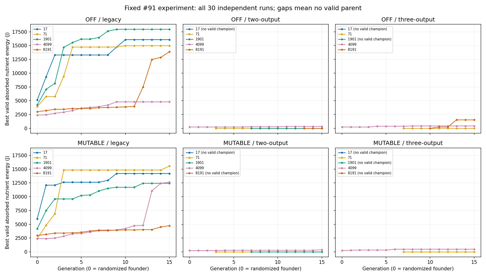
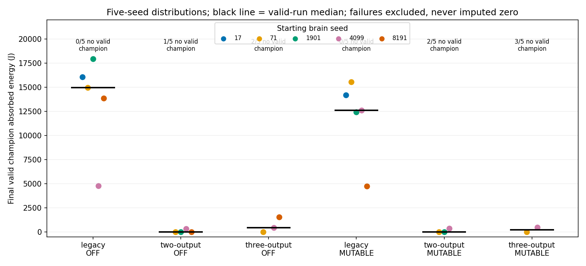

# Motor architecture × lifetime plasticity — fixed #91 experiment

**Complete, testing-only, no adoption or deployment.** All **6,750 offspring** ran once under the preregistered protocol: OFF first, then MUTABLE, each three architectures × five independent seeds ×15 generations ×15 offspring ×12s. Additional rows:30 founders,90 held-outs,45 learning-OFF ablations (6,915 planned rows total). No search extension, neutral drift, altered score or physical tuning. Selection was exclusively actual absorbed nutrient energy; invalid feeding never won.

The matched evidence does **not demonstrate a consistent learning advantage**. Legacy produced valid feeding champions in every run in both conditions. Mutable legacy beat its paired OFF result in2/5 seeds and lost in3/5; valid-champion median fell from14,976J to12,624J. The hybrids produced much less valid intake, lost further valid champions with mutable learning, and generalized poorly. Learning occurred in real motor and RGB synapses, including Mode and both three-output command heads; its presence was not sufficient for evolutionary benefit. This is evidence about this anatomy, habitat, horizon, initialization and strict selection protocol, not an architecture-wide theorem.

## Registered controls and reproducibility

Protocol: [registered before training](architecture-plasticity-v1-protocol.md) at `f49cfce4ac61d9f7f66b2e7306b05c3788871779`; implementation frozen at `04b9e93ad55a39cc794b4a083c177a64b091d0db`; base #90 `531e2d0b5fef6d6ce15fa6a83905b8c99f7606ee`. Branch `experiment/architecture-plasticity-91`, draft PR #93, issue #91. Completed OFF data was independently published at `c355d534f82daf477cf55c631debec3a723564cf`. Final head/CI and deployment readback are in #91/#57; no self-referential commit SHA is embedded in this report.

Same Darter geometry, normal mouth/eyes/CPG traits/motor capacity, accepted `passive-work-v3`, viscosity .18, gravity0, capsule contacts,10000J finite reserve,1000×800 arena and240 ordinary3000J nutrients. Exact #87/#89 clustered/uniform recipe and complete world reset: env73, heading .37;65% clustered/35% uniform,12 seeded sites,96px halfspread. All four source layouts, settings and PRNG states were checked against the preserved #89 environment. Normal feeding, metabolism, energy limitation and existing experience reward remain. The only biological exception is the existing request-scoped12s nonlethal fixture; **none of the6,750 offspring invoked mortality protection or energy limiting**.

Seeds17,71,1901,4099,8191; all input/recurrent/output weights and biases fresh. Exactly8 Gaussian σ.15 neural scalar changes in every offspring. MUTABLE adds one bounded learning-trait proposal plus one add/remove/swap mask proposal per category, with9 independent uniform draws. OFF consumes and records the same extra stream but discards its proposals. Additional active mutational degrees in MUTABLE are intentional and disclosed; no extra neural search. Eight changes are events, not necessarily eight unique coordinates. Genotypes and strict elite decisions reconstruct from exact receipts. Somatic deltas, eligibility and consolidation histories are reset, never inherited.

| Architecture | Neural scalars | Real motor HO pool | Initial eligible HO/output | Meaning |
| --- | --- | --- | --- | --- |
| Legacy | 2172 | 288 | 4 ×12 outputs | Original six outputs per joint; servo semantics, not oscillator-only |
| Two-output | 1972 | 96 | 12 ×4 outputs | Mode + shared Command; exact #90 revised semantics |
| Three-output | 2022 | 144 | 8 ×6 outputs | Explicit neural-motor-v3: Mode / DirectTorque / OscillatorStrength |

Both hybrids retain independent neural control of both joints, inherited ordinary oscillator traits, revised OFF/DIRECT/OSCILLATOR/OFF bands at−.9,0,+.9 and .06 hysteresis with immediate decisive transitions. A persisted four-band latch distinguishes the two OFF regions. No inherited architecture selector, extra legacy head, imposed rhythm or timer.

New explicit `plasticity-study-v1`/schema21 and `heritable-plastic-v1` DNA admit stable, real enabled HO and RGB-IH edge identities. Historical saves/controllers keep their old meanings and fixed-order learning. Initial48 motor +48 sensory edges in each genotype; cap96/category. Random hidden-edge sampling is stratified across every motor output; RGB sampling is seeded uniform from1008 enabled eligible edges. This equal edge-count cap produces different fractions of the differently sized output pools, an unavoidable design difference. It does not give an entire output head zero initial coverage. Mutations can add, remove or swap identities rather than only rewrite a fixed list.

MUTABLE uniformly initializes supported rates: motor/sensory[0,.8], forgetting[0,1], consolidation[0,2], injury aversion[0,1]. One trait event has σ=.10×its range and clamps to supported bounds. Both learning rates0 require consolidation0. OFF sets these five fields0; recurrence and normal sensing remain active. Existing reward, eligibility, forgetting, consolidation and cost equations are preserved. Current actual feeding/injury reward is used; #78’s future genetically evolvable contextual valence is **not implemented or replaced**. A synapse on an unused motor head can receive correlational learning under the unchanged global reinforcement equations; the mask is eligibility, not mode-specific credit assignment.

## All five outcomes per group

Final joules are in seed order **17 /71 /1901 /4099 /8191**. “FAIL” means no valid champion after225 offspring, not zero intake. Medians exclude failures, so valid-run counts must accompany them. “Gains” counts strict intake improvements over an already valid parent; first-valid feasibility restorations are separate. No inference uses invalid scores.

| Condition / architecture | Final valid J, five seeds | Valid runs | Median J | Gains / feasibility | Valid offspring /1125 | Valid feeders |
| --- | --- | --- | --- | --- | --- | --- |
| OFF / legacy | 16080 / 14976 / 17952 / 4800 / 13872 | 5/5 | 14,976 | 37 / 0 | 1070 | 1070 |
| OFF / two-output | FAIL / 0 / 0 / 336 / 0 | 4/5 | 0 | 2 / 3 | 143 | 62 |
| OFF / three-output | FAIL / 0 / FAIL / 432 / 1536 | 3/5 | 432 | 4 / 2 | 118 | 58 |
| MUTABLE / legacy | 14208 / 15552 / 12432 / 12624 / 4752 | 5/5 | 12,624 | 39 / 0 | 1101 | 1100 |
| MUTABLE / two-output | FAIL / 0 / 0 / 384 / FAIL | 3/5 | 0 | 2 / 2 | 132 | 59 |
| MUTABLE / three-output | FAIL / 0 / FAIL / 480 / FAIL | 2/5 | 240 | 3 / 1 | 77 | 53 |

The [derived summary](architecture-plasticity-v1-summary.json) contains each generation’s best retained score and median valid offspring score, all30 seed curves, accepted mutation receipts, exact inherited masks/traits, final diagnostics and paired held-outs. Full raw candidate results remain in the immutable per-generation archives, including all rejected scores.

| Cell / seed | Founder J (valid?) | Final valid J | Strict gains | First-valid restorations |
| --- | --- | --- | --- | --- |
| OFF / legacy / 17 | 5136 yes | 16080 | 4 | 0 |
| OFF / legacy / 71 | 3936 yes | 14976 | 4 | 0 |
| OFF / legacy / 1901 | 4272 yes | 17952 | 8 | 0 |
| OFF / legacy / 4099 | 2400 yes | 4800 | 9 | 0 |
| OFF / legacy / 8191 | 3024 yes | 13872 | 12 | 0 |
| OFF / two-output / 17 | 5520 INVALID | FAIL | 0 | 0 |
| OFF / two-output / 71 | 0 INVALID | 0 | 0 | 1 |
| OFF / two-output / 1901 | 11568 INVALID | 0 | 0 | 1 |
| OFF / two-output / 4099 | 240 yes | 336 | 2 | 0 |
| OFF / two-output / 8191 | 0 INVALID | 0 | 0 | 1 |
| OFF / three-output / 17 | 6912 INVALID | FAIL | 0 | 0 |
| OFF / three-output / 71 | 0 INVALID | 0 | 0 | 1 |
| OFF / three-output / 1901 | 0 INVALID | FAIL | 0 | 0 |
| OFF / three-output / 4099 | 240 yes | 432 | 2 | 0 |
| OFF / three-output / 8191 | 2592 INVALID | 1536 | 2 | 1 |
| MUTABLE / legacy / 17 | 6000 yes | 14208 | 4 | 0 |
| MUTABLE / legacy / 71 | 2400 yes | 15552 | 4 | 0 |
| MUTABLE / legacy / 1901 | 4176 yes | 12432 | 8 | 0 |
| MUTABLE / legacy / 4099 | 2400 yes | 12624 | 13 | 0 |
| MUTABLE / legacy / 8191 | 2976 yes | 4752 | 10 | 0 |
| MUTABLE / two-output / 17 | 1200 INVALID | FAIL | 0 | 0 |
| MUTABLE / two-output / 71 | 0 INVALID | 0 | 0 | 1 |
| MUTABLE / two-output / 1901 | 9456 INVALID | 0 | 0 | 1 |
| MUTABLE / two-output / 4099 | 240 yes | 384 | 2 | 0 |
| MUTABLE / two-output / 8191 | 0 INVALID | FAIL | 0 | 0 |
| MUTABLE / three-output / 17 | 11088 INVALID | FAIL | 0 | 0 |
| MUTABLE / three-output / 71 | 0 INVALID | 0 | 0 | 1 |
| MUTABLE / three-output / 1901 | 0 INVALID | FAIL | 0 | 0 |
| MUTABLE / three-output / 4099 | 240 yes | 480 | 3 | 0 |
| MUTABLE / three-output / 8191 | 4800 INVALID | FAIL | 0 | 0 |

Strict elitism cannot carry neutral mask/trait changes across a zero-intake plateau. An invalid founder is only a mutation source; a first valid0J candidate can establish feasibility but is not a feeding improvement. The experiment preserves this requested limitation. The same mutation streams cease to describe paired genotypes once different candidates are selected.

## Physical validity, feeding and switching

| Group | Rejected feeding candidates | Overlapping exclusion reasons (candidate counts) | Valid contact/intake ticks | Valid contact episodes | Valid absorbed J sum |
| --- | --- | --- | --- | --- | --- |
| OFF / legacy | 55 | boundary: 55 | 155250/155250 | 11567 | 7452000 |
| OFF / two-output | 569 | speed guard: 793, joint limit: 947, post-guard overspeed: 650, anchor: 3 | 255/255 | 255 | 12240 |
| OFF / three-output | 665 | speed guard: 838, joint limit: 983, post-guard overspeed: 692, anchor: 5 | 305/305 | 301 | 14640 |
| MUTABLE / legacy | 24 | speed guard: 6, boundary: 18 | 130725/130725 | 10721 | 6274800 |
| MUTABLE / two-output | 541 | speed guard: 810, joint limit: 950, post-guard overspeed: 657, anchor: 2 | 251/251 | 251 | 12048 |
| MUTABLE / three-output | 705 | speed guard: 947, joint limit: 1017, post-guard overspeed: 778, anchor: 2 | 266/266 | 266 | 12768 |

All valid offspring detected nutrients. Contact episodes mean consecutive contact-tick runs, not distinct nutrients, goals or meals. These summed diagnostics are not selection scores and descendants are not independent samples. Feeding was physically accessible: the actual ordinary-mouth fixture absorbed144J in three verification ticks, and every legacy founder fed in the unmodified training layout. Invalid hybrid intake, including large scores, is archived separately and excluded from all champions. High rejection rates diagnose this controller/environment combination’s limited reliability; they do not authorize a new solver investigation or prove a particular new solver defect.

| Hybrid group | Valid switching trials | Switching after1s | Valid switchers that fed | OSC joint-substeps / valid samples | Nonzero OSC deliveries | OSC trials that fed |
| --- | --- | --- | --- | --- | --- | --- |
| OFF / two-output | 78 | 4 | 8 | 143804 / 823680 | 143804 | 8 |
| OFF / three-output | 18 | 3 | 5 | 15152 / 679680 | 15152 | 5 |
| MUTABLE / two-output | 58 | 2 | 3 | 142672 / 760320 | 142672 | 3 |
| MUTABLE / three-output | 18 | 0 | 5 | 11848 / 443520 | 11848 | 5 |

No valid offspring used either OFF region. OSC observations were actual nonzero delivered joint torques, not merely selected neural labels. Most switches occurred during the first second. No final champion switched after1s. The mutable two-output feeding champion4099 was DIRECT-only; the mutable three-output4099 champion used only4 OSC joint-substeps (one physical control-tick burst in one joint), followed by DIRECT, with2 switches. Its480J versus OFF432J does not establish a useful sustained hybrid policy. The OFF two-output feeding champion used8 OSC substeps; the two feeding OFF three-output champions were DIRECT-only. Zero-intake71 champions sustained one oscillator joint, demonstrating accessibility without a foraging advantage. No causal benefit is inferred from a mode/intake correlation.

## Heritable eligibility versus actual learning

| Mutable group | Motor mask range (all offspring) | RGB mask range | Proposals with an uncovered output | Valid motor/RGB delta trials | Valid unfed trials with acquired deltas |
| --- | --- | --- | --- | --- | --- |
| legacy | [45, 53] | [44, 54] | 1 | 1091/1082 | 0 |
| two-output | [46, 49] | [46, 49] | 0 | 56/59 | 0 |
| three-output | [47, 50] | [46, 49] | 0 | 52/53 | 0 |

One legacy mutant lost all eligible edges for a single output through an ordinary mask edit; no fixed initializer excluded it. All final champions retained coverage of every output. All sensory selections remain actual enabled RGB-IH identities. Counts vary within the equal96 caps; no acquired edge identity/state is transmitted to offspring.

| Mutable champion / seed | Motor / sensory rate | Forget / consolidate / injury | Mask motor / RGB | Final |motor δ|₁ / |RGB δ|₁ | Paid learning J |
| --- | --- | --- | --- | --- | --- |
| legacy / 17 | 0.430 / 0.014 | 0.373 / 0.399 / 0.505 | 47 / 48 | 1.192404 / 0.073958 | 3.097 |
| legacy / 71 | 0.102 / 0.709 | 0.649 / 0.519 / 0.827 | 47 / 44 | 0.210874 / 3.992780 | 8.417 |
| legacy / 1901 | 0.435 / 0.486 | 0.829 / 1.666 / 0.185 | 51 / 48 | 0.655874 / 1.374848 | 5.291 |
| legacy / 4099 | 0.183 / 0.264 | 0.280 / 1.100 / 0.010 | 47 / 51 | 0.899199 / 2.748641 | 5.336 |
| legacy / 8191 | 0.357 / 0.481 | 0.679 / 0.596 / 0.236 | 50 / 53 | 0.009864 / 0.036197 | 3.625 |
| two-output / 71 | 0.060 / 0.709 | 0.545 / 0.519 / 0.709 | 47 / 47 | 0.000000 / 0.000000 | 2.256 |
| two-output / 1901 | 0.400 / 0.512 | 0.794 / 1.202 / 0.185 | 48 / 48 | 0.000000 / 0.000000 | 2.304 |
| two-output / 4099 | 0.069 / 0.289 | 0.734 / 0.697 / 0.241 | 48 / 47 | 0.001178 / 0.010666 | 2.369 |
| three-output / 71 | 0.060 / 0.709 | 0.581 / 0.796 / 0.709 | 48 / 47 | 0.000000 / 0.000000 | 2.280 |
| three-output / 4099 | 0.069 / 0.195 | 0.650 / 0.801 / 0.241 | 49 / 47 | 0.000522 / 0.004449 | 2.381 |

Values above are rounded only for display; exact traits, eligible sets and all final somatic delta/eligibility/consolidation records are archived. OFF has **zero acquired motor/RGB records, deltas, learning events, upkeep and rewrite charges** in every trial. Mutable valid unfed specimens also have zero acquired deltas; paying upkeep is not evidence of acquired learning. Motor changes include both Mode and Command in56 valid two-output offspring, and Mode, DirectTorque and OscillatorStrength in52 valid three-output offspring. Actual paid changes to those heads are verified; their usefulness is not assumed.

## Work, chemical balances and processing cost

| Group | Valid offspring median motor chemical J | Positive / braking mechanical J | Learning J | Total chemical expenditure J | Net reserve change J | Trial wall ms, all |
| --- | --- | --- | --- | --- | --- | --- |
| OFF / legacy | 9.225 | 2.306 / 0.610 | 0.000 | 315.475 | 4,490.270 | 156.1 |
| OFF / two-output | 6.550 | 1.638 / 0.030 | 0.000 | 312.800 | -310.261 | 159.4 |
| OFF / three-output | 3.423 | 0.856 / 0.027 | 0.000 | 309.673 | -307.912 | 160.9 |
| MUTABLE / legacy | 8.188 | 2.047 / 0.595 | 3.657 | 319.476 | 4,475.420 | 160.0 |
| MUTABLE / two-output | 4.605 | 1.151 / 0.029 | 2.292 | 313.151 | -311.240 | 164.7 |
| MUTABLE / three-output | 4.051 | 1.013 / 0.028 | 2.342 | 312.648 | -120.944 | 167.1 |

Positive actuator work and signed braking retain existing v3 prepaid accounting; braking is dissipative, not a chemical-energy refund. `motorJ` is the actual chemical motor debit (existing25% positive-work efficiency); `positiveJ`/`brakingJ` are mechanical receipts. Learning includes paid motor/RGB upkeep and rewriting with the existing consolidation effects; no extra or hidden consolidation bill is invented. Full partition: reserve spent + gross nutrient removal = motor chemical debit + recorded metabolism/assimilation heat + discarded remnants. Absorbed intake is gross removal less assimilation heat/remnants. Reported total chemical expenditure = reserve spent + absorbed intake; net reserve change = intake − expenditure. Food energy is neither free motor funding nor a selection proxy.

| Mutable group, all1125 rows including invalid | Motor upkeep / rewrite J | RGB upkeep / rewrite J |
| --- | --- | --- |
| legacy | 1,325.260 / 431.585 | 1,344.696 / 1,554.956 |
| two-output | 1,276.832 / 168.708 | 1,276.147 / 300.957 |
| three-output | 1,291.446 / 215.368 | 1,284.980 / 532.651 |

Maximum chemical conservation error across all training offspring: 0.000000001397J; maximum work/food partition residual: 0.000000001314J. Paid torque delivery error is exactly0. No energy limit, depletion protection or recorded-loss mortality shortcut occurred. Numerical guard/limit/overspeed failures remain fully reported, not clamped away or excused by conservation. Passing energy checks does not establish a physically valid trajectory.

Wall time includes instrumented Worker execution, receipt transport and final snapshot; all six groups used the same instrumentation. Mutable median trial times were about2–4% above their OFF counterparts here. Stages ran at different wall times alongside analysis/publication; these are descriptive experiment costs, **not** a controlled production throughput benchmark or a release-performance claim.

## Held-outs and diagnostic ablation — never used for selection

Existing matched environments: seeds811/977/2301 and headings−.7/2.3/π÷2,12s each, fresh lifetime/state. Champion-only rows below; absent champions have separate tagged fallback rows (included in fixed totals but excluded from generalization claims).

| Group | Champion held-outs | Valid | Valid feeding | Invalid feeding |
| --- | --- | --- | --- | --- |
| OFF / legacy | 15 | 15 | 15 | 0 |
| OFF / two-output | 12 | 1 | 1 | 8 |
| OFF / three-output | 9 | 4 | 3 | 4 |
| MUTABLE / legacy | 15 | 15 | 15 | 0 |
| MUTABLE / two-output | 9 | 1 | 1 | 7 |
| MUTABLE / three-output | 6 | 0 | 0 | 5 |

Every legacy held-out was valid and fed in both conditions. Mutable two-output has only one valid held-out and mutable three-output none. Therefore large raw hybrid held-out intake cannot support generalization claims. The full seed-by-environment table and all rejection reasons are in the summary and raw archive.

| Mutable champion ablation | Both trajectories valid | ON better / OFF better / equal | Median ON−OFF intake J |
| --- | --- | --- | --- |
| legacy | 13 | 3 / 10 / 0 | -768 |
| two-output | 1 | 0 / 0 / 1 | 0 |
| three-output | 0 | 0 / 0 / 0 | — |

Ablation starts each same final genome in a fresh matched held-out life, with motor/sensory rates and consolidation0; it does not erase an already learned state mid-life or retrain the brain. Masks, neural/oscillator genes, initial world and all other traits are retained. All45 ablations have zero somatic learning/cost. Two legacy ablations became physically invalid although their learning-ON counterparts were valid; those two intake differences are excluded from the paired benefit tally. The13 valid legacy pairs favor ON in3 and OFF in10 (median−768J, range−5376…+6576J). The two-output sole valid pair ties336J; no valid three-output pair exists. These are repeated environments of only five champions, not13 independent evolutionary runs. Switching plasticity also removes its energetic costs, so this is not a clean isolation of cognitive benefit alone.

## Verification and archive map

-333/333 fast tests plus release-metadata test and build/typecheck pass. Seven focused learning/mask tests cover random eligibility/head coverage, eight-plus-nine mutation receipts, gain/loss/swap, bounds, inheritance without somatic transfer, topology pruning/cache invalidation, disabled-state/cost zero, actual physical feeding and learned save/reset continuation. Three-output tests cover all revised bands, separate command heads, independent joint torques and prepaid work.
-Actual built Worker: all six conditions equal host/quiet/instrumented stepping, exact learned continuation/forks, actual Mode/RGB learning and debit receipts, ablation and zero-reserve checks. Historical full12s #87 legacy and #90 hybrid snapshots/PRNG match exactly. Production/experimental Worker checks pass; no browser campaign was initiated for this offline feature.
-Combined audit: **all6,750 genotypes and450 elite decisions reconstruct exactly**, all immutable primary archive and prior-evidence hashes match, all acquired identities belong to their inherited masks and all costs reconcile.30 final specimens (including explicitly failed fallbacks) replay with exact full snapshot, trajectory, physical/mode/food/learning receipts. Six split reset forks match exactly; one matched held-out/ablation pair per architecture additionally replays exactly. These verification replays are separate from training, not replacement measurements.
-CI at implementation head `04b9e93`: validate/build/fast/Worker, bounded locomotion checks and Worker smoke all pass; Pages assembly/publication/deploy skipped. At that checkpoint the fixed-data audit was correctly skipped because the completed dataset did not yet exist. Final-head CI must run the complete audit; actual run IDs/statuses are recorded in #91/#57. No final-head result is inferred from an earlier pass.

Archive entry point: [combined manifest](architecture-plasticity-v1.json) → separate OFF/MUTABLE manifests → all immutable gzip files and SHA256/byte receipts. Files: `...-{stage}-{architecture}-{seed}-initial.json.gz`;225 `...-gNN.json.gz` files/stage (15 offspring each); `...-{stage}-champions.json.gz`; `...-{stage}-environments.json.gz`; `...-{stage}-held-out.json.gz`; `...-mutable-ablations.json.gz`. Every initial genome, mask/rate, selected genotype and mutation receipt is retained. Nonselected genotypes exactly reconstruct from their parent and receipts; all30 final/failure genomes are explicit. Full sampled trajectories are retained for founders, accepted elites and held-outs/ablations; other candidates retain motion aggregates, trajectory hashes and deterministic reconstruction/replay inputs. All candidates retain final somatic edge/delta/eligibility/consolidation records. Wall time is observational and intentionally excluded from exact replay assertions.

Commands (after `npm ci` / build): `npm run test:plasticity-worker`; `npm run audit:architecture-plasticity`. New training reproduction requires a clean copy with no existing stage output paths: `npm run experiment:architecture-plasticity -- --stage=off`, then `--stage=mutable`; the runner refuses overwrite. Do not rerun the completed budget here. Pure derived analysis: `python scripts/summarize-architecture-plasticity.py` (Matplotlib/NumPy), then `python scripts/report-architecture-plasticity.py`. The finalizer creates the combined immutable index once and checks identical frozen scientific code/Worker across stages.

All earlier #72/#85/#86/#87/#89 reports/data and frozen baselines are byte-identical. #89’s incomplete auxiliary console log remains explicitly incomplete; this study uses append-only per-generation archives and does not claim to repair that prior log. [Prior #57 checkpoint](architecture-plasticity-v1-prior-handoff-57.md) is preserved verbatim as the historical handoff.

## Interpretation, limitations and stop

**Recommendation:** keep the established production controller/physics unchanged. This bounded study does not justify promoting either hybrid or the randomized heritable-plasticity package as a foraging improvement. Learning is functional and funded, but neither learning-ON training distributions nor the small matched ablation establish a reliable benefit. Preserve this implementation and its failures for owner review. No automatic second search is authorized.

The legacy motor semantics and inherited oscillator priors differ fundamentally from signed torque; equal anatomy/capacity/search time does not make their behavior or parameter counts equivalent. Both hybrids frequently reach existing guard/joint-limit/redistribution validity limits; no solver fix, extra clamp or capacity increase was attempted. Random masks/traits plus lifetime plasticity are tested as one package; their individual causal contributions are not isolated. Only five seeds and one training habitat/horizon per cell, strict elitism, fresh brains, paired stream divergence after selection and three held-out environments limit inference. Repeated contact can consume food without demonstrating purposeful steering. Twelve seconds gives actual feeding here but does not test long-term memory, natural ecological selection or #78 subjective rewards.

Production remains v0.37.0/main `194d70d1de2c4a31825e5f57d1d890a698fe4a5d`; independent testing T1.1 `d7a68144b02225db37bb6a9583b057458ff47d52`. This draft stack is unmerged and unpublished; releases, starters, physics, #60/#78, Wiki and VIDA3D are untouched. Future testing-only interactive Experiment Lab is recorded separately as #92; no detailed Lab specification was supplied and no Lab was implemented. **Next action: owner review of #91/#93 and these six matched groups; stop here.**
