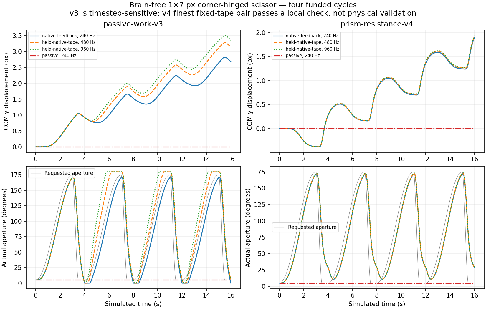

# Brain-free narrow-end scissor benchmark (#80)

Implemented offline in draft **#81**, branch `experiment/brain-free-scissor-80`,
stacked against #79's `experiment/prism-resistance-v4` at
`21c5a5484dd39c5f31255f223a72e3139c447495`. Exact final head/CI are in #80/#57.
**#79 is unchanged, draft, unmerged, undeployed and still fails promotion gates.**
This benchmark authorizes no solver investigation, promotion, ecology campaign or tuning.

The first bounded benchmark is complete. Both models move under the funded
mechanical program and remain still in passive controls. Removing fluid resistance
removes COM movement to numerical precision. **v4 passes the declared finest fixed-tape
check; v3 fails it and exhibits material orientation sensitivity. Neither enacts the
full commanded stroke.** This is qualified model-response evidence, not a validated
swimmer, biological advantage, drag-law validation or explanation of #79's regressions.

## Geometry, scope and reproducibility

Exactly two **1×7 simulation-pixel rectangles**, uniform density according to each
unchanged regime. Narrow ends lie along local±y. The shared hinge is at parent
`(+.5,+3.5)` and child `(+.5,-3.5)` corners. Aperture is
`pi + child.angle - parent.angle`, with physical travel0..pi; base offset−pi/2
and max relative angle pi/2. Parent starts angle0, child starts−175°, aperture5°.
The parts have no initial velocity. A180°-rotated control rotates the entire
assembly. A static SAT test sweeps all181 integer-degree poses: no overlap.

**Why corner anchors:** folding flush rectangles around centers of their end
faces would overlap material near the hinge at every nonzero bend. A shared end
corner permits a clear folded-to-straight stroke. This is an explicit fixture
interpretation, not an inherited anatomy change. No enforced symmetry or velocity
was added. Only initial assembly sets positions/angles; subsequent poses are dynamic.

Public saves require integer grid dimensions and widths/heights in7px multiples.
The exact requested1px width cannot be an ordinary inherited/saved creature.
The new `scissor-benchmark` message therefore creates a **private Worker-owned world**
with that fixed artificial anatomy (`dimN=1/7`, `dimM=1`). It never mutates the active
host or relaxes a save validator. Its returned `stateReceipt` has an explicit fixture
version and **no public save schema**; it is not an importable organism/save. The
external program/anchors are not persisted. Historical snapshots/PRNG continuation
continue through the existing APIs exactly; private benchmark state is not silently
converted to a normal world. Both paths use the actual Vite-built authoritative Worker.

`corner-scissor-v2` enables the **existing contact algorithm for this hinged pair**.
Ordinary directly hinged pairs keep their historical contact exclusion. Constraint
math/iterations, mass, fluid coefficients, limits, complete-batch passivity, contact
slop/impulses/projection, guard order and thresholds are unchanged. #79's optional
`unilateral-stop-v1` correction is **not enabled**. No solver correction is bundled.

Run after `npm run build`: `npm run benchmark:scissor`. Raw data and generated
summary are separate: `node scripts/analyze-scissor.mjs` reads the archive only;
`python scripts/plot-scissor.py` draws the figure without simulating.

## Fixed actuator program and controls

- Seed801, gravity0, no food/inflow/mouths/eyes, ample finite10,000J founder reserve
  included once in the chemical ledger. No energy top-ups. No reproduction during
  the16s experiment. Geometry, commands, environment and funding match within a regime.
- Four4s cycles: **3s cosine opening5°→175°, .5s cosine closing175°→5°,
  .5s zero-torque pause**. The pause does not hold or teleport the joint. Inertia
  continues moving it. Target angles are requests, not achieved kinematics.
- Conventional angle/speed feedback sampled **240Hz**, held over physical substeps:
  `torque=I*(100*(requestedAperture-actualAperture)-20*relativeAngularSpeed)`.
  Clamp to the existing `I*2200` ceiling (neutral capacity modulation). No ceiling
  saturation or energy limiting occurred. Equal/opposite impulses use normal paid
  motor integration. All positive work is prepaid at25%; braking never regenerates
  reserves or credits other actuation. Refinement bills its actual impulse path.
- **No neural evaluation or learning** is run; outputs used for capacity are fixed
  zero. The inert compatibility genome/layout is retained only for ordinary
  lifecycle bookkeeping; its unchanged basal/neural upkeep is reported separately
  (194.133333J/16s). This is not a new brain/cost feature or change to learning semantics.
- Passive/no-drive at240/960Hz; reversed opening/closing durations; symmetric1.75s
  opening/1.75s closing; same native torque tape under180° rotation; and **fluid-off**
  controls at240/960Hz. Fluid-off is a causal diagnostic, never a new calibrated
  coefficient/profile or a proposed environment.
- Native feedback240Hz captures the torque tape. **480/960Hz physics replay exactly
  the same240Hz requested torques**, with no neural/controller retiming. A separate
  960Hz feedback trial reports feedback/trajectory sensitivity. No adaptive ceiling
  increase or repeated parameter search.

Predeclared before evaluation in #80 comment6358307579: finest-pair vector error
≤max(.01px,1% of fine displacement), aperture RMS≤1°, positive work difference≤5%.
Interpretability flags separately require0guards, anchor/overlap≤.001px, dry COM
movement≤1e-7px and chemical error<1e-8J. **Passing a trajectory check does not
waive the other flags or validate the physics.** Native anchor peaks slightly fail;
no threshold was relaxed. Reverse/symmetric programs are not exact kinematic
reversals: actual stroke shapes differ under torque feedback and inertia.

## Movement, achieved stroke and timestep sensitivity

All values below cover four cycles/16s. Displacement is actual mass-weighted COM,
not speed-integrated odometry. Passive displacement is0 in both models/resolutions.

| Measurement | v3 | v4 |
| --- | ---: | ---: |
| Native240Hz powered displacement px |2.687559|1.897078|
| Native(dx,dy) px |(−.117230,+2.685001)|(−.082749,+1.895272)|
| Native bisector rotation rad |−1.19e-7|−4.90e-13|
| Native fourth-cycle aperture min..max degrees |−.000099..171.371|10.917..171.927|
| Native fourth-cycle closing endpoint degrees |74.509|76.446|
| Native fourth-cycle pause endpoint degrees |.260|28.834|
| Fixed-native-tape480Hz displacement px |3.146470|1.924649|
| Fixed-native-tape960Hz displacement px |3.362505|1.938222|
|480→960Hz vector error px |.216035 (**fails**)|.013573 (**passes**)|
|480→960Hz aperture RMS degrees |12.9743 (**fails**)|.2691 (**passes**)|
|480→960Hz positive-work difference |3.074%|.296%|
| Refined960Hz feedback displacement px |2.664018|1.878744|
|180° rotation covariance vector error px |.359580|1.22e-12|
| Reversed-duration native displacement px |3.037585 (same direction)|2.552163 (opposite direction)|
| Symmetric-duration native displacement px |2.858552|.137459|
| Fluid-off fixed-tape COM movement240/960Hz px |0 /0|0 /0|

v4 native late-cycle displacement increments are(.539884,.539885,.539885)px in y;
startup differs. Refined fixed-tape late increments vary slightly, with fourth
cycle .549665px. This shows repeated movement in that finite interval, not a
proven periodic limit cycle. The symmetric control has nonzero movement: finite
body inertia, pressure resistance, pause/startup and the imperfect realized stroke
all preclude applying the ideal quasi-static reciprocal-stroke theorem directly.

**No full stroke claim:** the closing command ends with the joint still near75°;
passive pause then permits further closure. v4 does not reach5° on later cycles.
v3 strikes its folded limit, and open-loop refined replays also hit the straight
limit. Matching target functions therefore does not match actual strokes. v3's
fixed-tape and orientation failures prevent treating its larger travel as a valid
physical superiority or a stable scissor-gait measurement. No controller gain,
ceiling, time program, design or fluid coefficient was tuned after evaluation.

## Work, dissipation and artifacts

| Native240Hz,16s | v3 | v4 |
| --- | ---: | ---: |
| Positive actuator work J |6.30538e-5|5.59410e-8|
| Braking work J |1.52714e-7|2.13660e-10|
| Motor chemical debit J |2.52215e-4|2.23764e-7|
| Basal/inert-layout upkeep J |194.133333|194.133333|
| Fluid physical dissipation J |not separately resolved|5.44928e-8|
| Fluid implicit numerical dissipation J |not separately resolved|6.36372e-10|
| Constraint net kinetic loss J |6.26221e-7|5.30216e-10|
| Contact net kinetic loss J |1.18447e-6|0|
| Peak hinge error px |.001314 (**flag fails**)|.001252 (**flag fails**)|
| Peak overlap px |1.99e-5|1.19e-13|
| Guard events / post-guard overspeed steps |0 /0|0 /0|
| Peak angular speed rad/s |2.9022|2.8057|
| Passivity-limited batches / pose repairs |615 /12|840 /28|

The .001px anchor flag passes at480/960Hz for the wet fixed-tape rows. Tiny negative
v3 apertures are residual limit/contact errors, not authorized physical overlap.
At960Hz its fixed-tape peak overlap is3.10e-5px and hinge error .000137px.
The dry controls have larger hinge errors (.0017–.0079px) and repeated stop/contact
interactions; they are **only a COM/internal-propulsion negative control**, not
matched kinematic fluid-removal or ideal constrained-dynamics solutions.

Across all22 measured rows: chemical discrepancy≤4.84e-10J; prepaid debit=4×positive
work and motor ledger agree within1e-12J; mechanical phase reconciliation residual
≤1.28e-19J. No saturation, energy limiting or request/application mismatch.
v4 implicit fluid-balance residual≤8.48e-19J. At960Hz fixed-tape v4 physical fluid
loss5.48612e-8J, implicit numerical loss1.59858e-10J and constraint loss1.35130e-10J
are lower numerical-loss contributions than at240Hz. v3 combines motor and fluid
in its explicit force step; the summary supplies a signed external drag-work
estimate, **not a fabricated physical/numerical split**.

The observer measures joint-batch linear-momentum changes≤4.65e-16 mass-unit·px/s
and per-substep COM deviations from velocity transport≤6.67e-13px. COM stays fixed
without fluid, so direct positional repair/internal impulse propulsion is not the
observed translation source. **That does not exclude indirect numerical effects**:
constraint/contact losses alter stroke histories and hence future fluid forces.
v3's failed refinement/orientation checks demonstrate this limitation. Pose-only
angular-momentum effects and #79's articulated overspeed findings remain open;
this small fixture's0guards does not resolve them. No further solver study follows.

### Why this is not a drag-only v3/v4 comparison

At this sub-grid anatomy, v3 retains its **.35 mass-unit floor**: inferred mass
.06125kg and inertia2.55208e-7kg·m² per part under its historical conversion.
v4 gives mass4.9e-5kg and inertia2.04167e-10kg·m² per part (7mm fixed depth,
1000kg/m³). That is **1250× different physical mass/inertia**. Existing normalized
capacity `I*2200` consequently differs1250× in SI torque too. Mechanical joule
conversions remain1.75e-7 versus8.575e-10 (about204×). Chemical stores are never
rescaled. No mass-floor/capacity/chemical rule was modified for apparent fairness.
These are **two existing regime responses**, not isolated evidence against a drag law.
#60 still needs an anatomical muscle/maintenance reference before a biologically
meaningful strength/energy comparison; #61's constitutive assumptions remain provisional.

## Cost, evidence, checks and stopping point

Two reversed-order, instrumentation-disabled16s fixture pairs after warmup:
v3 **14.59/13.65ms**, v4 **51.22/39.22ms**; summed ratio **3.20×**. These small
headless Worker measurements include the benchmark controller/lifecycle, not
browser FPS, ecosystem throughput or a replacement for #79's33–37% slowdown.
Instrumented native/refined rows are in raw data; JIT/contact variation makes
individual timings unsuitable for universal substep scaling claims.

- [Raw valid v2 Worker traces/tapes and timing](brain-free-scissor-v2.json.gz).
- [Read-only derived summary, flags and archive hash](brain-free-scissor-v2-summary.json).
- [Excluded v1 neighbor-contact trials](brain-free-scissor-v1-excluded-neighbor-contact.json.gz):
  contact exclusion permitted .005–.019px overlaps. Retained, not cited as swimming evidence.
- [Excluded100J funding setup](brain-free-scissor-v1-excluded-budget.json): aborted
  before completing16s; existing12.1333J/s upkeep exhausted its reserve. Only initial
  funding was corrected to normal founder reserve; no ongoing subsidy/rule change.
- All four protected prior result hashes checked unchanged. Frozen founders,
  public persistence, mass/drag modules, previous #79 reports and command tapes unchanged.
- Local **299 fast+1 metadata**, build/typecheck, legacy Worker, prism Worker
  (including #79's diagnostic version/continuation) and new scissor Worker checks pass.
  Read-only telemetry/tape replay leaves complete fixture state identical; the
  active host snapshot/PRNG is identical before/after benchmarks and invalid input.
  CI runs `test:scissor-worker`; no manual browser campaign/UI change. Actual final
  CI status is recorded on #80/#57/#81, never inferred from these local results.

**Recommended next action:** review this completed first benchmark and its limits.
If continuing #80, select the already listed **three-part, two-joint serpent** to
measure a non-reciprocal mechanical stroke, without tuning the scissor or reopening
#79's solver investigation. Do not infer a starter/controller redesign from these
numbers or start #63/#64 automatically. #60 remains undecided; #59/#72 and #78
(including contextual inherited reinforcement) untouched. Stop at this checkpoint;
no merge, deployment, production Wiki or3D change.
