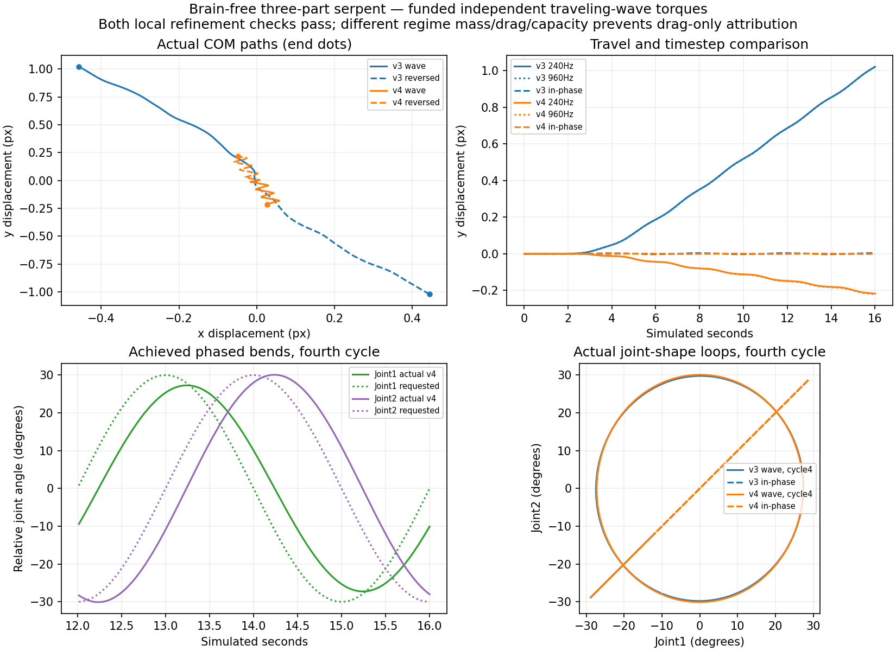

# Brain-free three-part, two-joint serpent (#80)

**Bounded experiment complete; stop for review.** Draft **#82**, branch
`experiment/brain-free-serpent-80`, stacked against #81's
`experiment/brain-free-scissor-80` at **8a2119a1be16e450b8c0df9ed50a15d5c04a864a**.
Protocol commit **fb6c4a5d6a54f7a0f4f29766b0ed913ad69074c7** preceded implementation.
Exact final head/CI are recorded in #80/#57/#82. #79 and #81 remain unchanged,
draft/unmerged/undeployed; no physics coefficients, capacities or release gates changed.

**Both models produce small but repeatable brain-free displacement.** Fixed-command
refinement passes the predeclared local checks in both models; passive and dry
COM motion is negligible, and reversing the wave reverses axial travel. Their
almost identical non-reciprocal joint-shape loops nevertheless swim in **opposite
axial directions**: native16s travel1.118312px(v3), .218357px(v4). This is evidence
of different whole-regime response, not a drag-only causal result or physical
validation. The inherited-grid/artificial-size mass mismatch remains1250×.



## Fixed geometry and mechanical program

The owner authorized this next #80 morphology; the prior scissor is not retuned.
Three identical **1×7px rectangles**, serial parents−1/0/1, no organs, no food,
gravity0, seed801 and viscosity setting .18. Same10,000J finite founder funding,
recorded once in external inflow; no top-ups, ecology or intergenerational search.
The initial assembly has centers(1200,750),(1201,757),(1202,764), all angles and
velocities0. A180° control rotates the entire assembly.

Each narrow-end hinge joins parent **(+.5,+3.5)** to child **(−.5,−3.5)**.
Opposing corners permit bending in either direction without a face-center hinge
pushing rectangles through each other. Base relative angle0 and existing angular
stops±90°. Static SAT tests sweep both joints over±30° in3° increments, checking
all three body pairs. No imposed mid-run pose/translation, special propulsion,
new constraint calculation or weakened collision/guard rule.

As in the scissor, this is a **private Worker-owned artificial fixture**.1px width
is outside the7px inherited anatomy grid (`dimN=1/7`); normal saves are neither
relaxed nor silently reinterpreted. The external fixture version is
`corner-serpent-v1`; its state receipt has **no public save schema** and is not
an importable genotype/world. The active world and its exact snapshot/PRNG remain
unchanged. Existing contacts include all three private fixture pairs; ordinary
neighbor exclusions and prior scissor anchors remain exact.

Two joints receive **independent relative-angle requests**, not an imposed path:

```
envelope(t) = sin²(pi*t/8) for0<=t<4s; then1
q1*(t) = envelope(t) * (pi/6) * sin(2*pi*t/4)
q2*(t) = envelope(t) * (pi/6) * sin(2*pi*t/4 - pi/2)
torque_j = I * (100*(qj* - qj) - 20*(omega_child - omega_parent))
```

The first cycle starts smoothly from a common straight/rest state; three full
cycles follow, **16s total**.30° amplitude,4s period,90° phase delay and all gains
were fixed in the protocol before seeing results. Each request is sampled/held
**240Hz**, bounded by the existing neutral-output **I×2200** ceiling. Both signs
are used independently. No neural evaluation/training/learning; unused compatible
brain metadata remains solely for unchanged lifecycle accounting. Its fixed
upkeep194.133333J is reported separately, not passed off as actuator work.

The actual shared-body paid impulse batch applies equal/opposite torques and
precharges positive work at25% efficiency. Braking does not regenerate energy or
fund another joint. Finer physical steps bill their actual combined impulse paths;
there is no fixed tick bill, free force or new muscle model. #79's diagnostic
`unilateral-stop-v1` is not enabled. No solver investigation/correction is bundled.

## Controlled comparisons and criteria

Same methodology as the scissor: each regime captures native240Hz feedback
commands, then **replays those exact two-channel torque requests** at480/960Hz.
A separate960Hz feedback trial distinguishes controller/trajectory sensitivity.
Passive240/960Hz,180° same-tape rotation, fluid-off same-tape240/960Hz, reversed
traveling wave and in-phase joint requests complete **22 measured rows**.
Reversal changes the temporal direction of the phase, not the initial assembly;
in-phase removes the inter-joint phase delay. Actual shapes are measured rather
than assumed to equal requested shapes. Fluid-off is a negative control, not a
retuned coefficient/profile for useful locomotion.

Protocol/pre-evaluation #80 comment6358671854 preserved the scissor criteria:
finest-pair vector error≤max(.01px,1% fine travel), combined two-joint RMS≤1°,
positive work difference≤5%. Separate interpretation flags require0guards,
anchor/overlap≤.001px, dry COM≤1e-7px, chemical discrepancy<1e-8J. No adaptive
refinement above960Hz, coefficient search, gain adjustment or phenotype tuning.
The legacy field name `apertureRmsDeg` in raw pair checks here means RMS over
**both relative-joint angle trajectories**, not a scissor aperture.

## Actual movement and realized shape

| Native240Hz over16s | v3 | v4 |
| --- | ---: | ---: |
| COM(dx,dy) px |(−.457380,+1.020502)|(+.026819,−.216703)|
| COM displacement px |1.118312|.218357|
| Mean part-angle change rad |−.028051|−.022991|
| Joint1 achieved degrees |−27.435..+27.411|−27.253..+27.277|
| Joint2 achieved degrees |−29.794..+29.792|−30.081..+30.078|
| Full-run tracking RMS degrees, joint1/2 |7.285 /7.327|7.096 /7.236|
| Fourth-cycle actual joint-loop area rad² |+.781635|+.785181|
| Fourth-cycle endpoint shape gap rad |3.27e-6|9.81e-14|
| Fourth-cycle COM(dx,dy) px |(−.192039,+.334976)|(+.014276,−.068603)|
| Reversed-wave total displacement px |1.112727|.220802|
| Reversed-wave dy px |−1.019932|+.215538|
| In-phase control total displacement px |.023856|.034543|
| In-phase fourth-cycle displacement px |.0001073|.0000133|
| Passive displacement px,240/960Hz |0 /0|0 /0|
| Dry same-tape displacement px,240/960Hz |1.66e-12 /9.65e-13|1.27e-12 /6.39e-12|
|180° rotated-vector discrepancy px |1.14e-12|3.64e-12|

Angle requests are **not exact kinematics**: the joints lag and joint1 undershoots
30°. A signed polygon area in(q1,q2) space measures the actual finite-cycle loop;
it includes the endpoint closing edge and separately reports endpoint gap, so
startup is not mislabeled a periodic loop. The theoretical full-amplitude requested
loop area is pi*(pi/6)²=.861285rad². Actual late loops are about91% of that area
and reverse sign when the wave reverses. In-phase late loops collapse near zero.

For v4, cycles3/4 COM increments are(.014273,−.068604) and(.014276,−.068603)px;
startup and body orientation still matter. This is repeated translation over the
bounded interval, not a long-term limit-cycle/ecological survival claim. Rotation
is the unweighted mean of the three part angles, a deformable-body orientation
proxy; root angle and full trajectories are provided separately in the summary.
The in-phase control's small total motion is mostly startup; no zero-swimming
requirement or theorem is imposed on a finite-inertia imperfect torque trajectory.

## Numerical sensitivity and artifacts

| Exact native-tape refinement | v3 | v4 |
| --- | ---: | ---: |
|240 /480 /960Hz displacement px |1.118312 /1.117823 /1.117579|.218357 /.220363 /.221383|
|480→960Hz vector error px |.0002502|.0010879|
|480→960Hz two-joint RMS degrees |.028714|.010289|
|480→960Hz positive-work difference |.08483%|.28039%|
| Declared finest-pair check |**passes**|**passes**|
| Separate960Hz feedback displacement px |1.121677|.220837|
| Native wet max hinge error px |3.826e-5|3.749e-5|
|960Hz fixed-tape max hinge error px |2.388e-6|2.350e-6|
| Native wet max rectangle overlap px |4.44e-14|1.33e-14|
| Native wet angular-speed peak rad/s |.64876|.63423|
| Native wet guards / passivity-limited batches / pose repairs |0 /0 /0|0 /0 /0|

The240→480Hz pair also passes in both regimes. Wet traveling, reversed and in-phase
rows pass the separate geometry/guard/chemical flags. Tiny corner-touch contact
receipts still occur from floating-point geometry; native contact kinetic loss is
3.32e-30J(v3),1.14e-33J(v4), effectively zero at this work scale. Position projections
leave immediate kinetic energy unchanged. In-phase v4 has35 passivity-limited
batches, disclosed in raw data; no clamps are lowered/added.

Dry replay drives different shapes into existing±90° stops; native dry hinge errors
.003185px(v3)/.001759px(v4) **fail the .001px flag**. Refined dry errors .000632/.000513px
pass. Dry overlaps≤.000380px, guards0. These are **only COM/internal-propulsion
negative controls**, not matched kinematic or ideal constrained-dynamics solutions.
Existing stop/pose limitations are preserved, not investigated further.

Across22 measured rows, maximum joint-batch linear-momentum residual1.56e-15
mass-unit·px/s, COM departure from integrated velocity6.47e-13px/substep,
mechanical phase residual2.14e-19J. Dry COM rest and tiny direct impulse/projection
residuals support **fluid-mediated**, rather than directly scripted or positional-
repair-driven, translation. Indirect solver/fluid coupling is not mathematically
excluded. Local refinement/orientation agreement strengthens that evidence here;
it does not prove exact continuous dynamics, general convergence or correct water.
#79's articulated overspeed and pose-induced angular-momentum issues remain open;
this fixture's zero guards does not resolve those unrelated findings.

## Paid work, chemical energy and physical comparability

| Native240Hz over16s | v3 | v4 |
| --- | ---: | ---: |
| Positive actuator work J |1.07478e-5|7.86660e-9|
| Braking work J |3.79206e-7|4.79906e-10|
| Motor chemical debit J |4.29910e-5|3.14664e-8|
| Basal/inert-layout upkeep J |194.133333|194.133333|
| Fluid physical dissipation J |not separately resolved|7.24915e-9|
| Fluid implicit numerical dissipation J |not separately resolved|5.54473e-11|
| Constraint net kinetic loss J |1.60479e-8|4.61837e-11|

All rows preserve debit=4×positive work and motor-ledger equality within1e-12J;
chemical discrepancy≤1.53e-9J. No ceiling saturation, energy limiting or request/
application mismatch. Braking never credits reserves or cancels positive work.
v4 fluid balance residual≤5.15e-19J; fixed-tape960Hz numerical fluid loss falls to
1.38596e-11J. v3 combines drag/motor in its explicit force step: summary provides
signed external drag work, not an invented physical/numerical decomposition.

**The scissor's1250× physical mass/inertia and SI capacity mismatch persists** at
this1px width: v3 retains the .35 mass-unit floor, physical mass .06125kg per part;
v4 uses4.9e-5kg. Mechanical-joule factors1.75e-7/8.575e-10 are unchanged (about204×).
The same normalized actuator and chemical reserves do not create an equal-mass or
equal-strength experiment. These two entire regimes can produce different travel
under nearly the same measured joint loops; the direction reversal is demonstrated,
but its drag/mass/capacity contributions are **not isolated**. No coefficients or
mass/cost rules are changed to obtain a preferred outcome. #60 still needs its
anatomical strength/maintenance decisions, and #61's fluid reference remains provisional.
No claim of energetic biological efficiency follows from tiny motor work amid
large inert-layout upkeep or from passing a chemical ledger check.

## Computational cost, preservation and checks

Two reversed-order instrumentation-disabled16s pairs per resolution, same Worker
after warmup, no concurrent local test campaign:

| Physical frequency | v3 ms, two runs | v4 ms, two runs | Summed v4/v3 |
| --- | ---: | ---: | ---: |
|240Hz |78.74 /50.68|135.93 /172.76|**2.39×**|
|960Hz |68.60 /63.17|300.51 /209.77|**3.87×**|

Timings are noisy/JIT/GC-sensitive short headless fixture measurements. They show
material v4 cost in these matched pairs; the apparent near-equal v3 totals across
4× substeps **do not establish free refinement**. Do not extrapolate browser FPS,
ecosystem throughput or a universal refinement factor, and do not compare absolute
times directly with the earlier scissor's different sampling/load. No further timing
campaign was run to improve the numbers.

- [Raw Worker traces, two-channel tapes, checks and timing](brain-free-serpent-v1.json.gz).
- [Read-only summary with interpretation flags and archive hash](brain-free-serpent-v1-summary.json).
- `npm run build && npm run benchmark:serpent` reproduces only this bounded matrix.
  `node scripts/analyze-serpent.mjs` and `python scripts/plot-serpent.py` read saved
  data only. Prior reports and valid/excluded scissor evidence are never overwritten.
- Nine previous report/archive checksums are unchanged. The shared hook extension
  justified **two scissor native-state regression checks only**: both actual-Worker
  final full-state hashes equal the archived #81 results exactly. No old matrix,
  ecological campaign, starter search or #79 solver experiment was repeated.
- Local **301fast+1metadata**, build/typecheck and **four** actual built-Worker checks
  pass: legacy, prism/#79 version continuation, scissor and serpent. Serpent checks
  cover independent opposite-sign channels, shared paid work, passive rest, exact
  observed/unobserved/tape fixture-state equality, whole-tape validation and active-
  host snapshot/PRNG isolation. Existing historical save/default tests remain intact.
- CI adds `test:serpent-worker`. Final actual head/CI/Project status in #80/#57/#82;
  no manual browser campaign or production Wiki changes.

**Next action: review these results and limitations. Stop here.** If separately
continuing #80, the remaining listed benchmark is the main body with two independent
rigid paddles; it is **not implemented or started**. Do not turn this result into
coefficient/brain/founder tuning, another solver study, #63/#64 optimization or a
promotion. #59/#72, #60 and #78's contextual inherited reinforcement remain unchanged.
No merge, deployment, release or VIDA3D modification.
