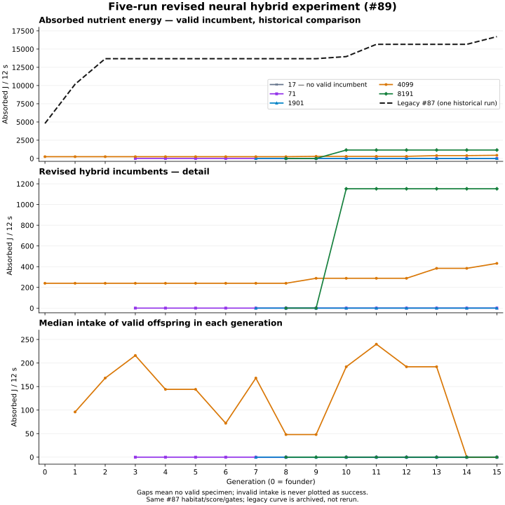

# Revised neural hybrid threshold experiment (#89 / draft #90)

**Fixed five-run experiment COMPLETE. Stop for owner review; no promotion.**
Easier oscillator access is demonstrated, but useful foraging via switching is
not established. Two runs found valid feeding champions (432/1152J); two valid
finals ate0J; seed17 found no valid candidate. Both feeding champions are
DIRECT-only during training. Most proposals violate the unchanged physical gates.
The historical legacy16704J result is one evolutionary run, not an architecture
population; it was read from #87, never retrained or given new held-outs here.

Gaps mean no valid incumbent, not zero intake. Panel1 includes the historical
legacy curve; panel2 expands the five revised runs; panel3 is valid-offspring
median intake. [PNG](hybrid-threshold-intake-v1-curves.png),
[full per-generation/mode/work summary](hybrid-threshold-intake-v1-summary.json).

## Versioned implementation and registered controls

Branch `experiment/hybrid-threshold-intake-89` / draft #90 targets #88's
`experiment/nutrient-intake-87`, base b64481eb02a4c253637cae3d91375a5051405fd1.
[Protocol](hybrid-threshold-intake-v1-protocol.md) registered BEFORE coding at
82c829ddba2fd28307cbd6b78a25069f285bd0d7; issue search found no existing specific
follow-up, so #89 was created and linked from #57. #87/#88 evidence unchanged.

New explicitly testing-only **neural-motor-v2 / schema20** retains precisely
Mode+shared Command per joint, inherited mutable oscillator traits, independent
joints and existing Command meanings. DIRECT is signed torque, OSCILLATOR is
existing inherited wave times (command+1)/2 strength, OFF zero active torque and
passive joints. No genetic architecture selector or extra six-output head.
Old neural-motor-v1, other controllers and schemas retain their original semantics;
no saved weights/genomes are automatically converted. Brain remains version7.

Nominal Mode bands and exact endpoints:

| Mode output x | Band / physical mode |
|---|---|
| x <−.9 | negative OFF |
| −.9 ≤x ≤0 | DIRECT |
| 0 <x ≤+.9 | OSCILLATOR |
| x >+.9 | positive OFF |

Actual **.06 hysteresis** applies to all three boundaries:

| Nominal boundary | Rising exit threshold | Falling exit threshold |
|---|---:|---:|
|−.9|>−.84|<−.96|
|0|>+.06|<−.06|
|+.9|>+.96|<+.84|

At a hysteresis endpoint equality retains the previous band. The nominal exact
−.9 DIRECT/0 DIRECT/+.9 OSC rules apply without hysteresis; with hysteresis the
saved previous band can persist inside a boundary's overlap, as intended.
A FOUR-band somatic latch distinguishes negative/positive OFF, both mapped to
the same physically passive OFF mode. This prevents losing the relevant OFF exit
boundary after save/reset. All crossed bands are evaluated in ONE call; large
neural changes can switch directly among any modes or OFF sides without a dwell,
cooldown, ramp or mandatory rhythm. Newborn latch starts DIRECT as #88. The
latch is not an inherited selector, neural output or timer.

The revised initializer uses EXACTLY #88's fully fresh IH/HH/HO/bias draws and
recurrent layout; only explicit controller version metadata changes. No targeted
or biased Mode connections. Five predetermined independent seeds:
**17,71,1901,4099,8191**.1972 scalars each,24 recurrent hidden neurons; no trained
Darter weights, champion transfer or learned-state inheritance. Every proposal
uses eight randomly selected scalar mutations with replacement, Gaussian sigma.15
and unchanged bounds. Mode/Command are independently mutable;40 proposals mutate
both in one offspring. Fixed CPG traits/anatomy/motor capacity are unchanged.

EACH run15 generations x15 offspring x12s =225, **1125 offspring total**.
With5 founders and30 held-out rows:1160 selection/held-out rows. Each generation
uses its frozen start parent. Sole score **actually absorbed nutrient joules**;
strict greater-than elitism, no neutral drift, distance/visibility/reserve/energy
secondary score. If founder is invalid, it is only a mutation source until a
valid specimen exists; first valid0J establishes feasibility, NOT an intake gain.
No invalid winner; explicit null champion if none valid in budget.

Exact #87 habitat/PRNG, verified against its archived snapshots for every seed
and condition:1000x800px, root500,400 heading.37, environmentseed73,240 ordinary
3000J nutrients, existing65% cluster/35% uniform recipe at12 abiotic sites,
96px square halfspread, gravity0, viscosity.18, passive-work-v3/capsule-v1.
Same nutrient positions/properties, ordinary ray vision, mouth contact, feeding,
assimilation, lifetime learning, metabolism and normal10000J founder reserve.
No respawn, food relocation, sensing oracle, artificial propulsion or motor gain.
Full world reset per evaluation; independent brains never transfer between runs.

Same ephemeral12s nonlethal fixture from #88, same actual energy limits and
chemical accounting. Its admission now accepts explicit v2; biological protection
logic unchanged. No new energy, age reset or production mortality/reproduction
change. No training candidate actually invoked protection or reserve limiting.

Validity gates unchanged #87: finite singleton/full duration/no eggs; no entry
into100px boundary zone, speed guards; anchor<.5px, joint-limit excess<.05rad,
constraint batch gain<1e-12J, post-constraint/contact omega<=20.001rad/s,
chemical closure<1e-5J, prepaid billing residual<1e-9J and exact paid torque delivery.
Zero energy/correct energy limiting remains valid. Boundary exclusion is a
conservative control, not a demonstrated numerical defect. No gate was weakened.

## All five training outcomes

| Brain seed | Founder intake J / valid? | Final valid intake J | Valid offspring /225 | Fed all / valid | Selected generations |
|---|---|---:|---:|---:|---|
|17|2400 / NO|**no champion**|0|197 /0|none|
|71|2640 / NO|0|23|51 /0|g3/o8: first valid0J|
|1901|6240 / NO|0|26|145 /0|g7/o8: first valid0J|
|4099|240 / yes|432|102|156 /71|g9/o6:288;g13/o3:384;g15/o9:432J|
|8191|0 / NO|1152|47|70 /12|g8/o11: first valid0;g10/o6:1152J|

Four valid finals `[0,0,432,1152]`: median216J, mean396J, range0–1152J.
One **separate failed run**, not imputed as a zero-intake valid champion.
Two of five runs yield positive valid final intake. Seed4099 improves240→432J
(+80%);8191 discovers valid feeding after establishing feasibility. Other two
valid finals have zero collection, and seed17 never becomes eligible. There are
seven accepted genotypes: THREE feasibility restorations and FOUR actual intake
improvements. Every selected mutation and inherited genome is archived.

198/1125 valid offspring (17.6%);619 feed at all, but only83 are valid feeders.
The other536 feeding rows are physically ineligible and cannot support a foraging
success claim. Typical rejection reasons overlap:

| Seed | Speed-guard candidates | Joint-limit candidates | Post-guard overspeed | Anchor candidates |
|---|---:|---:|---:|---:|
|17|225|222|185|0|
|71|169|200|133|3|
|1901|154|198|134|0|
|4099|27|122|7|0|
|8191|124|164|103|0|

Including founders:43578 guard events, raw max anchor.51877px, limit excess
.15409rad, post-contact angular speed23.57148rad/s. These are preserved failures,
not hidden/clamped successes. No constraint or solver redesign/correction follows.
All valid champions have zero guards/overspeed by the unchanged gates. Existing
v3 angular-stop/guard-placement limitations (#84) remain separate and deferred.

## Mode discovery, actual torque and nutrient encounters

No training proposal uses either OFF region; both regions are verified by
focused physical tests, but evolutionary OFF discovery is absent.75/198 valid
proposals execute funded OSCILLATOR torque and DIRECT↔OSCILLATOR changes;
123 valid proposals remain DIRECT-only. Most changes occur during startup.
Across valid proposals165 mode-transition events; only3 candidates switch after
1s (16 such events):8191/g15/o5=96J,1901/g13/o1=0J,4099/g9/o0=192J.
None is selected. Actual substep event times/commands, band occupancy and
requested/applied torque are preserved, not inferred from tick-only labels.

| Final valid seed | DIRECT↔OSC changes | Joint0 DIRECT/OSC substeps | Joint1 DIRECT/OSC | Intake ticks / first tick |
|---|---:|---|---|---|
|71|1|16 /2864|2880 /0|0 /none|
|1901|3|0 /2880|2864 /16|0 /none|
|4099|0|2880 /0|2880 /0|9 /330 (5.5s)|
|8191|0|2880 /0|2880 /0|24 /510 (8.5s)|

The nonfeeding71 final activates joint0 OSC at.070833s;1901 activates joint0
immediately, joint1 OSC at.104167 then DIRECT at.170833s. These are real funded
wave torques (e.g.71 joint0 normalized RMS.18452), but not useful mode adaptation
for collecting nutrients. Both feeding finals are DIRECT-only. Mere switches or
oscillator occupancy do not demonstrate meaningful behavioral transitions.

Within4099 valid proposals: no-switch89 candidates,66 fed, median192J/max432J;
switching13 candidates,5 fed, median0/max192J. Within8191: no-switch34,9 fed,
median0/max1152J; switching13,3 fed,median0/max240J. All23/26 valid proposals
in71/1901 switch but eat0J. Observational association does not show a switching
benefit or prove switching causes failure: genotypes/commands also differ.
No oscillator ablation or extra search was authorized or performed.

All final specimens see nutrients fromtick1. Feeding4099/8191 has genuine
mouth-contact absorption and ordinary learned motor/sensory L1 respectively
.001602/.006119 and.005106/.018527. Nonzero offsets are actual within-life
learning; its causal functional benefit and directed food seeking are not isolated.
Only9/24 feeding ticks, little COM motion and stop pressing are insufficient to
call this robust foraging. Twelve seconds is sufficient for some real feeding,
not meaningful interaction for every policy. No new #78 reward semantics.

## Work, reserves and processing cost

| Final valid seed | COM displacement px (diagnostic) | Positive / braking work J | Motor chemical J | Own chemical expenditure J | Median12s wall ms over225 offspring |
|---|---:|---|---:|---:|---:|
|71|5.772|1.66888 /.02579|6.67552|316.38152|114.85|
|1901|21.278|2.83172 /.02152|11.32687|321.03287|112.51|
|4099|6.864|1.01177 /.02495|4.04708|313.75795|111.88|
|8191|29.483|1.73930 /.06073|6.95721|316.67718|110.75|

Failed seed17 wall median110.24ms, excluded from valid-final comparison.
Instrumentation includes reset/IPC, vision, receipts, traces and snapshot export;
not gameplay FPS or a controlled speed ranking versus historical legacy112.26ms.
Seeds rotate evaluation order each generation on one sequential Worker.
Same mass/inertia/v3/motor capacity, no strength/biology calibration.

Existing4x positive-work prepayment, signed braking with no credit/regeneration,
chemical conservation and paid demand-delivery remain. Score sums actual ordinary
post-tick mouth absorption, not gross food loss. Exact food/work partition includes
assimilation and discarded remnants as #87. Training chemical error<=6.985e-10J,
partition residual<=6.625e-10J; held-outs also below6.985e-10J. Minimum training
reserve9666.98J; no reserve limiting/would-be death. Conservation does not establish
numerical or behavioral validity; bad guards/constraints still disqualify intake.

## Matching held-outs, never selected

Three arrangements per run, seeds811/977/2301, headings−.7/2.3/pi/2, same12s
and exact #87 recipe. Initial and final/fallback each:30 separately tagged rows.
`I` denotes invalid; seed17 fallback is NOT a champion.

| Brain | Final811 J | Final977 J | Final2301 J | Valid champion held-outs |
|---|---:|---:|---:|---:|
|17 (failed fallback)|14304 I|11712 I|3840 I|not applicable|
|71|6336 I|0 I|11712 I|0/3|
|1901|6240 I|0 I|9552 I|0/3|
|4099|144|7584 I|336 I|1/3|
|8191|720|0|2400|3/3|
|Historical legacy #87 (one run)|22320|14064|12288|3/3|

Among the12 true champion held-outs,4 valid /3 positive-intake; the3 failed
fallback slots are separate.4099 initially had one valid2301/288J; its final2301
row becomes invalid (limit excess), a disclosed regression despite training gain.
8191 restores physical validity in all three arrangements (its founder failed
all); only811 uses any OSC (16 substeps/.0667s,2 changes, normalized RMS.35657)
and eats720J. This real brief burst does NOT establish causal benefit. Other
valid feeding held-outs are DIRECT-only. Invalid high-intake rows never count.

Legacy historical training4800→16704J,201/225 valid/200 valid feeders, holds
out strongly here. Original hybrid17 #87 was valid0J/DIRECT-only; revised17
same fresh neural weights now accesses OSC and feeds2400J BUT fails guards,
limits and overspeed; all225 offspring invalid. This demonstrates changed access
and increased instability in that paired seed, not a successful threshold repair.

**No architecture-wide superiority claim:** five revised brains versus ONE
historical legacy evolutionary run, different output counts/semantics and finite
budget. No matched old-threshold controls for the other four seeds were requested;
the study cannot isolate a population-level causal threshold benefit. It does
show easier OSC access without demonstrated reliable feeding through switching.

## Integrity, reproducibility and checks

[Manifest](hybrid-threshold-intake-v1.json) protects ALL83 immutable gzip archives:
20 environment snapshots in one file,5 founders,75 generations,5 final/failure
specimens and30 held-outs. All1125 candidate genotype hashes reconstruct from
unchanged mutation ledgers/frozen parents; every elite choice and full selected
genotype matches. All #72/#85/#86/#87 report/data hashes unchanged. No training
repeat, replacement measurement, food/physics/gain/threshold tuning or extra legacy
selection/held-out campaign.

**Auxiliary log limitation:** the preserved original run.log contains only4 of
81 expected lines (first4 founders). Cause unestablished; no claim of intact
console evidence. The initial verifier rejected this count. Crucially, all83
PRIMARY archives match the final manifest hashes and all1125 rows/75 complete
generations are present. Selection and genotype integrity are checked from those
complete primary receipts. [Derived generation index](hybrid-threshold-intake-v1-derived-generation-index.json)
is explicitly a reconstruction, NOT the missing original console output.
[Verification](hybrid-threshold-intake-v1-verification.json) records the partial
log hash/count, completeness failure, all genotype/elite checks and exact replays.
No data were invented or invalid rows suppressed to repair the console log.

Five final specimens (four champions plus failed17 founder) replay exactly:
metrics, mode events/receipts, serialized trajectories, complete snapshot/PRNG;
five360+360-tick save/reset forks exactly match. These are verification only.
No lost trial receipt or training rerun was necessary. Raw archives, mutants,
initial/final genes, food/learning/work/mode events and failure flags are durable.

Local326 fast+1 metadata, typecheck/build,7 focused threshold/hysteresis/endpoint/
applied torque/save/fresh mutation tests pass. Production/gated/retained/basic
randomized-controller Worker checks pass. New Worker host/quiet/observation/fork,
both OFF sides, independent decisive transitions, ordinary144J physical feeding,
zero reserve/no free work and exact OLD #88 hybrid final state pass. Existing
legacy component checks remain; historical legacy champions/training/held-outs
were NOT re-executed for this comparison. No browser manual campaign. CI uses
new frozen audit; old pinned #87 scripts/evidence remain unchanged. Remote final
head CI/statuses and branch SHA are recorded in #89/#57.

Review commands: `npm run test:fast`, `npm run build`,
`npm run test:hybrid-threshold-worker`, `npm run audit:hybrid-threshold`.
Derived-only: `node --import tsx scripts/summarize-hybrid-threshold.mjs`,
`python scripts/plot-hybrid-threshold.py`. The experiment runner refuses overwrite;
never rerun the fixed budget automatically. Reproduction requires deliberate new
output paths/clean fixture and owner authorization, not accidental app startup.

**Recommendation / exact next action:** review this completed evidence and retain
current production. Do not adopt revised thresholds or claim evolved mixed-mode
foraging. Oscillator accessibility improved; stability and useful discovery remain
poor. Seed8191 is a limited valid feeder worth preserving, not a promoted founder
or proof of hybrid superiority. Stop: no further mutation/threshold/strength search,
solver study, #78 feature, merge or deployment. Main194d70d1/v0.37.0 and testing
d7a6814/T1.1 unchanged; no production save/default/starter/Wiki/3D changes.
