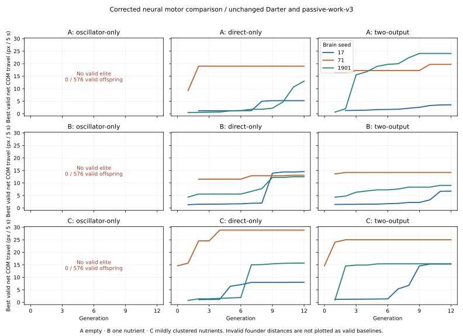

# Corrected neural motor / food comparison v1 (#59 / #63)

**Bounded experiment complete. Stop for owner review.** Draft #86,
`experiment/neural-modes-food-63`, based on #85 at
`e09bf46a27e84edbe1dc72e698c259ac7b8e6e9e`. No merge or deployment.

**Owner correction:** #85 compared the legacy six-output posture servo, a
three-output gate and a retained-head **genetic** selector. It did not compare
the intended architectures. All its files and measurements remain unchanged;
its ranking cannot answer the corrected question. Legacy six-output is not an
oscillator-only controller. This study introduces no legacy extra head or genetic
architecture selector.

## Implemented controllers and controlled variables

| Controller | Independent neural outputs per joint | Applied motor demand |
| --- | --- | --- |
| Oscillator only | OscillatorStrength | clamp(inherited wave,−1,1) × (Command+1)/2 × ceiling |
| Direct only | DirectTorque | signed Command × ceiling; no oscillator torque contribution |
| Neural hybrid | Mode + Command | #72 two-output OFF / DIRECT / OSCILLATOR semantics exactly |

Hybrid boundaries are ±0.3 with **0.06 hysteresis**. OFF is zero active torque,
with a physically passive hinge. DIRECT interprets Command as signed torque;
OSCILLATOR interprets it as `(Command+1)/2` strength. Decisive transitions jump
between any modes within one update. No cooldown, dwell, servo, imposed stroke
or smoothing. Pure controllers are structurally restricted to their named mode;
constant internal gate inputs reuse the same existing torque implementation.

`neural-motor-v1` / **schema19** is explicit and testing-only. Old schemas and
controller paths remain; no automatic genome conversion or old output
reinterpretation. New oscillator strength is a primary action for the existing
learner, just as direct torque / shared Command are. Old learning edge order,
96-edge limit, reward rules and #78 remain unchanged. The Darter's default
primary-action learning scope does not learn hybrid Mode rows within life;
ordinary genetic neural mutations can change Mode and Command together.

All worlds use unchanged **CUR-001 Darter**, v3, capacity formulas, joints,
organs/mouths/eyes, costs and safeguards; 4,800×3,000, gravity0, viscosity0.18.
Ceiling is the same existing mean-inertia×2200 assumption, not a newly adopted
#60 muscle law. Inherited motorFrequency2.6, cpgAmp0.65, phases, waveform and
frequency multipliers remain fixed during this neural-only search. Their
ordinary genetic mutation capability is preserved and tested; this is not a
co-evolution study of oscillator parameters. The oscillator's 50% strength at a
zero output is the prior #72 mapping, not neutral-equivalent to direct zero.
All architectures retain identical existing sensory inputs, including body
sin/cos clock inputs. Direct-only may use neural timing information but applies
no inherited oscillator-generated motor torque.

Every network, including all sensory and recurrent weights and biases, is
freshly randomized. Dense24 hidden; weights uniform ±1/sqrt(source fan-in), biases
±0.1, tau0 and no disabled connections. Paired trunk/Command streams use seeds
17/71/1901; hybrid Mode has the corresponding separate latent stream from #85's
fresh initializer. No trained weights survive. Initial genomes are re-created
independently for each environment from the same paired seeds, never transferred
from an evolved winner. Scalar counts are **1,922 / 1,922 / 1,972**; uniform scalar
sampling consequently gives different per-parameter opportunities.

Every offspring gets **eight neural scalar events**, sampled with replacement,
Gaussian sigma0.15, bounded ±3.5 weights / ±1.5 biases, as #85. There are no
selector-only slots. **75 hybrid proposals mutated both output roles directly,
seven selected**; common trunk changes can also affect both roles. No anatomy,
capacity, clock/gait-parameter or learning-trait mutation. Somatic activations,
learned deltas and eligibility reset at each evaluation, never enter the inherited
genotype. Offline generation counters are separate from normal biological life.

Each organism receives a **finite50,000J** starting reserve, funded once through
the normal external ledger. Normal metabolism, mortality, physical feeding and
learning run throughout. All durations are below unchanged18s maturity; maximum
age15s. No free motor energy or live-ecosystem fitness is introduced.

## Environments, budget and validity

[Protocol](neural-food-v1-protocol.md) was published before coding at
`0fca51dfb5fe7e09ba58b159d02a9283a69ae032`. Training uses environmental seed73,
heading0.37 and5s/300 ordinary ticks; the four existing physical substeps and
neural cadence are unchanged.

| Environment | Ordinary nutrient placement; no inflow/respawn |
| --- | --- |
| A — empty | Same empty water as #85 |
| B — one | One3000J nutrient center60px ahead of root COM along initial heading,42.5px beyond root face; no initial mouth contact |
| C — clustered | 800 ordinary3000J nutrients;600 uniform,200 jittered around12 abiotic grid sites with400px square halfspread; separate placement PRNG seed = envSeed XOR0x36e2079b |

C averages **55.56 nutrients/million px²**. The mixture gives ~1.6× background
local density in unclipped, nonoverlapping cluster boxes; exact finite placement
is authoritative, not that approximation. This is representative dispersed water,
not guaranteed feeding: current production defaults275/3.6Mpx² ≈76.39/million.
The large arena lowers mean density to ~73% of that default. Training C has30
nutrients within450px of root, nearest79.57px. Held-out C nearest distances are
57.55/56.18/28.76px. All nutrient properties/funding use ordinary `addNutrients`;
only offline initial positions are set. Sources never follow the organism.

Exact initial environment snapshots, coordinates, PRNG states and settings for
all training/held-out layouts are in
[environments](neural-food-v1-environments.json.gz). The same layout is shared
across architectures and brain seeds. B rotates with initial heading; C uses
new deterministic global layouts in held-outs.

Each of **nine architecture/environment combinations** received exactly
**12 generations ×16 offspring ×3 seeds ×5s =576 offspring**: **5,184 total**.
All16 offspring descend from a frozen generation-start parent. Strict elitism
uses **only valid net COM displacement**; ties keep the parent. Invalid founders
are not eligible elites; until a valid offspring appears, proposals originate
from the original founder without resampling. No energy/intake/direction/late
motion term enters selection.

Validity is unchanged from #85: finite full-duration living singleton, positive
reserve, no eggs/boundary, zero speed guards/energy limiting, substep anchor
<0.5px, limit excess<0.05rad, accepted constraint gain<1e-12J, chemical error<1e-5J,
post-constraint/contact omega≤20.001rad/s, exact torque delivery and debit=4×positive
work within1e-9J. Nutrients are now permitted; feeding partition is audited.
All failures remain visible. Screens exclude known exploits, not certify all
possible numerical artifacts. No limits were relaxed to obtain winners.

Paired initial/final held-outs: seeds811/977/2301, headings−0.7/2.3/π/2,
10/15/15s, with corresponding environment recipes. No held-out influences
selection. There are27 founders,162 held-outs,27 passive,27 fluid-off and18 B/C
food-removed controls: **5,445 unique planned trial rows**. Failed runs use the
explicitly labeled original specimen in validation slots, **not a champion**.

## Evolution and generalization

Final distances are medians of the three valid champions where available.
No valid oscillator-only champion exists; do not substitute its guarded raw
movement or zero as a valid distance. Only C/seed71 direct and hybrid founders
were initially valid; other initial distances are raw, invalid baselines.

| Environment | Controller | Final valid runs | Median5s px | Valid offspring /576 | Valid champion held-outs /9 |
| --- | --- | ---: | ---: | ---: | ---: |
| A | Oscillator | 0/3 | — | 0 | — no champions |
| A | Direct | 3/3 | 13.02 | 173 | 6 |
| A | Neural hybrid | 3/3 | 19.71 | 194 | 6 |
| B | Oscillator | 0/3 | — | 0 | — no champions |
| B | Direct | 3/3 | 13.09 | 151 | 8 |
| B | Neural hybrid | 3/3 | 9.06 | 140 | 7 |
| C | Oscillator | 0/3 | — | 0 | — no champions |
| C | Direct | 3/3 | 15.67 | 219 | 1 |
| C | Neural hybrid | 3/3 | 15.39 | 216 | 5 |

| Environment/controller | Final5s px, seeds17 /71 /1901 | Held-out valid counts in same order |
| --- | --- | --- |
| A/direct | 5.23 /19.01 /13.02 | 3 /0 /3 |
| A/hybrid | 3.58 /19.71 /24.08 | 3 /0 /3 |
| B/direct | 14.54 /13.09 /12.49 | 3 /2 /3 |
| B/hybrid | 6.76 /14.21 /9.06 | 3 /1 /3 |
| C/direct | 8.02 /28.87 /15.67 | 0 /0 /1 |
| C/hybrid | 15.31 /25.00 /15.39 | 3 /0 /2 |

Every oscillator offspring (1,728) triggered guards and exceeded the registered
joint-limit tolerance. No selection could advance from its invalid founders.
This demonstrates a failure under these fixed priors/initialization, capacity
and sparse-neural-only budget. It does **not** establish that inherited oscillator
control is intrinsically incapable, or that another oscillator genotype would
fail. No gain/activation mapping/oscillator tuning was tried to rescue it.

Direct/hybrid produce18 valid champions. Their motions are modest and often
stop-pressing/transient. A/direct17 settles: final-third15s travel~0.163px;
A/hybrid17~0.019px. A/hybrid1901 sustains more motion (57.76px total and18.60px in
final third at15s/π/2). C/seed71 training improves from valid14.61px to28.87 direct
or25.00 hybrid, yet both champions fail all three changed-layout held-outs.
Across environments direct passes15/27 champion held-outs, hybrid18/27. Three
seeds/one anatomy and mixed environment rankings do not justify superiority.
All beneficial valid elites are preserved monotonically; none is displaced by
an invalid faster specimen.

### Does the neural hybrid use its modes?

Valid offspring use OFF in4 B and7 C trials, and OSCILLATOR in14 C trials
(counts can overlap). Invalid candidates also switch, but do not count as useful
discovery. All nine final hybrid champions remain DIRECT throughout training
except **C/1901 joint1**, which uses OSCILLATOR for16 physical substeps /0.0667s
and DIRECT otherwise; two transitions. Joint0 stays DIRECT. No final champion
uses OFF during training.

[Actual burst receipt](neural-food-v1-mode-receipt.json) verifies nonzero applied
oscillator torque: normalized RMS0.25353, peak0.31746 of the unchanged ceiling,
zero clipping/energy limiting/delivery error/guards, and exact final-state replay.
It is a real neural lifetime transition, not a genetic selector. Its causal
benefit has **not** been established; no ablation or claim of meaningful use of
all three modes follows from one brief burst. Mode/Command remain independent
per joint, and arbitrary non-rhythmic direct commands remain possible.

## Food cues, intake and interpretation

All12 B/C champions detect ordinary nutrients from tick1. Yet **none of the18
valid champions, nor any valid training offspring, contacts/eats a nutrient**
within5s. Their recorded acquired motor/sensory deltas remain zero. Five seconds
and these small movements did not provide a physical feeding/teaching encounter;
**zero intake is not evidence of failed food seeking**. Vision had meaningful
input, but this cannot evaluate useful learned foraging, future prediction or
#78's intended reinforcement capabilities.

Invalid B offspring do physically eat (168 oscillator,3 hybrid), and several
invalid longer held-outs eat. Those are excluded from valid locomotion/foraging
claims, not promoted for nutrient intake. Separate physical-contact fixtures
verify ordinary uptake and conservation through the real Worker.

Removing food from the *same final B/C genome* changes motion and sometimes
stability without a food score or training transfer. Only3/12 champion
food-removed controls remain valid: B/hybrid17 changes6.76→1.75px,
B/hybrid71 changes14.21→16.46px, C/hybrid71 changes25.00→15.91px.
The other nine become invalid, so their raw distances are not successful
counterfactual swimming. These demonstrate food-presence-sensitive control,
not evolved attraction or a universal benefit from food cues. Since selected
5s policies had no contact/intake/learning, visual input is the supported
mechanism; this was not an isolated retinal ablation.

All27 passive controls pass with zero active work and zero displacement.
All27 fluid-off COM displacements are<8.20e-12px; only3 pass all stability screens,
so **24 are excluded as stable-swimming evidence**. The three valid dry controls
are B/direct1901, C/direct71 and C/hybrid71. The results support fluid-dependent
motion, not artificial internal propulsion, without claiming all measured
trajectories are numerically clean. Guard/constraint redistribution and the
separately deferred stop defect remain visible; no solver investigation occurred.

## Work, stability and computational cost

Champion medians below; there is no valid oscillator energy-efficiency ranking.
Braking is signed mechanical absorption, never refunded as chemical energy.

| Environment/controller | Positive work J | Braking J | Motor debit J | Organism chemical expenditure J/5s |
| --- | ---: | ---: | ---: | ---: |
| A/direct | 0.27921 | 0.00503 | 1.11683 | 130.16100 |
| A/hybrid | 0.29889 | 0.01158 | 1.19555 | 130.23972 |
| B/direct | 0.42380 | 0.00816 | 1.69521 | 130.73938 |
| B/hybrid | 1.04581 | 0.00992 | 4.18326 | 133.22743 |
| C/direct | 0.84053 | 0.04203 | 3.36211 | 132.40627 |
| C/hybrid | 0.40186 | 0.02098 | 1.60744 | 130.65160 |

Existing capped24-hidden maintenance is129.04417J/5s in these specimens.
Prepaid debit remains4×positive work. The normal metabolic ledger includes
unabsorbed feeding losses: reserveSpent + **gross** source depletion = motor debit
+ metabolic ledger. Organism expenditure = reserveSpent + **absorbed** intake.
No work billing, chemical conversion or nutrient property changed.

Across5,445 unique rows: maximum chemical discrepancy2.33e-9J, partition residual
2.17e-9J, accepted constraint gain1.39e-17J; exact torque delivery and zero energy
limiting. Minimum reserve49,580.71J; no premature death, depletion or reproduction.
Rejected raw trials retain up to257 guards, peak post-constraint/contact speed
23.244rad/s, angular-limit excess0.15570rad. These do not prove a new solver
calculation defect; safeguards were neither hidden nor weakened.

Instrumented5s median wall milliseconds (median of within-run medians):
A oscillator/direct/hybrid **22.58/22.41/21.37**;
B **25.24/21.76/22.61**;
C **96.63/99.53/101.26**. Reset, snapshot validation, observations and IPC are
included. Richer food/vision/snapshot work dominates the ~4× C cost; no profiler
isolates its shares. Small architecture differences and invalid oscillator
behavior do not establish a reliable FPS/efficiency ranking. Do not compare
these host timings directly to #85's different-time measurements.

## Integrity, exclusions and reproducible evidence

- [Manifest](neural-food-v1.json), [summary](neural-food-v1-summary.json),
  [diagnostics](neural-food-v1-diagnostics.json),27 raw run archives indexed by
  manifest, [all initial genomes/18 champions/nine explicit failed slots](neural-food-v1-champions.json.gz).
  Every candidate has its mutation/seed/genotype hash and energy/joint/food/
  guard aggregates; each generation stores the full selected genotype and elite
  trace. Held-outs/controls/initials/final elites have10-tick sampled trajectories.
  Unselected candidates have aggregate joint receipts, not full substep tapes.
- All **5,184** proposal genotypes and every elite decision reconstruct exactly.
  All **324 generation summaries** match the preserved
  [original runner log](neural-food-v1-run.log.gz). No selected mutation was lost.
- [Exact replay verification](neural-food-v1-verification.json):27 final specimens
  (18 champions +nine clearly labeled failed founders) reproduce metrics,
  serialized trajectories and full snapshots exactly; nine150+150tick save/reset
  continuations exact. One additional C/hybrid1901 replay addresses actual
  oscillator torque, not a new selection trial.
- **Post-run integrity failure and recovery:** four archives contained stale
  partial checkpoints with missing held-out/control rows. The original completion
  hashes did not match; cause is not established. Do not treat those original
  missing receipts as available evidence. Their `.partial.json.gz` files,
  [original manifest](neural-food-v1-original-manifest.json) and
  [recovery log](neural-food-v1-finalization.json) are retained. Exactly **14 missing
  validation rows** were remeasured from identical frozen genomes/settings, tagged
  `recovered:true`; new wall times are not the lost originals. **Zero training
  evaluations or selection decisions were repeated/changed**. There are5,445
  unique planned rows, plus14 recovery executions and separate replay checks.
  Recovery is not another evolution search or a modified test condition.
- All protected #72/#85 report bytes/hashes remain exact. New Worker asset
  `simulation.worker-Bec82G-y.js`, SHA256
  `140b1fb11ed2da4dda0e34068d57c16fc9ae8c209866e855f092702b26c835f7`.
  Three old #85 seed17 final states still replay exactly after the runtime change.
- Local313 fast +1 metadata tests, six focused corrected-controller tests,
  typecheck/build and production/gated/retained/new Worker checks passed.
  Final CI outcomes and exact head/base/environment status are recorded in
  #59/#63/#57/#86. No manual browser campaign was launched; automatic smoke
  outcomes must be read from the actual final-head checks.

To verify sealed results: `npm ci`, `npm run build`, `npm run audit:neural-food`,
`python scripts/diagnose-neural-food.py`. Optional figure uses matplotlib via
`scripts/plot-neural-food.py`. The original runner/source and registered protocol
are retained; **do not run a new search over accepted archives**. A future
owner-approved experiment needs a new version/output location. The recovery
script permits only missing post-selection slots, never new training proposals.

## Comparison and recommendation

The intended three architectures are now implemented and compared fairly in
budget, body, physics and neural mutation rules. **No architecture is ready for
promotion.** Direct and hybrid find valid small-motion policies; neither is
consistently better across environments/held-outs. Hybrid can switch neurons'
mode outputs, but useful three-mode behavior is unproven. Oscillator-only fails
all sampled validity screens under these fixed strength/frequency/init priors.
Numerical conservation and mode availability are not successful locomotion.

Keep existing legacy/v3 production and all experimental PRs unmerged. Stop for
owner review of these results. Any future discovery protocol must explicitly
address the fixed oscillator priors/centered activation mapping, invalid-founder
barrier, short feeding horizon and generalization before interpreting another
search. **No new mutation/population-size search, gain calibration, organism
optimization, solver redesign or #78 work is started or implied here.**
