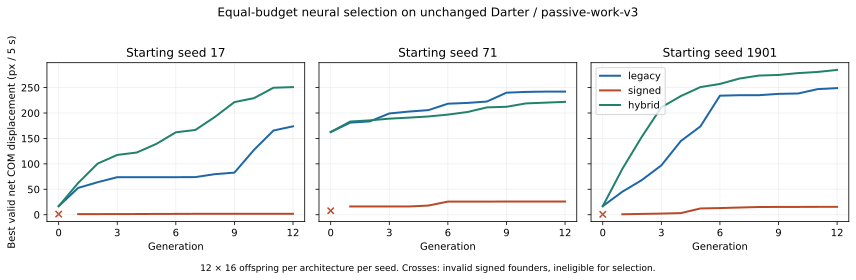

# Equal-budget neural locomotion selection v1 (#63)

**Completed bounded experiment; stop for owner review.** Draft PR #85 on
`experiment/locomotion-selection-63`, stacked on draft #72 at
`2ac6477298eff792c2c93f255cfb99285f64231a`. Neither PR is merged or deployed.
Production remains v0.37.0 / `passive-work-v3`; no runtime source changed here.

Legacy and retained-head hybrid readily improved fresh random policies on this
Darter. Signed-only policies were much weaker and less reliably valid. Every
hybrid champion remained **all legacy**: this experiment demonstrates no beneficial
transition to signed control and no causal advantage from the added head. Hybrid
beating legacy in two runs cannot establish architectural superiority: their
parameter spaces and mutation proposals differ, and there are only three seeds.

## Controlled protocol and reproducibility

The [registered protocol](neural-selection-v1-protocol.md) was published before
substantive coding (PR #85 seed commit `3225eea30349b725cf40391e5cb2ab91365803a8`).
Its budget and validity thresholds were fixed before the search. The runner did
not adapt them to results. This is offline artificial selection, **not a fitness
rule in VIDA's live ecosystem**.

All three architectures received exactly **12 generations × 16 offspring × 3
starting seeds × 5 seconds**: 576 offspring each, 1,728 total. Nine initial-parent,
54 paired initial/final held-out and 18 negative-control trials bring the total
to **1,809 evaluations**. All offspring in a generation descend from its frozen
parent. A valid strictly better net COM displacement replaces it; ties retain the
parent. Energy, late motion and direction do not influence selection. All nine
runs found a valid champion. There was no second search, ecology campaign,
controller tuning or physics/solver investigation.

Fresh dense 24-hidden networks rebuild **every IH/HH/HO weight and hidden/output
bias**. No trained Darter neural motor, sensory or recurrent weights survive.
Shared trunks and semantically corresponding output rows use paired streams
(seed 17, 71 or 1901). Weights are uniform ±1/sqrt(source fan-in), biases ±0.1;
tau is zero and masks empty. Legacy and all-legacy hybrid initial movement is
identical in all three seeds. This is a defined initialization comparison, not
an assertion that unlike controller semantics have equivalent random policies.

| Architecture | Outputs / joint | Mutable neural scalars | Proposals / generation |
| --- | ---: | ---: | --- |
| Legacy | 6 original | 2,172 | 16 neural |
| Signed | 3, independent signed torque | 2,022 | 16 neural |
| Hybrid | 6 original + 3 separate signed | 2,322 + 2 selectors | 14 neural + 2 selector-only |

Signed and hybrid use existing three-output gating and 0.06 hysteresis from #72.
No old weight is reinterpreted as torque. The hybrid starts all legacy. Proposals
0/1 flip only joint 0/1's inherited selector, in either direction. Every ordinary
neural proposal mutates eight uniformly sampled scalars (with replacement),
Gaussian sigma 0.15, weights bounded ±3.5, biases ±1.5. Indexed mutation seeds are
paired, but different scalar counts imply different targets and per-parameter
exposure. Hybrid routing spends 2/16 of its budget and has dormant signed rows;
strict elitism does not preserve neutral dormant-head mutations. These are
important accessibility limitations, not equivalent mutation distributions.

All trials use unchanged Darter anatomy, organs, joint limits, mass/inertia,
capacity, oscillator phases/frequencies/amplitudes, motorForce 2.8 and
motorFrequency 2.6; `passive-work-v3`, empty 4,800×3,000 world, gravity zero,
viscosity 0.18, seed 73 and heading 0.37. Retained nonneural oscillator/motor traits
are an architectural prior, **not freshly evolved gait parameters**. Each trial
starts at rest with a finite 50,000 J stock, explicitly funded once in the external
ledger (below existing reserve capacity). No replenishment, free motor work,
metabolism/mortality change or learned-state inheritance. The inherited learning
rate remains 0.016; every evaluation is born from the genome, with fresh somatic
state. Empty conditions supply no food/injury reinforcement. #78 is untouched.

The actual Vite-built authoritative Worker executes every meaningful trial
(asset and SHA in the [manifest](neural-selection-v1.json)). Neural cadence,
physical integration and guards are unchanged (60 Hz world / existing four
physical substeps). This study makes no timestep-robustness claim.

Validity requires full-duration alive singleton, positive reserve, no eggs/food/
boundary, finite state, zero speed guards and energy limiting, substep anchor
error <0.5 px, angular-limit excess <0.05 rad, accepted constraint gain <1e-12 J,
chemical error <1e-5 J, post-constraint/contact speed ≤20.001 rad/s, exact torque
delivery and prepaid debit =4×positive work within 1e-9 J. Failures remain in raw
results and cannot reproduce as elites. These screens reject demonstrated known
problems; they do not prove the absence of every numerical exploit.

## Selection results

Distances are net COM pixels at 5 s. Signed founders are **invalid**, so their
raw starting distances and changes are descriptive, not valid-baseline gains.
Each cell represents an independent run, not a specimen selected across seeds.

| Controller / seed | Initial px (valid?) | Final valid px | Change px | Valid offspring / 192 | Elite improvements |
| --- | ---: | ---: | ---: | ---: | ---: |
| Legacy / 17 | 16.78 (yes) | 173.85 | +157.07 | 192 | 9 |
| Legacy / 71 | 162.66 (yes) | 242.10 | +79.44 | 192 | 11 |
| Legacy / 1901 | 16.78 (yes) | 249.01 | +232.22 | 192 | 11 |
| Signed / 17 | 1.21 (no) | 1.81 | +0.60 raw | 97 | 12 |
| Signed / 71 | 7.82 (no) | 25.88 | +18.07 raw | 55 | 4 |
| Signed / 1901 | 0.66 (no) | 15.48 | +14.82 raw | 84 | 12 |
| Hybrid / 17 | 16.78 (yes) | 250.93 | +234.16 | 180 | 12 |
| Hybrid / 71 | 162.66 (yes) | 221.97 | +59.31 | 176 | 12 |
| Hybrid / 1901 | 16.78 (yes) | 284.80 | +268.02 | 178 | 12 |

Median final distances: **legacy 242.10; signed 15.48; hybrid 250.93 px**. The
median hybrid/legacy difference is only 3.65%; signed is 93.61% below legacy.
Legacy has 576/576 valid offspring; signed 236/576; hybrid 534/576. Different
initial quality is substantial (legacy seed71 already 162.66 px). All elites are
monotone under the registered validity/displacement rule, and every selected
mutation/genotype is preserved. No beneficial elite was lost or replaced by an
invalid faster candidate.

All **72 hybrid selector-only proposals** were tested: 30 valid, 42 invalid,
**zero beneficial, zero selected**. All 504 hybrid neural proposals were valid;
all hybrid validity failures came from selector flips. Thus both controller types
are explicitly reachable, but no improving one-step transition exists among the
sampled proposals from these selected parents. This does not test crossing a
neutral/deleterious valley, correlated head+selector changes or other body plans.
Dormant signed-head coadaptation is limited by strict elitism. The hybrid's
better runs evolved legacy policies via a different sparse-mutation sequence.

## Held-out behavior and motion attribution

Each initial and final genome is tested at seed811/heading−0.7/10s,
seed977/heading2.3/15s, seed2301/headingπ/2/15s. No held-out result enters training.
All are below unchanged 18 s maturity. Empty homogeneous water makes unseen seeds
weak novelty (mostly IDs/caustics); changed headings and longer time are the
substantive challenge, not a test of food seeking or ecology.

| Controller / seed | 10s px | 15s at 2.3 px | 15s at π/2 px | Valid held-outs / 3 |
| --- | ---: | ---: | ---: | ---: |
| Legacy / 17 | 140.87 | 43.16 | 36.84 | 3 |
| Legacy / 71 | 615.04 | 839.13 | 841.33 | 3 |
| Legacy / 1901 | 625.90 | 830.27 | 778.53 | 3 |
| Signed / 17 | 1.93 | 1.94 | 1.94 | 3 |
| Signed / 71 | 52.87 **invalid** | 75.33 | 90.01 **invalid** | 1 |
| Signed / 1901 | 19.88 | 21.03 | 21.03 | 3 |
| Hybrid / 17 | 681.14 | 1,122.15 | 1,121.56 | 3 |
| Hybrid / 71 | 567.82 | 757.78 | 760.62 | 3 |
| Hybrid / 1901 | 748.23 | 1,238.74 | 1,248.48 | 3 |

Legacy improves on its paired valid founder in 7/9 held-outs; hybrid 9/9.
Legacy17 loses net displacement versus its founder in both 15 s trials despite
ongoing motion: maximizing five-second travel can select a turning/returning
trajectory. Do not call every training gain robust straight swimming.

Signed17/1901 mostly push against joint stops; all three signed champions use
DIRECT mode for all 2,400 motor samples at 5 s (no discovered OFF/OSCILLATOR mode
sequence). Signed17 travels only ~0.008 px in the final third of either 15 s trial;
signed1901 ~1.30 px. Their early movement is largely a transient, not an effective
sustained stroke. Signed71 continues moving, but its limit error fails at 10 s,
and guards/limit/post-guard overspeed fail at the π/2 15 s heading. Invalid rows
are not successful generalization; signed founders themselves fail all held-out
validity screens, so valid-founder paired improvement is undefined.

Both joints remain independently actuated: per-joint torque and angle histories,
min/max angles and mode counts are archived, without imposing a common command.
Legacy/hybrid champion sampled interjoint-angle RMS differences span 0.667–0.800
rad. Signed1901's angles nearly coincide (RMS 0.00152 rad) while commanded torques
differ (RMS ~70,769 internal torque units): independent channels alone do not
produce a coordinated gait. No joint control capability was removed.

All nine passive controls have **zero work and zero displacement**. All nine
fluid-off final specimens move their COM <5.92e-12 px. The six legacy/hybrid dry
controls pass all screens. Three signed dry controls fail guards (and in two
cases limits/overspeed); those controls support only COM attribution and are
**excluded as valid stability evidence**. In water, valid legacy/hybrid champions
move hundreds of pixels with continued late motion and bounded joints. Fluid-on/
off evidence supports locomotion through the existing v3 resistance, not free
internal propulsion. It does not certify physically exact fluid dynamics or
eliminate unmeasured numerical effects.

## Work, chemical accounting, stability and cost

| Controller | Median positive work J | Median braking work J | Median motor debit J | Median total chemical J / 5s | Median 5s trial wall ms |
| --- | ---: | ---: | ---: | ---: | ---: |
| Legacy | 0.58693 | 0.33723 | 2.34771 | 131.39187 | 78.61 |
| Signed | 0.45878 | 0.01181 | 1.83512 | 130.87928 | 73.55 |
| Hybrid | 0.73561 | 0.40768 | 2.94244 | 131.98660 | 87.72 |

Work/energy are champion medians; timing is the median of the three within-run
training medians. Positive work is prepaid at existing 25% efficiency; braking
has no chemical credit. Maintenance is identically 129.04417 J/5s here because
existing brain/edge upkeep is capped at these 24-hidden counts. Thus the extra
head did not silently alter chemical rules, though this does not generalize to
all sizes/masks. Signed's low motor cost is **not** superior locomotion efficiency;
it travels far less and cost never influenced selection.

Across all 1,809 trials, maximum chemical discrepancy <9.83e-10 J, stock/work/
maintenance partition residual <9.78e-10 J, and accepted constraint gain
<1.39e-17 J. Minimum remaining stock >49,594 J; maximum age 15 s. No premature
biological death, depletion or energy limiting occurred. Every training champion
has zero guard events, zero post-guard overspeed and exact requested/delivered
motor torque. Valid training anchor peaks across all proposals are ≤0.202 px;
valid omega <18.471 rad/s. Known guard-ordering and joint-stop problems remain
visible in rejected rows and are not corrected or hidden here.

Rejection reason counts overlap: signed offspring 81 guard, 324 limit and 2
post-guard-overspeed failures; hybrid selector proposals 16 guard, 35 limit and
6 post-guard-overspeed failures. No safeguard, coefficient or capacity changed.

Wall timings include reset, snapshot validation, instrumented Worker execution
and IPC on one shared host, not kernel FPS. Architecture blocks were rotated by
seed; the within-run median ranged ~63.7–102.3 ms. Aggregate hybrid median is
~11.6% above legacy and signed ~6.4% below, but host/JIT noise and differing
behavior prevent treating these as precise architectural overhead. No browser
or live-ecosystem performance claim follows.

## Evidence, checks and limits

- [Manifest, budget, code/Worker/prior-report hashes](neural-selection-v1.json).
- [Summary with every generation, validity count, selector trial and energy/joint metric](neural-selection-v1-summary.json).
- Nine `neural-selection-v1-{legacy,signed,hybrid}-{17,71,1901}.json.gz` archives:
  every proposal's seed/scalar ledger/genotype hash, full selected genotype each
  generation, metrics, sampled COM/joint trajectories, held-outs and controls.
- [All initial genomes and nine final champions](neural-selection-v1-champions.json).
  Offspring full genotypes are exactly reconstructible from archived parent and
  mutation ledger/seed; the summary script verified all **1,728** hashes and every
  displacement-only elite decision. Sampled traces are 10-tick intervals, not a
  complete substep trace; guard/error peaks come from existing substep receipts.
- [Exact Worker replay/save continuation verification](neural-selection-v1-verification.json).
  Nine final specimens reproduced metrics, serialized trajectories and complete
  snapshots exactly; three additional 150+150 tick reset forks reproduced the
  300-tick final snapshots. These are verification replays, not new selection.
- [Finalization log](neural-selection-v1-finalization.json): the first integrity
  check found three stale `completed:false` archive markers. Changing ONLY that
  field reproduced the original runner manifest SHA for each archive exactly;
  no measured values, genotypes or original hashes changed. The replay checker
  initially compared an undefined optional mode property to its JSON-omitted
  representation; serialization-normalized comparison passes without changing
  the Worker or stored data. Neither issue invalidates physical trials.
- 308 fast tests +1 metadata test, typecheck, build and focused built-Worker
  randomized-head/trace-vs-quiet/funded-stock/host/fork/passive/prepayment checks
  passed locally. Existing runtime, old save paths and four protected #72 report
  hashes are unchanged; the Worker asset remains `simulation.worker-CpVcnMT-.js`.
  Browser tests are not required for offline-only scripts and were not run locally.
  Final CI outcomes are recorded in #63/#57/PR85, not inferred from local checks.

Reproduce from this branch with `npm ci`, `npm run build`,
`npm run experiment:neural-selection` (resumes matching completed archives, does
not rerun them), `node --import tsx scripts/summarize-neural-selection.mjs`, and
`node --import tsx scripts/verify-neural-selection.mjs`. A genuinely fresh search
requires a separate copy/output location preserving these archives. Do not delete
or overwrite the accepted prior experiment evidence or baselines.

## Recommendation and exact next action

Keep production legacy/v3 and both experimental PRs draft. This schedule supports
legacy semantics as the more accessible useful motor prior on Darter; it does
not resolve the general evolutionary value of signed control. Hybrid preserves
existing behavior and can evolve useful legacy locomotion, but its signed routing
has **not** been demonstrated useful. Do not promote it on its best specimen.

Stop here for owner review. If more discovery evidence is wanted, approve one
second **equal-budget, all-three** comparison changing only Gaussian mutation
sigma **0.15 → 0.30** (same seeds, 12×16×3×5s and validity gates), to test sensitivity
to sparse mutation magnitude. Do not launch it automatically. This cannot by
itself resolve dormant-head neutral valleys or generalization to other anatomies;
those remain separate design questions. No gain/physics/starter optimization,
#60 muscle model, #78 reinforcement redesign, merge, promotion, Wiki or deployment
is authorized by these results.
