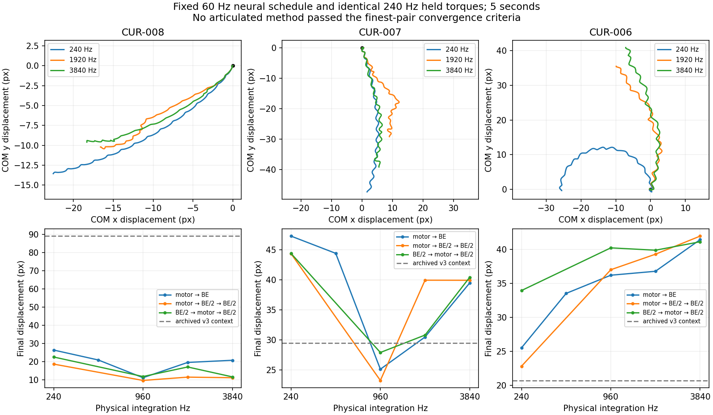

# Prism v4 integration diagnostic — #61 / draft #79

**Bounded diagnostic complete; no integrator correction or promotion selected.**
All nine body/method combinations fail the predeclared finest-pair convergence
gates at the 3840 Hz cap. Refinement changes motion materially, including new
post-contact overspeed. Numerical sensitivity is demonstrated; its dominant
articulated mechanism and a trustworthy continuous-time locomotion limit remain
unresolved. Passing local drag/energy tests does not resolve that failure.

Incremental branch `experiment/prism-resistance-v4`, parent
`68538604995532440c317e4c98bdc506615ec760`, target `testing`
`d7a68144b02225db37bb6a9583b057458ff47d52`. This supplements, and does not replace,
[the original v4 report](prism-resistance-v4.md). Old valid/excluded data and all
baseline bytes are unchanged. No full swim study, evolutionary search or ecological
campaign was repeated. Main v0.37.0 and testing T1.1 remain separate and unchanged. Public deployed
assets were read back: root `index-6HCxDzEn.js` labels 0.37.0; testing
`index-C91pGQj0.js` labels `TESTING · main v0.37.0 @ b2a05e5 · cycle 1 · iteration 1`.
Latest successful main Pages run is 39768008422 at 194d70d. These are deployed
build identities, distinct from this unmerged experiment's head.

## Controlled experiment and validity gates

Three frozen organisms: CUR-008 Hammerhead Pursuer (severe regression), CUR-007
Hooktail Scavenger (improvement), CUR-006 Broadwake Forager (angular guards/hinges).
Each uses the original seed 711, heading .37, legacy viscosity .18, five simulated
seconds, initial position/reserves/body/genome/brain state and empty environment.
The fixed v4 fluid ignores the legacy viscosity slider as before. No strength,
coefficient, biological cost, initializer, baseline, learning rule or safeguard
changes. Approved 1 mm/px, 7 mm depth, SI mass/work reference are untouched.

Capture native v4 once: 60 Hz neural outputs and final **bounded requested** torques
at the original 240 Hz servo clock, before funding. Replay those same torques as
piecewise constant demands over precisely the same 1/240 s intervals. Every
refined impulse is torque times its actual shorter dt. Held neural outputs provide
only the original local capacity/modulation inputs; they never overwrite brain
arrays, weights or learning state. The live RNN/learning still executes its
ordinary 60 Hz schedule; physical feedback cannot alter the externally held torque
sequence. This is an **open-loop numerical diagnostic**, not a newly evaluated
closed-loop controller or evolved adaptation.

Capture and 240 Hz replay each equal the ordinary built-Worker full snapshot,
including PRNG, exactly for all three bodies. Native travel, guard counts and
ordinary positive work equal the archived #79 data exactly. Refined alternate
ordering also has exact 150+150 versus 300 tick snapshot/reset continuation when
the same external tape and offset are explicitly resupplied. A normal save still
means the original v4 integration; no diagnostic configuration is hidden in schema
17. The paused, v4-only command rejects malformed/topologically incompatible,
nonfinite, over-capacity or mistimed tapes before advancing any requested tick.

Raw [results/60 Hz trajectories](prism-integration-v1.json), durable initial
snapshots and complete torque tapes:
[CUR-008](prism-integration-v1-CUR-008.json),
[CUR-007](prism-integration-v1-CUR-007.json),
[CUR-006](prism-integration-v1-CUR-006.json).
Input and protected baseline SHA256 hashes are recorded in the raw report.
The adapter resolves the Worker referenced by the built application, not a stale
asset. Actual Worker asset identities are retained separately for main/probe runs.

## Criteria, substeps and operator placement

Criteria were posted **before coding/results** in
[#61 comment 6352694234](https://github.com/smeagol44/vidAI/issues/61#issuecomment-6352694234).
Adjacent finest levels must satisfy every condition:

- Final COM-vector error <= max(.25 px, 1% fine displacement).
- 60 Hz COM trajectory RMS error <= max(.5 px, 1% fine path).
- Positive actuator work, braking work, endpoint fluid dissipation and guard-loss
  changes each <= max(1e-7 J, 1% fine magnitude).
- Peak anchor error <= .5 px and its change <= .01 px.
- Angular/linear guard and post-contact overspeed part-time exposure changes
  <= one percentage point; post-contact peak omega change <= .5 rad/s.
- Chemical ledger discrepancy <1e-6 J. Numerical BE loss reported separately.

Reproduction tools (explicit offline use only): `npm run experiment:integration`,
`npm run probe:integration`, `npm run audit:integration-control`; build first.
Optional figure regeneration: `python3 scripts/plot-integration.py` (matplotlib).
These diagnostics are not routine CI swim/search campaigns.

Native `motor-drag` runs at 240/480/960/1920 Hz. Two bounded order controls run at
240/960/1920 Hz. Only failure of the 960/1920 pair authorizes one 3840 Hz follow-up;
all nine failed and used that single capped follow-up. No further refinement.

| Method | Order at one physical substep |
| --- | --- |
| motor-drag | Prepaid motor/external impulse → full backward-Euler drag |
| motor-half-half | Prepaid impulse → BE(dt/2) → BE(dt/2) |
| half-motor-half | BE(dt/2) → prepaid impulse → BE(dt/2) |

The last two use **identical drag solve sizes/counts**, isolating their placement
at fixed physical dt. Both are first order; half-before/after BE is not a claim
of second-order Strang accuracy. All retain the original per-substep guards,
ten joint iterations, passive complete-batch acceptance, conditional pose repair,
position advance and contact/projection. Refining physics also refines those
operations' cadence. This is not a pure unconstrained ODE step-size test and does
not independently hold constraint/contact frequency fixed.

## Movement and convergence results

Native motor→drag displacement in pixels; archived v3 is historical context,
not a replay of the same v4 torque tape under a different law:

| Body | Archived v3 | 240 Hz | 480 Hz | 960 Hz | 1920 Hz | 3840 Hz |
| --- | ---: | ---: | ---: | ---: | ---: | ---: |
| CUR-008 | 88.995 | 26.304 | 20.831 | 11.084 | 19.496 | 20.684 |
| CUR-007 | 29.493 | 47.305 | 44.436 | 25.124 | 30.490 | 39.494 |
| CUR-006 | 20.711 | 25.515 | 33.530 | 36.208 | 36.787 | 41.448 |

Every 1920/3840 pair fails **both** final-vector and trajectory-RMS gates, and
positive/braking/fluid/guard work gates. Merely similar scalar travel can conceal
a different path: Hooktail's motor-half-half travel is 39.959 versus 39.944 px,
but its final COM vectors differ by 1.753 px and trajectory RMS by 2.720 px.

| Body | Method | 3840 Hz travel px | 1920/3840 final vector error px | Trajectory RMS px | Passed |
| --- | --- | ---: | ---: | ---: | --- |
| CUR-008 | motor-drag | 20.684 | 1.814 | 1.400 | No |
| CUR-008 | motor-half-half | 11.076 | 2.862 | 2.993 | No |
| CUR-008 | half-motor-half | 11.551 | 5.462 | 3.380 | No |
| CUR-007 | motor-drag | 39.494 | 10.536 | 6.920 | No |
| CUR-007 | motor-half-half | 39.944 | 1.753 | 2.720 | No |
| CUR-007 | half-motor-half | 40.442 | 17.755 | 8.438 | No |
| CUR-006 | motor-drag | 41.448 | 6.049 | 3.772 | No |
| CUR-006 | motor-half-half | 41.965 | 6.853 | 3.776 | No |
| CUR-006 | half-motor-half | 41.132 | 2.095 | 1.464 | No |

Changing **only placement** of matched half drag solves changes final COM vectors
at 240 Hz by 4.484 px (CUR-008), .050 px (CUR-007), 11.704 px (CUR-006).
At 3840 Hz these placement differences remain 3.449, 1.730, 2.027 px. This is
controlled evidence of ordering sensitivity in the articulated numerical system;
it is not evidence that the fluid law changed. The half-before scheme offers no
consistent improvement across bodies or a converged alternative to select.

Hammerhead remains far below its historical 88.995 px in every sampled method,
but **the nonconverged experiment cannot establish its continuum limit or exclude
numerical integration as a material cause of the regression**. Hooktail and
Broadwake likewise cannot be promoted on positive scalar travel changes.

## Energy, work and safeguards

Work is billed on the actual funded impulse path at each resolution, using the
unchanged v4 joule conversion and 25% efficiency. Braking is a separate positive
magnitude, does not finance other joints and never regenerates reserve. An earlier
fluid halfstep changes actual pre-impulse speed, so an honestly different work bill
is expected; a fixed charge per original tick would silently change the work rule.

All 1,708,800 replayed joint requests are delivered without energy limiting or
request/applied mismatch. Integrated absolute torque demand is unchanged within
1e-5 mechanical impulse units (accumulation roundoff). Every row reconciles motor
debit with 4× positive work and the mechanical ledger within 1e-12 J.
Max chemical discrepancy is 6.08e-10 J; max per-solve fluid balance residual
6.09e-15 J. Complete accepted joint-batch kinetic gain is <=5.43e-20 J.
These accounting checks do not establish physiological or fluid realism.

Native motor→drag rows, showing 240 → 3840 Hz:

| Body | Positive work J | Braking work J | Motor chemical J | Physical fluid J | BE numerical loss J | Constraint loss J |
| --- | ---: | ---: | ---: | ---: | ---: | ---: |
| CUR-008 | 0.00599628 → 0.00553922 | 0.00278028 → 0.00292301 | 0.0239851 → 0.0221569 | 0.00140355 → 0.00130685 | 1.27926e-05 → 7.21628e-07 | 0.000976766 → 0.000690863 |
| CUR-007 | 0.00701381 → 0.00692861 | 0.00247939 → 0.00297133 | 0.0280552 → 0.0277144 | 0.00289873 → 0.00313308 | 7.27128e-05 → 5.01369e-06 | 0.00133197 → 0.000523656 |
| CUR-006 | 0.0257772 → 0.0212287 | 0.00444031 → 0.0066268 | 0.103109 → 0.0849149 | 0.00575159 → 0.00539285 | 0.0001167 → 4.58018e-06 | 0.00590052 → 0.00348582 |

BE numerical loss decreases at every native refinement and is much smaller than
accepted constraint dissipation. That establishes the damping trend; it does not
prove constraint dissipation is erroneous or explain how a changed trajectory
redistributes pressure/actuation work. Constraint and contact receipts are gross
phase losses, not independent additions to the chemical ledger or a full
thermodynamic balance. Constraint pose repair can affect later dynamics without
an instantaneous kinetic-energy change.

| Body | Peak anchor px | Angular guard part-time | Post-contact peak rad/s | Post-contact overspeed part-time |
| --- | ---: | ---: | ---: | ---: |
| CUR-008 | 0.05164 → 0.00118 | 0.000% → 0.116% | 15.437 → 20.129 | 0.000% → 0.039% |
| CUR-007 | 0.05729 → 0.00375 | 0.000% → 0.081% | 14.461 → 19.871 | 0.000% → 0.000% |
| CUR-006 | 0.06500 → 0.00525 | 10.476% → 6.071% | 17.024 → 54.580 | 0.000% → 2.464% |

Guard exposure is weighted by dt and body-part count; raw event counts are retained
but are not comparable incidence rates when substeps differ. Linear exposure is
zero. Finer integration introduces post-contact overspeed in Hammerhead and much
larger peaks in Broadwake (up to **56.392 rad/s** across all rows), despite unchanged
20 rad/s pre-constraint clamps and passive aggregate joint batches. Large accepted
velocity corrections persist: Broadwake's native-method finest peak delta-v is
196.88 px/s and delta-omega 31.74 rad/s. Passivity is an aggregate energy property,
not an individual speed bound. The prior contact/constraint redistribution finding
is preserved and worsens under some refined paths; it is not fixed by smaller dt.

## Bounded mechanism checks

All nine capped failures justified one read-only follow-up, recorded in
[probe/timing data](prism-integration-probe-v1.json). The first **.5 seconds** of each
native body run at 240/1920/3840 Hz had zero limited joint batches, zero conditional
pose repairs and minimum acceptance scale 1. This excludes early passivity/repair
branch switching in that observed window; it does **not** exclude later switching,
contact onset or angular limits as explanations for five-second divergence.

The solver still has positional bias `.35*anchorError/dt`, angular limit bias
`.2*angleError/dt`, ten sequential joint iterations per substep and contacts after
clamping. Refinement changes their relaxation and event resolution per simulated
second. Peak early anchor-bias speeds decrease (CUR-008 3.216→.211 px/s;
CUR-007 4.449→.302; CUR-006 4.631→.636), while later accepted corrections/overspeed
can grow. A small anchor error therefore does not establish converged impulses.
These existing mechanisms are candidates for a narrowly targeted next audit;
this experiment does not isolate one as the dominant cause.

A separate free-prism constant-torque pure-spin control removes hinges, contacts,
pose repair and guards while retaining exactly the same resistance kernel.
Viscous-plus-quadratic spin has an analytic Riccati solution. All three splittings
approach that solution with approximately halving angular-velocity error per
doubling of Hz. Errors at 240→3840 Hz are .003642→.000227 rad/s (native),
.011544→.000723 (two post halves), .007879→.000496 (half-before/after).
[Isolated results](prism-integration-isolated-v1.json) include work, physical and
numerical losses. Per-solve energy residuals are <1e-14 J; whole-run residuals
(up to 1.14e-12 J) are bounded by accumulated actual solve residuals. The original
Newton tolerance remains unchanged. This confirms local first-order convergence
and that the rearranged BE scheme is not second order. It does not transfer that
convergence proof to a constrained/contacting organism.

## Cost, exclusions and verification

The main comparison's `runtimeMs` values overlapped a fast-test process and are
**excluded from performance inference only**. Deterministic numerical data remain
valid. A separate Worker process, after both completed, ran two reversed-order
120-tick timing rounds per body/config with identical receipt/trajectory overhead:

| Body | Native 240 Hz mean ms | Native 1920 / 240 | Two post halves 1920 / native 240 | Half-before/after 1920 / native 240 |
| --- | ---: | ---: | ---: | ---: |
| CUR-008 | 29.44 | 5.49× | 7.72× | 7.19× |
| CUR-007 | 23.03 | 5.14× | 7.30× | 7.83× |
| CUR-006 | 39.87 | 5.18× | 7.03× | 6.68× |

These short two-round instrumented timings demonstrate large additional cost;
they are not observation-free production throughput or browser FPS. The previously
measured **33–37% v4 slowdown versus v3** remains independent evidence, not replaced
by these ratios. No new ecological claim: the original nutrient/reproduction
regressions remain blockers and no ecological campaign was repeated.

Verification: 292 fast tests plus one testing-metadata test, typecheck/build,
legacy actual Worker, v4 actual Worker, new native capture/replay equality,
malformed-tape rejection and refined external-tape fork continuation pass locally.
The focused unit suite includes analytic isolated convergence and impulse-path
accounting. CI status and exact final SHA are recorded in #79/#61/#57. No manual
browser campaign: this change adds no UI/render path. Prior browser run
39846665038 was cancelled after Chromium 11/11; incomplete Firefox is still not a
passed result. Original missed-joule and stale-Worker excluded reports remain
excluded and preserved. No baseline hashes were refreshed.

## Interpretation and checkpoint

1. **Verified numerical findings:** materially step/order-sensitive articulated
   motion/work; all nine capped criteria fail; BE damping decreases; smaller
   anchor errors coexist with worse post-contact speeds. No new work/PRNG/save
   defect was demonstrated and no narrowly justified runtime correction selected.
2. **Constitutive differences:** the original v3/v4 resistance/reference treatment
   remains real. Within this diagnostic the constitutive law is identical, so its
   coefficients cannot cause the controlled ordering differences. The relative
   contribution of numerics versus that law to the old movement regression is
   still unquantified; there is no converged limiting swim to use for attribution.
3. **Physical uncertainties:** Cd, shear length, covered surfaces, omitted wakes,
   added mass and coupling remain provisional. Numerical convergence, had it been
   obtained, would not validate them. Do not fit coefficients to historical gaits.
4. **Behavior:** old evolved controllers experience another environment; these
   held-command replays cannot establish adaptive behavior or evolutionary
   discovery. No universal swimming or learning benefit is inferred.

#60 must not choose stress/lever/volume, capacity or energetic costs to repair a
nonconverged trajectory. The 204× mechanical-joule difference and empirical
chemical stocks are unchanged. Anatomy, efficiency, activation and braking costs
still require their own decisions. #59/#72 and audit #77 remain independent.
#78's inherited subjective positive/negative/zero contextual reinforcement remains
accepted, distinct from selection and future-food prediction; no universal
food-positive/injury-negative rule or learning-semantic change was introduced.

**Stop here.** Keep #61/#79 In progress, draft, unmerged and undeployed. Precise next
action: use the saved CUR-006 tape and existing 1920/3840 trajectories to localize
the first later contact/constraint overspeed/divergence event; inspect only that
short saved-state window with per-impulse effective masses, pre/post velocities
and projection/passivity data. Separate velocity-constraint, pose/contact and guard
ordering before proposing a versioned correction. Do not run another full search,
coefficient sweep, starter rescue, ecology campaign or uncapped Hz refinement.
