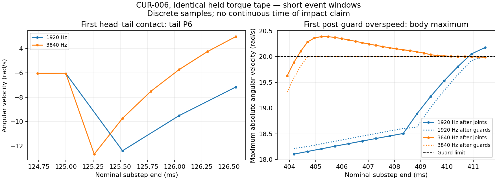

> **Superseded physical conclusion:** the preliminary algebra-only no-defect
> conclusion below missed unilateral angular-stop admissibility. All44 old active
> stop batches in the inspected overspeed window apply net outward reactions.
> See [the final defect/correction checkpoint](solver-stop-v1.md). Original raw
> localization and algebraic measurements remain valid and retained; no baseline
> was reset. `unilateral-stop-v1` is an explicitly selected diagnostic correction.

# CUR-006 first articulated event — #61 / draft #79 (2026-10-23)

**Conclusion: no specific invalid constraint/contact calculation was demonstrated
in the inspected windows. No physics correction was implemented. Stop this
bounded numerical investigation.** The observed impulse redistribution is
consistent with the existing algorithm; the guard placement and pose/contact
coupling remain approximations. Neither this conclusion nor passing identities
establishes that v4 is promotion-ready or physically validated.

This is an incremental diagnostic on `experiment/prism-resistance-v4`, draft #79
→ `testing` d7a68144b02225db37bb6a9583b057458ff47d52, parent
**d2826d7966a76564bf05d57e0cd2aeabb545bacf**. Exact published head/CI are recorded in
#61/#57. No merge, deployment, release, Wiki change or 3D modification.

## Bounded method

Scope and thresholds were posted before replay in
[#61 comment 6357228221](https://github.com/smeagol44/vidAI/issues/61#issuecomment-6357228221).
Use only the existing deterministic CUR-006 Broadwake snapshot and 240 Hz held
torque tape; native motor→full backward-Euler drag at **1920 and 3840 Hz**. No new
resolutions, coefficients, motor gains/capacity, neural weights, chemical rules,
starter initialization or learning semantics. The original 60 Hz neural schedule
and external held actuation remain. No convergence matrix, five-second swim study,
ecology campaign, evolutionary search or coefficient sweep was rerun.

Read the existing trajectories first: at saved 60 Hz samples, the COM-vector gap
first exceeds .25 px at .8 s. Therefore scan at most the **first one second** of
each resolution. Compare states at their shared 1920 Hz end timestamps; inspect
all finer halfsteps for first post-guard overspeed/contact. Before results:
meaningful COM gap .25 px; part-angle gap .05 rad; part-angular-speed gap .5 rad/s;
post-guard overspeed >20.001 rad/s, avoiding roundoff crossings.

| First shared-clock threshold | Time s | Gap |
| --- | ---: | ---: |
| Angular speed | 0.125520833 | 2.666545438 |
| Part angle | 0.309375000 | 0.050511725 |
| COM vector | 0.786979167 | 0.250083140 |

Both one-second prefixes equal the corresponding original archived trajectories
**exactly**. They are localization replays, not new locomotion comparisons.

Capture two short windows, each within a **single original 1/60 s tick**:

- First-contact/state-separation window: .124479167–.126562500 s (2.083 ms).
- Window spanning both first joint overspeeds: .403645833–.411458333 s (7.813 ms).

For each resolution export the world at the preceding tick boundary (.116666667
or .400000000 s), then run that tick with telemetry. Captured start/end snapshots,
all incoming/outgoing part poses/velocities, inverse masses/inertias, geometry,
constraint impulses/biases, provisional/accepted batches, contacts, corrections,
projection effects, guards, fluid losses and motor receipts are durable.
Observed/unobserved runs have **exact full snapshot/PRNG and work equality**;
localized continuation equals the first-second scan exactly.

Times identify the containing discrete substep and its nominal end, **not an
exact continuous time of impact**. The first post-guard overspeed is distinct from
a motor impulse temporarily exceeding the guard threshold before drag/clamping.

## First event: head–tail self-contact and changed solve cadence

Before first contact, at .125 s, the maximum part-angular-speed difference is only
**.012608 rad/s**. At the next common endpoint, .125520833 s, it is
**2.666545 rad/s**, on tail part P6. The COM gap remains .0003725 px; interpreting
only gross travel would miss this early articulated separation.

Both runs first detect head P0 against tail P6 in the interval starting .125 s,
but at different discrete endpoints. The fine step detects a shallow contact
before the coarse step's deeper contact:

| First detected contact | 1920 Hz | 3840 Hz |
| --- | ---: | ---: |
| Nominal end s | .125520833 | .125260417 |
| Penetration px | .031657112 | .002235330 |
| Normal approach speed px/s | -71.042330 | -73.145006 |
| Effective normal mass kg | .000336227 | .000349521 |
| Normal impulse N s | .0000238864 | .0000255657 |
| Pair kinetic change J | -8.48472e-7 | -9.35002e-7 |
| P6 omega before rad/s | -5.536573 | -5.805168 |
| P6 omega after first impulse rad/s | -12.321915 | -12.670393 |
| Explicit contact position correction | Active | Zero |

The existing correction is `min(3,max(0,depth-.02)*.6)/(imA+imB)`. The coarse
penetration exceeds its .02 px slop; the fine penetration does not. First coarse
pseudo-impulse magnitude is .00508674 in the solver's positional units; it moves
P0 +.0005388 px and P6 -.0053882 px in x, with the corresponding normal y changes.
It changes **no velocity**. Subsequent hinge projections repair pose and recalculate
contact geometry on the next pass.

The finer run also has another joint/contact solve inside the same common coarse
interval. In that second fine halfstep, P6 omega goes **-11.948974 → -4.312896** in
the joint batch, followed by contact/projection. At .125520833 its resulting omega
is **-9.725858**, versus coarse **-12.392403**. Thus the first large speed gap
localizes to contact onset and the different sequence/cadence of valid joint and
contact responses. These observations do not prove that contact timing alone
explains all later motion or that either resolution represents a continuum limit.



## First post-guard overspeed is a dissipative accepted joint batch

All incoming after-guard part speeds are within 20 rad/s at these events. The
complete joint batch is accepted at scale **1**, with no conditional pose repair:

| Resolution | Containing substep s | Part | After guard → after joints rad/s | Whole-body kinetic change J |
| --- | --- | --- | ---: | ---: |
| 1920 Hz | .410416667–.410937500 | P4 | +19.923856 → +20.052073 | -5.11339e-7 |
| 3840 Hz | .404166667–.404427083 | P5 | -19.788225 → -20.103479 | -4.57896e-7 |

At the fine event body kinetic energy drops **.000189342804 → .000188884908 J**.
The corresponding coarse event drops **.000182641832 → .000182130493 J**.
The active angular-limit bias on P6 is .03057896 rad/s (fine) or .02894774 rad/s
(coarse); the other inactive limit biases are not applied. Mass and inertia
contrast permits some small parts to accelerate while the body loses energy.

| Part | Mass kg | Planar inertia kg m² |
| --- | ---: | ---: |
| P0 | 0.00686 | 1.14847833e-06 |
| P4 | 0.003087 | 2.268945e-07 |
| P5 | 0.000686 | 1.40058333e-08 |
| P6 | 0.000686 | 1.40058333e-08 |

The actual order remains **prepaid motor/external impulse → implicit drag → speed
guards → joint velocity batch → optional pose repair → pose advance → contacts
and projections**. No guard runs again after joints/contacts within that substep.
The measured overspeed therefore exposes a guard-placement limitation rather
than demonstrating energy creation or a wrong effective mass. Later contacts can
further redistribute velocity, as the previous checkpoint already established.
No extra/lower clamp was added, and no overspeed was removed from reporting.

## Independent calculation and energy checks

The analysis imports **no simulation or solver functions**. It reconstructs the
spatial Jacobians from the recorded geometry and generalized velocities:

```
D = inverse body mass/inertia matrix
A = J D J^T
Delta velocity = D J^T lambda
Delta K = lambda^T J velocity + .5 lambda^T A lambda
```

For a frictionless inelastic normal contact with approaching normal speed `vn`,
`lambda=-vn/A`; expected kinetic loss is `.5*vn²/A`. Check contact normals/points
against both rectangles, mass/inertia against the fixed SI prism reference,
effective matrices, impulse residuals, resulting velocities, momentum and work.
For joint anchors reconstruct rotated faces and `.35*positionError/dt` bias;
for active angular limits check `.2*angleError/dt` and the scalar inverse inertia.
For the whole accepted batch check `s*linear+s²*quadratic`, the passivity scale and
every resulting generalized velocity. No claim that all biased joint iterations
must individually dissipate energy; the full accepted batch owns passivity.

Across the four captured windows:

- **3420 anchor impulses, 440 angular-limit impulses and 368 contact calls** pass
  the independent identities; some contact calls are separating and apply zero.
- Reconstructed impulse velocity changes agree to normalized error <=7.78e-16;
  effective-matrix error <=2.88e-16. No invalid mass, sign or update found.
- Maximum work/energy residual, including fluid solves: **2.17e-15 J**.
- No measured contact or accepted joint batch adds kinetic energy in these windows.
- Contact linear-momentum residual <=1.10e-19 kg m/s and angular-momentum residual
  <=8.48e-22 J s, using the common recorded contact point.
- All **414 projection batches** leave velocities and immediate kinetic energy
  exactly unchanged. Their COM shifts are <=6.44e-13 px.
- However pose projection changes angular momentum by up to **6.61e-10 J s per
  observed batch**. This is a real artifact of moving poses with fixed velocities;
  projection is not a physical impulse and does not guarantee angular momentum.
  It is an explicit existing stabilization limitation, not evidence that its
  scalar effective-mass calculation is wrong. Its contribution to long-time
  nonconvergence has not been isolated. No conservation claim is made for the
  complete articulated/projection algorithm. Split contact position correction
  also leaves kinetic energy unchanged but shifts angular momentum, up to
  **3.25e-10 J s per observed pair correction**.
- Actual tick-window motor debit, positive/braking work, guard loss and fluid
  dissipation remain exactly equal with telemetry disabled. No request mismatch
  or energy limiting; maximum chemical ledger discrepancy **8.01e-11 J**.
  Braking receives no regeneration/credit; impulse-path prepayment is unchanged.

Phase energy sums over the actual traced time windows (motor/chemical tick
receipts are separate, never billed from these passive phase losses):

| Window / Hz | Contact kinetic change J | Accepted joint change J | Existing guard loss J |
| --- | ---: | ---: | ---: |
| First contact / 1920 | -1.68038e-6 | -1.01165e-6 | 0 |
| First contact / 3840 | -2.28227e-6 | -1.60638e-6 | 0 |
| First overspeed / 1920 | -5.45849e-6 | -4.86967e-6 | 7.71195e-7 |
| First overspeed / 3840 | -3.14923e-6 | -3.78871e-6 | 1.81820e-5 |

The finer cadence can dissipate more through the unchanged guard; passing impulse
identities does not make that safeguard a physical fluid or muscle law.

Detailed per-call incoming/outgoing velocities, effective masses, impulses,
normal speeds, bias terms and phase energies are in the raw receipts/checks.
Projection is observed at batch level, including each contact's split positional
correction; this is not a proof of exact ideal constrained/contact dynamics.

### Checker exclusion, not a model correction

The first independent checker used a uniform 1e-10 tolerance for world-coordinate
anchor-bias reconstruction. Its regrouped subtraction differed by <=1.53e-10
px/s because ~1200 px coordinates are subtracted and multiplied by `.35/dt`.
This is below the derived floating-point bound
`4*EPSILON*sum(abs(coordinate terms))*.35*Hz`.
The corrected checker uses that coordinate-roundoff bound; velocity/work tests
remain strict. No simulation equation, Newton tolerance, gate or baseline was
changed. The initial checker report is labelled **excluded** and retained below.
Inactive cached angular-bias slots are canonically emitted as zero in new receipts
so unrelated previous worlds cannot affect diagnostic packets; dynamics already
ignore those inactive slots. Only the short windows were recaptured to verify
that receipt-only correction; the localization scan was not rerun.

## Classification and stopping decision

| Category | Verified conclusion |
| --- | --- |
| Invalid constraint/contact calculation | None demonstrated in inspected velocity/impulse identities. No versioned physics correction implemented. |
| Permissible redistribution / guard placement | Contact impulses conserve pair momentum and dissipate energy; accepted joints dissipate aggregate energy yet raise individual angular speeds above the earlier guard. |
| Contact timing / trajectory sensitivity | First major articulated speed separation coincides with P0–P6 contact. Finite-step detection depth crosses positional slop differently; finer steps insert extra joint/contact solves. Material sensitivity is real, not proof of arithmetic failure. |
| Insufficient evidence / approximation | Pose angular-momentum drift and incomplete simultaneous hinge/contact coupling remain limitations. Their share of five-second nonconvergence and the numerical/constitutive split are unquantified. |

**Further automatic numerical bug hunting is not justified by this result.**
Stop this investigation as requested. A different constraint/contact coupling or
guard contract would be a new solver-design scope, not a one-line correction
supported by these receipts. It requires an explicit requirement, versioned
proposal and appropriate gates; do not initiate it from this checkpoint.

The original v4 movement/ecology/performance promotion failures stand. Passing
local identities does not validate provisional fluid coefficients or anatomical
strength/cost assumptions. No changes were made to #59/#72, #60 or #78; #78's
accepted genetically evolvable subjective/contextual reinforcement is preserved,
and no learning code or semantics changed.

## Durable evidence and verification

- [Compact summary / protected SHA256 hashes](solver-event-summary-v1.json).
- [Full first-second scan, shared-clock states](solver-event-scan-v1.json.gz).
- [Short-window receipts and exact start/end snapshots](solver-event-windows-v1.json.gz).
- [Independent identity results, contact impulses and energy/momentum](solver-event-checks-v1.json).
- [Excluded initial coordinate-bias checker](solver-event-checks-v1-excluded-bias-association.json.gz).
- The original CUR-006 input/tape, original convergence reports/raw data and
  baselines remain byte-identical. Fifteen protected source/input files have
  hashes in the summary, including unchanged constitutive, funding, persistence
  and founder sources. No baseline refresh.

Read-only trace protocol is explicitly paused, single-organism v4-only, existing
held tape, native ordering, 1920/3840 Hz, at most 60 ticks, detail window <=4/60 s.
Bad bounds/methods/tapes reject before stepping. Receipts copy/freeze owned data;
no mutable world references, saved fields, PRNG changes or render coupling.

Local checks: **294 fast tests + one testing-metadata test**, typecheck/build,
legacy real Worker and prism real Worker pass. Focused tests exercise immutable
packets, invalid-request nonmutation and exact observed/unobserved Broadwake
state/work equality. Built-Worker checks cover the new trace through the actual
port. Exact four-window Worker comparisons also pass. No manual browser campaign;
new-head automatic CI and exact final SHA are recorded in #61/#57/#79. Prior
browser success at d2826d7 and prior cancelled run remain distinct evidence.

Reproduction is **not** a next experiment: `npm run audit:solver-event` only
re-analyzes saved receipts; `npm run trace:solver-event` explicitly rebuilds the
bounded prefix/window evidence after `npm run build`. Optional figure generation:
`python3 scripts/plot-solver-event.py` (matplotlib). Do not run the old convergence,
swim, ecology or evolutionary campaign for this checkpoint.

**Next action:** review this stopped checkpoint and retain #79 draft/unmerged,
#61/#79 In progress, production v0.37.0/main194d70d and testing T1.1/d7a6814 unchanged.
Do not automatically start another numerical study or solver implementation.
