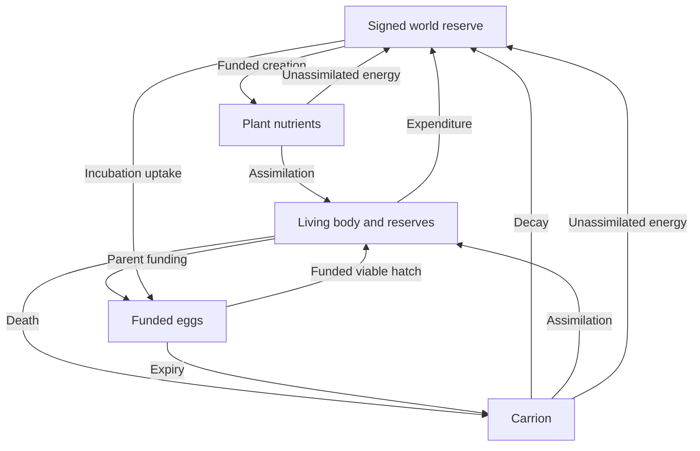
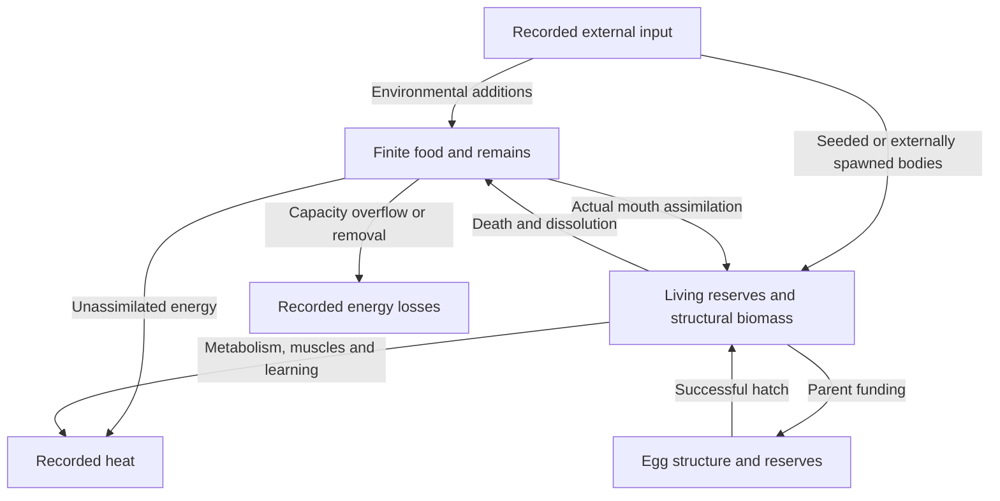
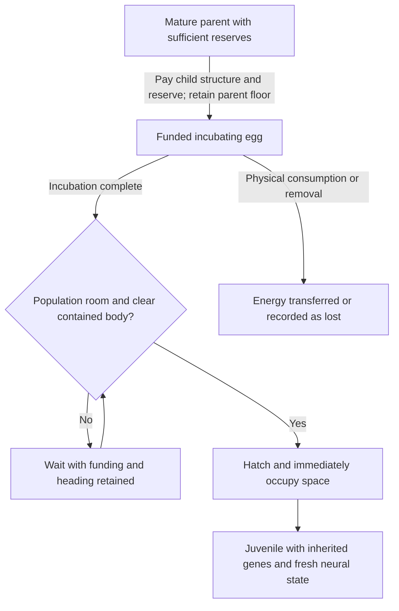

# Ecology and Energy Auditing

Physical feeding, finite reserves, funded eggs, hatching and death exist.
Reliable unassisted food acquisition and self-sustaining populations across
generations remain open outcomes. Startup survival alone does not show viability.

## Closed world budget

New application worlds use a finite recycled ecological energy budget. Its
initial value is the actual seeded body, reserve and food energy; initialization
adds no spendable historical heat. The invariant is **living biomass + living
reserves + food + carrion + funded eggs + signed world reserve = world budget**.
This is an ecological stock ledger, not proof of solver mechanical conservation.

- Maximum nutrients defaults to Unlimited. A finite cap gates creation without
  deleting food. Total world energy is separate: increases credit the reserve;
  decreases debit it and may create withdrawal debt.
- A new nutrient costs 3,000 J from the reserve. Recycling has a bounded rate
  (15 particles/s initially), never unconditional external input. Feed and Feed
  All spend the same pool; adding life funds both body and founder reserves.
- Unassimilated food, actual metabolism, learning and motor expenditure return
  once to the reserve. Clear Free Nutrients also returns their remaining value.
  Cumulative heat/loss counters are diagnostics and are excluded from live stocks.
- Negative reserve blocks nutrient creation and hatching. Returned expenditure
  and carrion decomposition repay debt; surplus beyond zero remains available.
  A funded egg can hatch at zero reserve. Debt is a signed budget adjustment,
  not negative physical energy.
- Debt repayment requires a return flow. Plant nutrients do not decay; an
  extinct world containing only nutrients can remain in debt indefinitely.
  Clear Free Nutrients returns their energy to the reserve, or the player can
  raise the budget. Persistent debt after extinction is accepted; no abiotic
  nutrient decay is planned. Manual life still requires available reserve.
- Carrion decays into the reserve regardless of the nutrient cap; funded food
  conversion then uses that reserve. Extinct worlds keep recycling until paused.
- The computational food limit is 2,200 particles. At that limit, remains merge
  into existing carrion, or use one extra carrion slot if all particles are plants;
  merging restarts that carrion timer. All energy is retained. Unspent energy
  stays banked; Unlimited is an ecological setting, not unlimited computation.

Saved open-economy worlds retain their exact replenishment and lifecycle rules.
**Convert this world to a closed energy budget** explicitly uses current stores
with zero initial reserve, preserving physics, creatures, PRNG and memory. It
never reclaims historical heat/loss counters. There is no implicit conversion
on import; reset creates a new closed-economy world.

### Closed energy transfers

## Food and energy transfers

| Mechanism | Current rule |
| --- | --- |
| Diet | Herbivore mouths eat plant nutrients; carnivore mouths eat animal food; omnivore mouths eat both |
| Gross mouth rate | 3,600 J/s per specialist mouth; 1,800 J/s per omnivore mouth, shared across contacted sources |
| Assimilation | 80%; carrion also applies the 85% digestion factor, giving 68% combined assimilation |
| Storage | Removal stops at the creature's available capacity |
| Remains | One edible circle containing remaining body and reserve energy; closed worlds aggregate at capacity without loss; open saved worlds record overflow |
| Decomposition | Closed worlds return carrion energy to the reserve; open saved worlds convert to plant food when a slot is available |

Mouth permissions apply per mouth, including on creatures with different
specialist mouths. Feeding requires physical contact; no steering or survival
bonus is supplied. Pigment is independent of diet. Kin protection can restrict
living-relative/related-egg feeding; carrion carries no kin protection.

### Physical mouth aperture

New worlds use a **rounded capsule**: the inherited `intakeWidth` span (half-span
at least the contact radius), thickened by 4.5 px for carnivores, 4 px for omnivores
or 3.5 px for herbivores. Prey rectangles, nutrient circles and eggs all use that
full aperture. Endpoint grazing, containment and rotated prey count only on
physical overlap; tank body contacts still resolve before feeding. No steering,
automatic feeding, new reach outside this capsule or increased transfer rate is
provided. A narrow-host mouth can overhang its face; inherited widths are not
silently clamped or resized.

The tank aperture overlay shows that actual capsule at physical size. Bank
previews show the inherited span and radius. Mouth icons and bite animation are
cosmetic and do not change contact. Older saved worlds keep their original prey
shape (span line plus central disk) until **Update mouth contact geometry** is
chosen in settings. That authoritative upgrade retains the entire ecosystem,
energy, random state, genes, brain, physics and economy; reset uses current contact.
The same correction applies to carnivore and omnivore prey contact; diet balance
and broader biological mouth sizing remain separate design work.

## Chemical energy transfers

This retained diagram describes the open-economy saved-world rules. Closed
worlds use the reserve flow above. Neither diagram certifies mechanical work
conservation.

## Funded eggs and lifecycle

Egg funding transfers the child's structural cost plus
`eggReserveFraction * 10,000 J` from the parent. Default reserve fraction 0.35
funds 3,500 J. Parents retain at least 12% of storage capacity or 2,000 J,
whichever is larger. Higher reserves trade later reproduction for better-funded
hatchlings. Existing funded eggs are not rebalanced during import.

The old `reproductionThreshold` field is retired compatibility data: it never
added a reserve-ratio gate to eligibility or laying. Paid-work offspring
keep its stored value without mutating it; legacy worlds retain their exact old
mutation draws/behavior. This does not add a parental reserve-ratio eligibility gate.
Maturity, cooldown, clutch size, child funding and retained-parent reserves
remain the actual biological rules, shared by the inspector and kernel.

Closed worlds count **living creatures plus unhatched eggs** against the
population setting. Laying reserves a slot; clutches fill only available slots.
Hatching replaces that slot even if the player subsequently lowers the cap.
Parents can lay during world debt if they can pay and a slot exists.

Each closed-world egg has a saved hatch-reserve target: its parent-paid reserve
plus 10%, capped by inherited reserve capacity. Uptake transfers world energy
at up to 10% of that target per incubation duration. Eggs share available uptake
funds proportionally to their current demands; nutrient conversion precedes
uptake. Uptake repairs missing structural funding first, then fills reserves.
No uptake borrows into world debt. Intact eggs need the additional funding;
partly eaten eggs can recover or fail to reach the total body-plus-reserve target.
This is abstract incubation energy, not local temperature simulation.

Hatching needs completed incubation, funded body and target reserves, no world
debt and a contained clear body envelope. Eggs expire at three incubation
durations of simulation age, including time blocked by debt or physical space.
Expiry wins at the deadline and transfers all remaining funding to edible
carrion. Open-economy eggs retain their original rules and can wait indefinitely.
On explicit conversion, known incubation progress determines age (a ready egg
gets two incubation durations of grace); the new reserve target is based on its
remaining funded reserve. No unknown past waiting or uptake is invented.

The inspector reports the actual kernel blocker, target and expiry countdown.
Ready eggs retain their chosen heading while blocked. Each successful hatch
immediately blocks later overlapping hatches. Laying is not a hatched birth.

Death, dissolution and lifespan limits are implemented. Juvenile/adult/aging
labels do not imply physical growth, local tissue healing or gradual senescence;
those systems remain unimplemented.

## Egg lifecycle

The retained lifecycle diagram describes open-economy saves. In closed worlds,
population slots are reserved before laying; debt, reserve funding and physical
space can delay hatching only until expiry. A hatchling still needs to survive
and acquire energy before reproducing.

## Environmental food

New application worlds seed **275 plant nutrients**, with Uniform distribution.
The seeded stores set their initial finite budget; subsequent plant count is
controlled by funded recycling and the independent Unlimited-by-default cap.
Optional Blooms place 65% of environmental additions near twelve seed-derived
sites and 35% dispersed. Sites are abiotic; they do not follow creatures.

Both distributions retain funding, energy per particle and capacity rules.
Only open-economy saved worlds use external replenishment.
Feed bursts use their explicit placement. Switching modes does not move existing
food or grant new particles. Old snapshots without the pattern use Uniform.
Some diagnostic scenarios explicitly use 400 nutrients; that is a test condition,
not the application default.

## Read-only measurements

`ecologyAudit.ts` and `ecologyBaseline.ts` measure actual intake, reserves,
laid eggs, hatched/seeded births, death causes and chemical energy balance.
The closed ledger compares live stores plus signed reserve against the budget.
Open saved worlds compare stores, cumulative heat and recorded losses against
external inflow. The historically named motor-heat
bucket includes chemical energy allocated to work and inefficiency, excluding
kinetic energy as a stored ledger term. This does not certify full
mechanical-energy conservation; see [Movement](Motor-Control).

Intake observers sample each completed tick and count only increments of
coalesced feeding receipts. At most eight recent receipts per organism means
very dense within-tick activity can undercount; this is not a complete event
archive. Census or diagnostic results never become brain inputs or rewards.

The featured acquisition survey separates physical ray intersections,
spectrally detected edible stimuli, mouth-to-food gaps, oral contact and
absorbed joules. It also reports reserve change and first-egg shortfall.
Predator free-food proximity covers carrion, while prey/egg sightings are
reported separately. Sight or contact alone is not counted as successful intake.

`npm run benchmark:ecology` runs bounded free-roaming and controlled comparisons.
Some scenarios deliberately pre-fund mature parents or deplete reserves to
check mechanisms; those initial conditions are not evidence of naturally earned
reproduction or representative mortality. Detailed results belong in
[project status](https://github.com/smeagol44/vidAI/blob/main/docs/PROJECT_STATUS.md).
