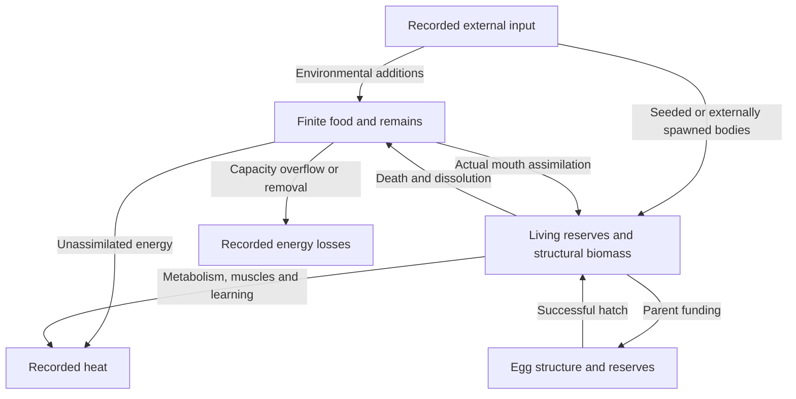
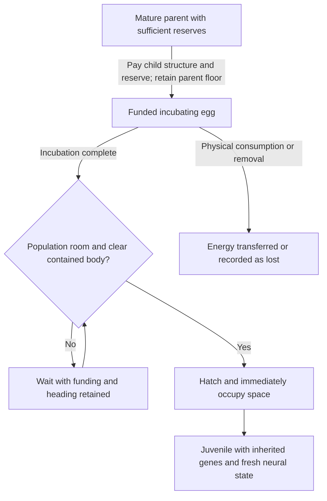

# Ecology and Energy Auditing

Physical feeding, finite reserves, funded eggs, hatching and death exist.
Reliable unassisted food acquisition and self-sustaining populations across
generations remain open outcomes. Startup survival alone does not show viability.

## Food and energy transfers

| Mechanism | Current rule |
| --- | --- |
| Diet | Herbivore mouths eat plant nutrients; carnivore mouths eat animal food; omnivore mouths eat both |
| Gross mouth rate | 3,600 J/s per specialist mouth; 1,800 J/s per omnivore mouth, shared across contacted sources |
| Assimilation | 80%; carrion also applies the 85% digestion factor, giving 68% combined assimilation |
| Storage | Removal stops at the creature's available capacity |
| Remains | One edible circle per newly dissolved organism, holding remaining reserve and biomass energy when particle capacity permits; removed overflow energy is recorded |
| Decomposition | Carrion becomes a plant nutrient after its decay period when a plant-food slot is available, without adding energy |

Mouth permissions apply per mouth, including on creatures with different
specialist mouths. Feeding requires physical contact; no steering or survival
bonus is supplied. Pigment is independent of diet. Kin protection can restrict
living-relative/related-egg feeding; carrion carries no kin protection.

## Chemical energy transfers

This sketches transfers between chemical-energy stores. It is not a diagram
of mechanical work conservation. Other removals are also ledgered; remains
mineralization changes food type without creating energy.

## Funded eggs and lifecycle

Egg funding transfers the child's structural cost plus
`eggReserveFraction * 10,000 J` from the parent. Default reserve fraction 0.35
funds 3,500 J. Parents retain at least 12% of storage capacity or 2,000 J,
whichever is larger. Higher reserves trade later reproduction for better-funded
hatchlings. Existing funded eggs are not rebalanced during import.

The old `reproductionThreshold` field is retired compatibility data: it never
added a reserve-ratio gate to eligibility or laying. Paid-work offspring
keep its stored value without mutating it; legacy worlds retain their exact old
mutation draws/behavior. No replacement threshold or funding rebalance is added.
Maturity, cooldown, clutch size, child funding and retained-parent reserves
remain the actual biological rules, shared by the inspector and kernel.

The egg inspector reports funding, incubation and actual population/space/tank
blockers. Ready eggs wait for a contained, clear whole-body envelope and retain
their heading/funding while blocked. Each successful hatch immediately blocks
later overlapping hatches. An egg laid is not yet a hatched birth or an adult.

Death, dissolution and lifespan limits are implemented. Juvenile/adult/aging
labels do not imply physical growth, local tissue healing or gradual senescence;
those systems remain unimplemented.

## Egg lifecycle

The cycle is conditional: a laid egg can be eaten or remain blocked, and a
hatchling still has to survive and acquire energy before reproducing.

## Environmental food

New worlds default to **275 plant nutrients**, with Uniform distribution.
Optional Blooms place 65% of environmental additions near twelve seed-derived
sites and 35% dispersed. Sites are abiotic; they do not follow creatures.

Both modes retain food caps, energy per particle and external-inflow accounting.
Feed bursts use their explicit placement. Switching modes does not move existing
food or grant new particles. Old snapshots without the pattern use Uniform.
Some diagnostic scenarios explicitly use 400 nutrients; that is a test condition,
not the application default.

## Read-only measurements

`ecologyAudit.ts` and `ecologyBaseline.ts` measure actual intake, reserves,
laid eggs, hatched/seeded births, death causes and chemical energy balance.
The ledger accounts for reserves, structural biomass, funded eggs, food, heat
and recorded losses against external inflow. The historically named motor-heat
bucket includes chemical energy allocated to work and inefficiency, excluding
kinetic energy as a stored ledger term. This does not certify full
mechanical-energy conservation; see [Movement](Motor-Control).

Intake observers sample each completed tick and count only increments of
coalesced feeding receipts. At most eight recent receipts per organism means
very dense within-tick activity can undercount; this is not a complete event
archive. Census or diagnostic results never become brain inputs or rewards.

The featured acquisition survey separates physical ray intersections,
spectrally detected edible stimuli, mouth-to-food gaps, oral contact and
absorbed joules. It also reports reserve change and first-egg shortfall.
Predator free-food proximity covers carrion, while prey/egg sightings are
reported separately. Sight or contact alone is not counted as successful intake.

`npm run benchmark:ecology` runs bounded free-roaming and controlled comparisons.
Some scenarios deliberately pre-fund mature parents or deplete reserves to
check mechanisms; those initial conditions are not evidence of naturally earned
reproduction or representative mortality. Detailed results belong in
[project status](https://github.com/smeagol44/vidAI/blob/main/docs/PROJECT_STATUS.md).
