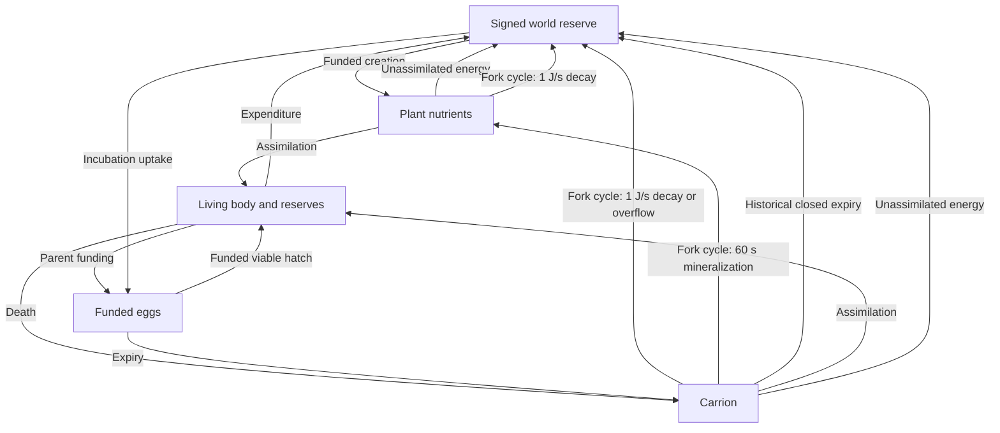
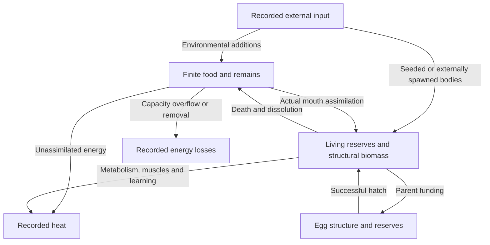
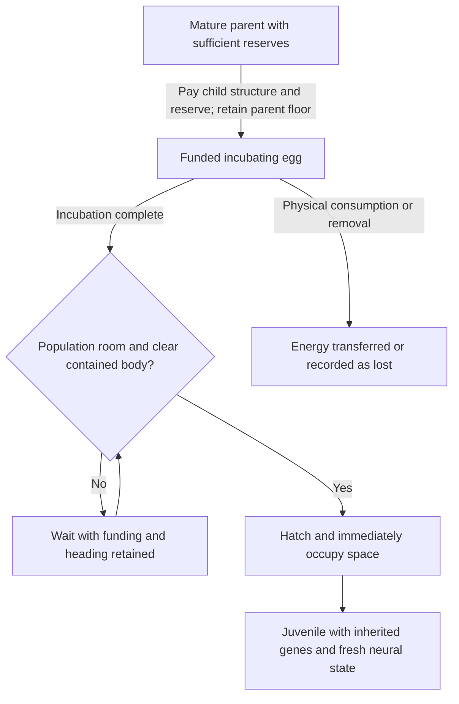

# Ecology and Energy Auditing

Physical feeding, finite reserves, funded eggs, hatching and death exist.
Reliable unassisted food acquisition and self-sustaining populations across
generations remain open outcomes. Startup survival alone does not show viability.

## Initial environmental scenarios

The start-menu Environment dropdown offers world-icon **Default** (preselected)
mountain-icon **Harsh World**, and green-pipe **Pipe World**, independently of founder population/brain mode.
Default retains configured initialization. Harsh starts a 4800 × 3000 px tank,
20 px/s² gravity, viscosity 0.40, a combined creature/egg cap of 50 and 1 nutrient/s
recycling with a finite 200-nutrient cap. Initial population stays preset-dependent
(normally 18). All other settings use configured defaults.

Harsh has **zero free nutrients before the first tick**. The normal initial
nutrient grant is returned to the existing reserve using Clear Free Nutrients
during creation, retaining the same global budget as Default for the same
seed/population (currently 825,000 J of food energy banked). Recycling and all
feeding, egg and energy rules remain unchanged; extinction remains valid.
Controls remain editable. Imports keep exact saved conditions and never reapply
a scenario. Returning to the start menu can select a fresh Default; existing
in-world reseed controls keep their current-settings semantics. No custom profiles
or fractional-rate control is included.

### Pipe World

The third Environment
option is **Pipe World**, with an original pixel-style green angled-pipe icon
beside the selected option. Default and Harsh keep their existing labels/icons.
Pipe has its own frozen, explicit startup settings; it does not inherit Harsh
or configured application defaults at runtime.

| Setting | Pipe World initial value |
| --- | --- |
| Tank dimensions | 4600 × 2100 world units |
| Gravity / water viscosity | 20 / 0.40 |
| Nutrient recycling / ecological cap | 1 particle/s / 200 particles |
| Initial nutrient grant / pattern | 275 × 3000 J / uniform, then banked |
| Initial free nutrients / eggs | 0 / 0 |
| Initial organisms | Existing selected founder preset (normally 18; Megafauna 12; showcase 9), with independent balanced/unbiased mode |
| Combined living-creature + egg cap | 50; existing separate 75-egg safeguard unchanged |
| Kinship protection / mutation severity | true / 0.25 |
| Physics / ecology / mouth contact | passive-work-v3 / closed-v1 / capsule-v1 |
| Nutrient cycle | decay-v2 (1 J/s per food particle) |
| Automatic selection / tracking | Both off; editable observer preferences |
| Initial calls / openings / tubes | None |

These values were copied once from the current fork Harsh reference, except
for dimensions. Food banking preserves the same global initial grant for the
same seed/population; 825,000 J of food energy is in reserve at time zero.
The dimensions already fit existing width 800–4800 and height 600–3000 limits.
Manual local window/tube operations remain available. No remote topology or
automatic connection is created. Saving uses the existing schema 19 and exact
Worker export; imports restore persisted settings/state without consulting any
starting preset. Selecting Pipe in the menu only takes effect when seeding.

## Continuous food recycling

New closed application worlds explicitly select `nutrientCycle: decay-v2` and export
schema 19. Both plant nutrients and carrion lose **1 J per simulated second**,
also while partly eaten, outside the camera or inside a connected tube. Loss is
capped at remaining energy and returned once to the signed universe reserve.
Zero-energy food is removed. Thus an untouched 3,000 J particle lasts 3,000 simulated seconds (50 minutes).
Feeding rates and efficiencies remain unchanged; natural decay is additional.

Below 3,000 J, physical radius is `18 * sqrt(remainingJ / 3000)` with a 6-unit minimum physical radius (the historical minimum was 8).
Larger food retains its established logarithmic radius. Vision, food contact and
rendering use that physical radius; the existing glow and outline shrink with
it. No new visual effect or organism-only information is added.

Carrion still has a 60-second timer. Decay runs first; at expiry only remaining
energy becomes nearby ordinary plant particles, each at most 3,000 J. A local,
deterministically rotated grid keeps fragment centers distinct, even beside
walls or channel corners; it preserves the source velocity and adds no force.
Fully depleted carrion produces nothing. No living organism is needed.

Mineralization obeys `targetNutrients`, any finite `nutrientLimit`, and the 2,200
food-particle safeguard. It removes expired remains even with no available slot
and banks energy that cannot be materialized. It never creates a giant fallback
or loops over the unbounded theoretical fragment count. Ordinary closed-world
recycling still uses its existing reserve/rate/count rules: `targetNutrients`
sets initial abundance and additionally bounds mineralization, whereas the
independent closed nutrient cap bounds ordinary subsequent generation. Default
retains 15/s and Unlimited; Harsh World retains 1/s and its 200-particle cap.
Smaller particles can therefore raise particle counts without increasing stock.

Historical imports omit the cycle and retain their exact food lifetimes,
minimum radii, PRNG and mineralization rules. Import, export, fork, physics repair
and open-to-closed budget conversion do not silently enable the cycle. A fresh
start/reset selects it. Settings offers an explicit update to 1 J/s for saved
closed worlds, keeping their present energy/PRNG/organisms and recomputing only
food radii. Saved decay-v1/schema18 keeps its original 30 J/s and shrinking below
6 until explicitly updated. Schema 19 requires
a closed pool and the known cycle, supports existing independent physics/contact
modes and optional tube topology; older schemas reject the new flag. Worker
control packets reject cycle changes; an upgrade uses an authoritative reset. Snapshots remain authoritative.

The closed transfer diagram below includes the versioned food cycle. Historical
closed worlds without a cycle send expired carrion directly to the reserve and
never decay plants until explicitly upgraded.

## Closed world budget

New application worlds use a finite recycled ecological energy budget. Its
initial value is the actual seeded body, reserve and food energy; initialization
adds no spendable historical heat. The invariant is **living biomass + living
reserves + food + carrion + funded eggs + signed world reserve = world budget**.
This is an ecological stock ledger, not proof of solver mechanical conservation.

- Maximum nutrients defaults to Unlimited. A finite cap gates creation without
  deleting food. Total world energy is separate: increases credit the reserve;
  decreases debit it and may create withdrawal debt.
- A new nutrient costs 3,000 J from the reserve. Recycling has a bounded rate
  (15 particles/s initially), never unconditional external input. Feed and Feed
  All spend the same pool; adding life funds both body and founder reserves.
- Unassimilated food, actual metabolism, learning and motor expenditure return
  once to the reserve. Clear Free Nutrients also returns their remaining value.
  Cumulative heat/loss counters are diagnostics and are excluded from live stocks.
- Negative reserve blocks nutrient creation and hatching. Returned expenditure
  and carrion decomposition repay debt; surplus beyond zero remains available.
  A funded egg can hatch at zero reserve. Debt is a signed budget adjustment,
  not negative physical energy.
- Debt repayment requires a return flow. New fork cycle worlds return natural
  food decay to reserve, including after extinction. Historical worlds without
  the cycle keep plants indefinitely and can retain debt; Clear Free Nutrients
  or a budget increase remains available. Manual life still needs reserve.
- New fork cycle worlds mineralize expired carrion as described above; historical
  closed worlds return it directly to reserve. Extinct worlds keep recycling
  until paused; neither mode guarantees survival or automatic repopulation.
- The computational food limit is 2,200 particles. At that limit, remains merge
  into existing carrion, or use one extra carrion slot if all particles are plants;
  merging restarts that carrion timer. All energy is retained. Unspent energy
  stays banked; Unlimited is an ecological setting, not unlimited computation.

Saved open-economy worlds retain their exact replenishment and lifecycle rules.
**Convert this world to a closed energy budget** explicitly uses current stores
with zero initial reserve, preserving physics, creatures, PRNG and memory. It
never reclaims historical heat/loss counters. There is no implicit conversion
on import; reset creates a new closed-economy world.

### Closed energy transfers

## Food and energy transfers

| Mechanism | Current rule |
| --- | --- |
| Diet | Herbivore mouths eat plant nutrients; carnivore mouths eat animal food; omnivore mouths eat both |
| Gross mouth rate | 3,600 J/s per specialist mouth; 1,800 J/s per omnivore mouth, shared across contacted sources |
| Assimilation | 80%; carrion also applies the 85% digestion factor, giving 68% combined assimilation |
| Storage | Removal stops at the creature's available capacity |
| Remains | One edible circle containing remaining body and reserve energy; closed worlds aggregate at capacity without loss; open saved worlds record overflow |
| Decomposition | New fork cycle: 1 J/s food decay plus bounded 60 s carrion mineralization; historical closed worlds return carrion to reserve; historical open worlds convert when a slot is available |

Mouth permissions apply per mouth, including on creatures with different
specialist mouths. Feeding requires physical contact; no steering or survival
bonus is supplied. Pigment is independent of diet. Kin protection can restrict
living-relative/related-egg feeding; carrion carries no kin protection.

### Physical mouth aperture

Current mouths extend from their anatomical anchor along the outward face
normal. Their inherited `intakeLength` sets the forward centerline reach;
`intakeWidth` stores the fixed diameter: 7 px for herbivores, 8 px for omnivores
and 9 px for carnivores. Reach is at least that diameter. New worlds use the
resulting **rounded capsule** for prey rectangles, nutrient circles and eggs.
Endpoint grazing, containment and rotated prey count only on physical overlap;
tank body contacts still resolve before feeding. Transfer rates and diet
permissions are unchanged, and no steering or survival subsidy is supplied.

The tank overlay and Bank previews show that physical capsule. Mouth icons and
bite animation are cosmetic. Loading an older creature automatically sets
`intakeLength = max(diet diameter, old intakeWidth)` and replaces `intakeWidth`
with the fixed diameter. This applies to living creatures, eggs, lineage and
saved Bank specimens. The input file is untouched; later saves use the converted
format. IDs, learned state and energy are retained, but future mouth contacts
use the converted forward geometry, so historical feeding is not guaranteed
identical. This automatic mouth migration is accepted by the owner.

The independently saved prey-contact model remains explicit: historical worlds
retain their line-plus-disk contact test until **Update mouth contact geometry**
is chosen. That authoritative action changes the contact model, retaining the
ecosystem, energy, random state, brain, physics and economy. Reset uses current
capsule contact. Diet balance remains separate design work.

## Chemical energy transfers

This retained diagram describes the open-economy saved-world rules. Closed
worlds use the reserve flow above. Neither diagram certifies mechanical work
conservation.

## Egg reserve observation

The egg's white interior
shows remaining original usable reserve. A pink sector grows counterclockwise from
12 o'clock as reserve is lost: 25% loss gives 25% pink. Exhausted reserve stays
fully pink through subsequent structural damage. Existing uptake can shrink the
sector; reserves above the original reference remain fully white. The outer
incubation ring still advances clockwise; glow and selection remain decorative.

This is not a hatch-readiness or viability indicator. It adds no incubation cost,
energy recovery, hatch rule or forced conversion to carrion. Organisms still see
the same white egg (`EGG_RGB`), without any display sector or ring information.

The reference is stored at laying, independently of the parent and offspring
genome, and retained through save/export/import/Worker restore. Older eggs lacking
it use their known current reserve once and carry `initialReserveIsLegacy: true`;
loss before migration is unknown. A migrated positive-reserve egg starts white;
an empty egg starts pink. With a zero reference, any later positive reserve is
white. These optional metadata fields are accepted in historical saves and current
forward-mouth schema v16; they do not change ecology or physics.

## Funded eggs and lifecycle

Egg funding transfers the child's structural cost plus
`eggReserveFraction * 10,000 J` from the parent. Default reserve fraction 0.35
funds 3,500 J. Parents retain at least 12% of storage capacity or 2,000 J,
whichever is larger. Higher reserves trade later reproduction for better-funded
hatchlings. Existing funded eggs are not rebalanced during import.

The old `reproductionThreshold` field is retired compatibility data: it never
added a reserve-ratio gate to eligibility or laying. Paid-work offspring
keep its stored value without mutating it; legacy worlds retain their exact old
mutation draws/behavior. This does not add a parental reserve-ratio eligibility gate.
Maturity, cooldown, clutch size, child funding and retained-parent reserves
remain the actual biological rules, shared by the inspector and kernel.

Closed worlds count **living creatures plus unhatched eggs** against the
population setting. Laying reserves a slot; clutches fill only available slots.
Hatching replaces that slot even if the player subsequently lowers the cap.
Parents can lay during world debt if they can pay and a slot exists.

Each closed-world egg has a saved hatch-reserve target: its parent-paid reserve
plus 10%, capped by inherited reserve capacity. Uptake transfers world energy
at up to 10% of that target per incubation duration. Eggs share available uptake
funds proportionally to their current demands; nutrient conversion precedes
uptake. Uptake repairs missing structural funding first, then fills reserves.
No uptake borrows into world debt. Intact eggs need the additional funding;
partly eaten eggs can recover or fail to reach the total body-plus-reserve target.
This is abstract incubation energy, not local temperature simulation.

Hatching needs completed incubation, funded body and target reserves, no world
debt and a contained clear body envelope. Eggs expire at three incubation
durations of simulation age, including time blocked by debt or physical space.
Expiry wins at the deadline and transfers all remaining funding to edible
carrion. Open-economy eggs retain their original rules and can wait indefinitely.
On explicit conversion, known incubation progress determines age (a ready egg
gets two incubation durations of grace); the new reserve target is based on its
remaining funded reserve. No unknown past waiting or uptake is invented.

The inspector reports the actual kernel blocker, target and expiry countdown.
Ready eggs retain their chosen heading while blocked. Each successful hatch
immediately blocks later overlapping hatches. Laying is not a hatched birth.

Death, dissolution and lifespan limits are implemented. Juvenile/adult/aging
labels do not imply physical growth, local tissue healing or gradual senescence;
those systems remain unimplemented.

## Egg lifecycle

The retained lifecycle diagram describes open-economy saves. In closed worlds,
population slots are reserved before laying; debt, reserve funding and physical
space can delay hatching only until expiry. A hatchling still needs to survive
and acquire energy before reproducing.

## Environmental food

New application worlds seed **275 plant nutrients**, with Uniform distribution.
The seeded stores set their initial finite budget; subsequent plant count is
controlled by funded recycling and the independent Unlimited-by-default cap.
Optional Blooms place 65% of environmental additions near twelve seed-derived
sites and 35% dispersed. Sites are abiotic; they do not follow creatures.

Both distributions retain funding, energy per particle and capacity rules.
Only open-economy saved worlds use external replenishment.
Feed bursts use their explicit placement. Switching modes does not move existing
food or grant new particles. Old snapshots without the pattern use Uniform.
Some diagnostic scenarios explicitly use 400 nutrients; that is a test condition,
not the application default.

## Read-only measurements

`ecologyAudit.ts` and `ecologyBaseline.ts` measure actual intake, reserves,
laid eggs, hatched/seeded births, death causes and chemical energy balance.
The closed ledger compares live stores plus signed reserve against the budget.
Open saved worlds compare stores, cumulative heat and recorded losses against
external inflow. The historically named motor-heat
bucket includes chemical energy allocated to work and inefficiency, excluding
kinetic energy as a stored ledger term. This does not certify full
mechanical-energy conservation; see [Movement](Motor-Control).

Intake observers sample each completed tick and count only increments of
coalesced feeding receipts. At most eight recent receipts per organism means
very dense within-tick activity can undercount; this is not a complete event
archive. Census or diagnostic results never become brain inputs or rewards.

The featured acquisition survey separates physical ray intersections,
spectrally detected edible stimuli, mouth-to-food gaps, oral contact and
absorbed joules. It also reports reserve change and first-egg shortfall.
Predator free-food proximity covers carrion, while prey/egg sightings are
reported separately. Sight or contact alone is not counted as successful intake.

`npm run benchmark:ecology` runs bounded free-roaming and controlled comparisons.
Some scenarios deliberately pre-fund mature parents or deplete reserves to
check mechanisms; those initial conditions are not evidence of naturally earned
reproduction or representative mortality. Detailed results belong in
[project status](https://github.com/smeagol44/vidAI/blob/main/docs/PROJECT_STATUS.md).
