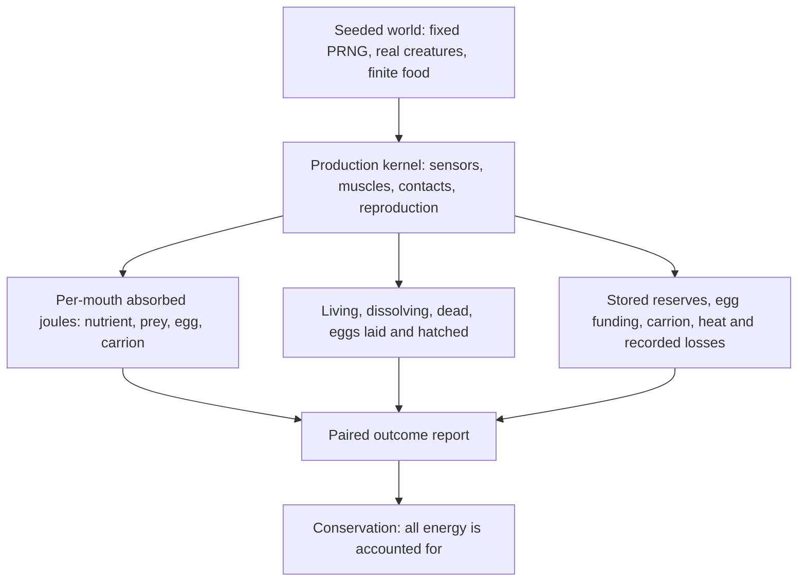

# Ecology Baseline and Energy Auditing

VIDA organisms have physical eating, death, funded eggs and hatching. This
page describes how to **measure those mechanisms**, not an automatic survival
guarantee. Sensory/motor strategies are inherited and may succeed or fail.

## What is measured

**Read-only monitoring** lives in `ecologyAudit.ts`.
`readEcologyState` gets a census from real organism and lineage records,
including starvation/predation/age death causes, reserves, eggs actually
funded, and conservation error. It carefully distinguishes *laid eggs*
(parent offspring count) from *hatched births* (world birth count also
includes initial seeded organisms). An egg is not a survivor or a new adult.

`EcologyIntakeObserver` samples after **every completed simulation step**.
VIDA's brief feeding-event history coalesces receipts over 0.25 seconds;
the observer counts only increments of each receipt, avoiding accidental
double-counting. Its records are measurement-only and don't enter creature
brains or snapshots. Since an organism exposes at most eight recent
receipts, unusually dense situations creating more than eight separate
events within one tick can undercount; this is **not** a complete
high-density historical feeding ledger.

## Abiotic food distribution in new worlds

The **Abiotic nutrient distribution** control lets new worlds choose:

- **Blooms** (optional): 65% of new environmental nutrients
  appear near twelve sites derived from the world seed and tank dimensions;
  35% remain dispersed. These sites stay fixed until changing tank size
  or seed, and do not sense or follow creatures.
- **Uniform** (default): historical random placement with no seeded hotspots.
  Imported older snapshots without the setting use Uniform, preserving
  historical randomness and exact continuation.

Neither setting changes the food cap (400 by default), energy per nutrient,
inflow rate, physical mouth contact, prey appetite, or egg cost.
The environment charges every added nutrient to the external-inflow
ledger. Manually placed Feed bursts retain their explicit positions in
either mode; changing modes alone does not add food or move existing
particles. World reset repopulates from the selected distribution.

### Nine-founder ecological observation

The optional `npm run benchmark:ecology` now includes a normal
**400-food, nine-featured-founder, three-second comparison** under
Uniform and Blooms (seed 17). All nine organisms start with the same
identities and positions before nutrient generation. It reports
real orally absorbed nutrient/prey joules, reserve change, survival,
funded eggs and conservation for each founder. Absorbed joules come from
incremental physical mouth receipts, not what an eye sees.

In a **bounded two-second seed-17 trial**, Uniform yielded **2,592 J**
of genuine nutrient absorption (CUR-001, CUR-002 and CUR-006 fed).
Blooms yielded **864 J** (CUR-005 fed). Both used nine distinct CUR
genotypes, 400 nutrient particles, real locomotion and energy
conservation. This single result favored Uniform, which therefore
remains the fresh-world default. Resource patches are an
**experimental option**, not a proven survival improvement.

A three-second comparison cannot establish ecological sustainability,
even if some starters acquire food; adult maturation, multi-generational
selection and ongoing nutrient accessibility still need separate evidence.
The `EcologyIntakeObserver` also exposes read-only per-organism intake,
subject to the existing eight-receipt-per-organism density limit.

## Repeatable bounded protocol

Run `npm run benchmark:ecology` to print the fixed-seed report. Short fast
regressions are `tests/ecology-baseline.test.ts`. All scenarios use the
real 2D physics, normal mouth permissions and conservation ledger.

| Scenario | Initial conditions | What it establishes |
| --- | --- | --- |
| Free roaming | Seeds 17, 29, 41; four independently seeded founders, 60 scattered nutrients, no later inflow; paired clone with food removed/accounted at the start | Short, *unassisted* intake and reserve outcomes. Not a test of full lifespan. |
| Controlled visual grazing | Two seeds, targets 135 or 160 px to either side, finite starting food; genetically retinally connected or disconnected Darter | Actual absorbed food joules due to sensory behavior in bounded geometry. No forced contact. |
| Adult egg allocation | Three seeds; explicitly *mature* and *initially funded* parents versus the same adults below the first-egg reserve barrier | Real reserve-to-egg transfer, inherited genome and parental survival floor. Preloaded reserve is an initial condition, **not earned food**. |
| Starvation | Three seeds; initial reserve set to 1 J, no food | Ordinary metabolic exhaustion, eventual death record, and carrion conservation. It is a stress test, not representative natural mortality. |

Each case distinguishes reserves, actual mouth intake, laid eggs, hatched
births, death cause, and the difference between **total accounted energy**
and external input energy. No replacement organisms, artificial feeding
or post-start survival aid occurs.

## Results from the fixed short tests

- **Free-roaming:** all twelve founders in the three 3-second mini-worlds
  remained alive, but **none fed**. The paired food-removed worlds also
  had zero intake. The observed survivors were spending startup reserves;
  this **does not prove that the ecosystem can sustain itself**.
- **Sensory foraging:** all **eight** six-second off-axis sighted trials
  physically absorbed **816–1,680 J** from finite food, while all matched
  retinally disconnected controls absorbed zero. Both fixed seeds
  generated the same outcomes at these deliberately identical geometries;
  this is not evidence of broad randomized ecological success.
- **Reproduction:** across all **three** test seeds, one explicitly
  mature, initially funded parent laid a single egg with **3,500 J**
  usable reserve and **4,740–5,460 J** structural energy (depending on
  its valid mutated child geometry). Matched underfunded adults laid no
  eggs. These eggs were **not yet hatched** during the short comparison.
- **Death:** all **three** intentionally low-reserve animals starved,
  completed dissolution and left **4,980 J** of carrion; conservation
  remained valid.

**Interpretation:** This closes the **bounded B-D measurement milestone**
but does **not** establish self-sustaining ecosystems, cross-generation
selection, reliable hunter pursuit, or long-term population fitness.
Those remain biological results to improve and test, not implied outcomes
of implementing sensors and reproduction. All 55 legacy founders and historical saved genotypes remain accessible. Original Phase 5 waking synaptic learning is implemented as a bounded feature but has no proven general ecological benefit. Original Phase 6 optional sleep/replay remains unimplemented.

## Where to inspect next

- `ecologyAudit.ts`: passive census, energy/reserve balances and incremental
  receipt counting
- `ecologyBaseline.ts`: identical seeded paired worlds, controlled grazing,
  warm-start egg allocation and explicit starvation stress
- `scripts/ecology-baseline.ts`: JSON report, with negative results included
- `tests/abiotic-blooms.test.ts`: focused bloom/uniform physical ecology, saves and accounting
- `tests/ecology-baseline.test.ts`: compact deterministic conservation,
  snapshot, intake, survival, reproduction and mortality regressions
- [Sensory Behavior](Sensory-Behavior): inherited retinal/motor pathways,
  measured feeding and the limits of predator pursuit

This Wiki page describes the current diagnostic capability, not a release
changelog. Historical evidence is kept in `docs/PROJECT_STATUS.md`.
