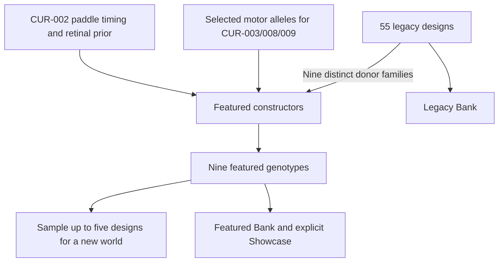

# Featured Starters and the Specimen Bank

The Bank has **Featured**, **Legacy**, **My saved specimens** and **All**
collections, with text search, family/diet filters, previews and spawning.
Nine featured genotypes coexist with all 55 original legacy designs.

## Featured designs

| Identity | Source anatomy | Diet | Body plan |
| --- | --- | --- | --- |
| CUR-001 Darter Scout | FND-001 Three-link Darter | Herbivore | Small axial swimmer with head-first gait and retinal steering |
| CUR-002 Twin Oar Grazer | FND-006 Twin Oar | Herbivore | Paired paddles with mouth-first timing and retinal steering |
| CUR-003 Tidewheel Browser | FND-021 Fourway Fan | Herbivore | Radial fan |
| CUR-004 Lantern Filterer | FND-052 Lantern Jellyfish | Herbivore | Hinged rectangular bell |
| CUR-005 Forktail Opportunist | FND-019 Extended Fork | Omnivore | Forked axial body |
| CUR-006 Broadwake Forager | FND-034 Broadtail Cruiser | Omnivore | Broad torso with multiple active segments |
| CUR-007 Hooktail Scavenger | FND-039 Hooktail Generalist | Omnivore | Asymmetric branched body |
| CUR-008 Hammerhead Pursuer | FND-030 Longtail Hammer | Carnivore | Wide head and long tail |
| CUR-009 Branchstalker | FND-050 Wildbranch Hunter | Carnivore | Branched body |

These are nine distinct source families. Each CUR design has its own part and
organ identities. Geometry, mouth anchors and lifecycle economics come from
its source; inherited RGB receptor gains and optional learning capacities
specialize the featured genotypes. The two carnivores have reduced or zero
initial green sensitivity. Pigment remains independent of diet.

New CUR-003, CUR-008 and CUR-009 genomes also receive selected motor alleles
from the [offline swimming search](Motor-Control). New CUR-002 genomes use
mouth-first paddle timing and, in Balanced mode, stronger inherited retinal
steering. The other five featured motor genotypes and all 55 legacy founders
retain their prior genes. Every selected allele remains mutable. Imported
animals and saved specimens keep their stored genomes; they are not rewritten by starter calibration.

## Starter construction

Constructors create new genomes. Imports and saved specimens retain their
stored genes; they do not pass through this calibration.

## New-world defaults

| Setting | Default |
| --- | --- |
| Starting population | 18 |
| Starting design diversity | At most five randomly selected featured designs |
| Maximum living population | 30 |
| Plant-food target | 275 |
| Nutrient distribution | Uniform |
| Initial UI seed | Random, editable and reusable on reset |

The Featured Showcase requests one of each featured design, subject to the
living-population cap. Lowering the cap does not remove existing creatures.
Explicit seeds reproduce a world under the same implementation and settings;
imported worlds retain their stored settings, genes and random state.

Starter genes are frozen. New worlds use their established force model with
prepaid simultaneous work. Historical calibration assays remain pinned to
legacy billing. Imported worlds retain their saved genes and physics regime.

## Selection and inspection

Clicking a creature opens general status. **Inspect** there, or the explicit
inspector control, opens Recurrent Brain & Diagnostics. Each opening resets
its display-only pruning threshold to **0.5**. Filtering the graph changes
neither inherited nor learned connections.

The roster provides diverse mutable starting points. Swimming, valid mouths
and bounded learning do not establish reliable foraging, hunting, predator
avoidance or self-sustaining reproduction for every design. Names such as
“Pursuer” describe a starting design, not a scripted or guaranteed behavior.
