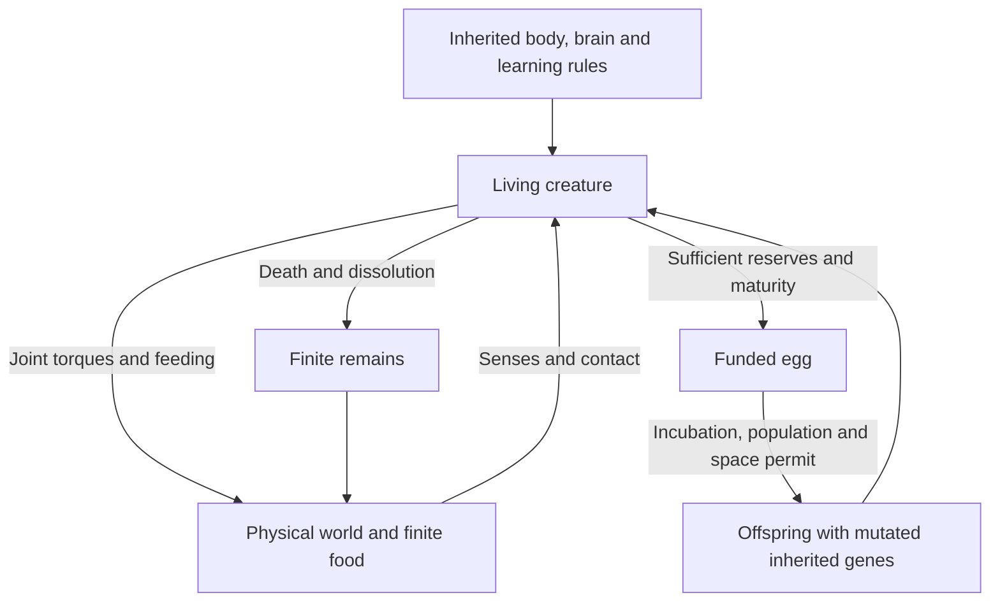

# VIDA 2D — Current Feature Reference

VIDA is an aquatic artificial-life simulator. Articulated bodies, inherited
neural controllers, individual experience and physical interactions determine
behavior. Survival and reproduction depend on finite energy.

**Implementation baseline: v0.37.0.** The core mechanisms exist; reliable
foraging, predator pursuit and self-sustaining multigeneration ecosystems remain
unproven. This reference covers VIDA 2D; the separate 3D project is independent.

[Play VIDA — production](https://smeagol44.github.io/vidAI/) · [Open experimental testing](https://smeagol44.github.io/vidAI/testing/) · [Source](https://github.com/smeagol44/vidAI)

The independent `testing` branch publishes to `/vidAI/testing/` without
replacing production. Its distinct release label identifies the pinned main
version and commit, cycle and iteration (currently `T1.1` from
`main v0.37.0 @ b2a05e5`). Each testing commit advances its iteration;
resetting to an explicitly chosen newer main baseline begins the next cycle.
Production retains its normal `v0.37.0` label, save format and simulation
behavior. The testing-only version code must never be merged to main.

## Simulation overview

## Diagrams

- [Starter construction](Featured-Starters#starter-construction)
- [Recurrent brain architecture](Waking-Learning#recurrent-brain-architecture) and [personal learning loop](Waking-Learning#personal-learning-loop)
- [Motor control loop](Motor-Control#motor-control-loop)
- [Sensory feedback loop](Sensory-Behavior#sensory-feedback-loop)
- [Closed energy transfers](Ecology-Baseline#closed-energy-transfers), [open-world transfers](Ecology-Baseline#chemical-energy-transfers) and [egg lifecycle](Ecology-Baseline#egg-lifecycle)
- [Worker and display architecture](Simulation-Performance#worker-and-display-architecture)

## Systems

| Page | Covers |
| --- | --- |
| [Featured Starters and Specimen Bank](Featured-Starters) | Nine featured designs, 55 legacy designs, defaults and selection |
| [Movement and Motor Control](Motor-Control) | Physical joints, mutable rhythms, drag, muscle scaling and offline swimming search |
| [Senses and Visually Guided Behavior](Sensory-Behavior) | Retina, spectral sensitivity, feedback and inherited sensory responses |
| [Waking Synaptic Learning](Waking-Learning) | Brain architecture, activation memory, personal learning and inheritance |
| [Ecology and Energy Auditing](Ecology-Baseline) | Feeding, funded eggs, food distribution and ecological measurements |
| [Simulation Performance](Simulation-Performance) | Worker ownership, rendering, optimizations, saves and throughput limits |

## Original plan and current status

| Original phase | Status |
| --- | --- |
| 1 — Variable neural architecture | Implemented: stable identities and variable hidden-neuron counts |
| 2 — Inherited structural brain evolution | Implemented: offspring can mutate neurons and connections |
| 3 — Biological trade-offs and egg inspection | Core scope implemented; some other inherited trait trade-offs remain open |
| 4 — Evolvable activation-memory timescales | Implemented |
| 5 — Learning during individual lives | Bounded waking-learning feature set implemented; ecological usefulness remains inconsistent |
| 6 — Optional rest/sleep and experience replay | Not implemented; world-model dreaming is also absent |

The additional **B-A–B-D** movement, sensory-behavior and ecological-measurement
workstream is complete as a bounded prototype. It did not replace original
Phases 5 and 6 or establish sustainable ecology. Worker/render separation and
the bounded offline starter search are implemented additional capabilities.

New worlds use the established swimming forces with prepaid simultaneous
muscle work and a kinetic-passive complete joint solve. Saved worlds retain their explicit regime; surface-model worlds
can opt into repaired swimming and other old worlds can explicitly stabilize
their joint solver without losing their ecosystem. Coherent
replacement drag/muscle scaling and full solver mechanical conservation remain
unresolved; see [Movement](Motor-Control).

New application worlds use a closed recycled energy budget and population
slots shared by living creatures and eggs. Incubation uptake is funded, debt
blocks hatching and unhatched eggs have finite lifetimes. Existing saves keep
their open economy until explicit conversion; see [Ecology](Ecology-Baseline).

## Scope and maintenance

The next ecological goal is unassisted food acquisition followed by genuinely
funded laying, hatching and reproduction across generations. Physical growth,
local tissue repair, gradual senescence and within-life structural brain growth
remain unimplemented. Current anatomy is capped at seven parts; the original
roughly 100-creature/1,000-part performance ambition remains unverified.

These pages describe current implementation and limitations, without release
history. Detailed experiments stay in
[project status](https://github.com/smeagol44/vidAI/blob/main/docs/PROJECT_STATUS.md);
priorities stay in the [roadmap](https://github.com/smeagol44/vidAI/blob/main/docs/FEATURE_ROADMAP.md).
The maintained source is `docs/wiki/`, automatically published to this Wiki.
