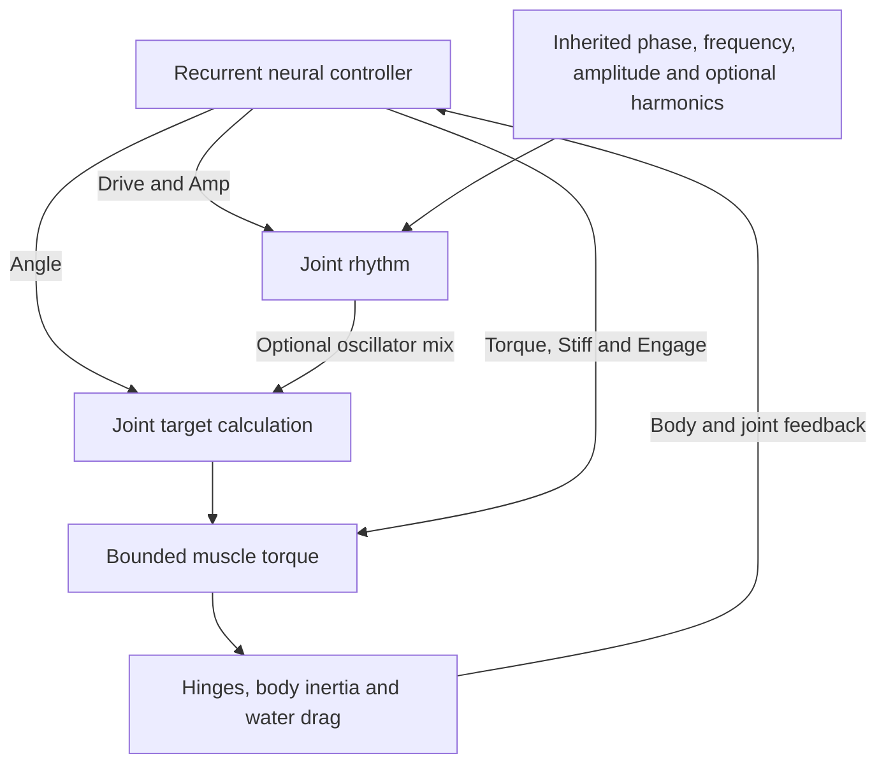

# Movement and Motor Control

Rectangular body parts connect through physical hinges at their attachment
faces. Joint torques and water resistance produce motion; neural outputs do
not directly set world-space position or grant forward thrust.

Hinge markers are hidden in the display. The joints still constrain and actuate
body parts in the Worker; hiding their dots saves drawing, not physics work.

## Controller

Each joint has six neural outputs:

| Output | Effect |
| --- | --- |
| Angle | Joint posture/target-angle command |
| Drive | Oscillation frequency modulation |
| Torque | Peak torque modulation |
| Stiff | Controller stiffness/damping modulation |
| Amp | Rhythmic stroke amplitude, including suppression |
| Engage | Muscle engagement, including zero active torque |

Inherited phase, frequency and amplitude genes define each joint's rhythm.
The optional `oscillatorMix` gene ranges from 0 (direct posture) to 1 (full
rhythmic contribution). Four optional bounded harmonics permit smooth
non-sinusoidal strokes. On the evolved mixed/direct path, suppressing the
rhythm gives the Angle command full joint travel. Older genes lacking the
new fields use their original sine calculation exactly.

Body geometry, relative timing, force limits and drag determine whether a
stroke produces useful progress. No universal swimming or escape policy is
imposed. Rigid hinged jellyfish do not have deformable bells or fluid jets.

## Motor control loop



The target calculation preserves the legacy path for older genes. Physical
motion, rather than a direct position command, closes the feedback loop.

## Current physics and its limits

| Persisted regime | Behavior |
| --- | --- |
| `paid-work-v2` (new worlds) | Established drag, inertia-based muscle strengths and simultaneous motor updates, with prepaid work and reserve limits |
| `surface-work-v1` | Unit-depth four-face drag, geometric muscles and sequential paid impulses; kept for exact continuation of stored worlds |
| `legacy-v0` | Original forces, integration and legacy billing; used by v3–v11 imports |

Save schemas v12 (open economy) and v13 (closed economy) validate the regime. Export, fork, Worker commands and fallback
preserve it. Reset creates a current-physics world. A stored surface-model world
can explicitly select **Repair swimming in this world** in settings, keeping its
creatures, eggs, food, time, PRNG and personal memory while changing future
physics. Imports never silently convert regimes.

### Working drag and muscle forces

The current world model retains its calibrated anisotropic drag:

```text
Fx_local = -0.05 * mu * h * u
Fy_local = -2 * mu * w * v
drag_torque = -mu * omega * (w^3 + h^3) / 6
```

For average connected-part inertia `Iavg` and the usual neural modifiers:

```text
kp = motorForce * Iavg * 480 * stiff
kd = sqrt(kp * Iavg) * 1.4 * stiff
maxTorque = Iavg * 2200 * torque
command = clamp(kp * angleError - kd * relativeSpeed, +/-maxTorque) * engagement
```

Every joint reads the same substep-start velocities. Equal/opposite motor
commands accumulate with external forces before the original shared velocity
update and hinge solve. Funded muscles retain the established force arithmetic;
no founder/body/brain/phase/weight retuning supplies the recovery.

These are calibrated simulation forces. Axial drag is 1/40 of a uniform normal
four-face reference; uniform 2D size doubling gives 16x torque. They are not
claimed to be a coherent single surface law or biologically justified muscle
scaling. Resolving that model remains open and must preserve functional movement.
No wakes, shielding, fluid motion, deformable bells or jets are simulated.

### Prepaid simultaneous work

Commands remain simultaneous rather than updating one joint's velocity before
calculating the next. For each constant substep angular impulse `J`, actuator
work integrates `J * relativeAngularVelocity` along the actual linear velocity
update, including other motors on shared parts and external torques. Split the
integral at any reversal: positive work is paid independently of negative work
on that or another joint. Acceleration from rest is included.

One mechanical simulation-energy unit is 1.75e-7 J; efficiency is 25%.
Positive work costs `positiveWorkJ / 0.25`; negative work dissipates without
regeneration. If all commands cannot be funded, a conservative work bound
reduces their common amplitude before motion, preserving command balance.
Zero reserves disable muscles. The final measured cost, not the bound, is
charged immediately; later food cannot fund earlier movement. There is no new
40-J billing cap. Muscles spend before basal upkeep, after any waking-learning
charges; unpowered joints and passive contact still operate.

The historical `mechanicalWorkHeat` name denotes chemical motor expenditure,
including allocated work and inefficiency. It does not assert instantaneous
thermodynamic heat. Chemical accounting excludes kinetic energy as a stored term.
Diagnostics expose per-tick positive/negative work, reserve-limited commands
and speed-clamp events (400 px/s, 20 rad/s). Existing guard usage on some body
plans remains a limitation; a passing movement check does not resolve it.

### Surface-model save continuation

Stored `surface-work-v1` worlds retain `Fx=-2*mu*h*u`, `Fy=-2*mu*w*v`, and the
same integrated rotational drag, counting all four unit-depth faces even when
connected/covered. Strength uses stress 300 times the smaller attachment
cross-section and a mean internal lever; doubling lengths gives 4x torque.
PD damping uses reduced pair inertia, and muscles apply sequential prepaid
impulses. This mode's normal-resistance idea follows Karl Sims's
[*Evolving Virtual Creatures*, section 4](https://www.karlsims.com/papers/siggraph94.pdf);
its absolute strength normalization and movement performance are unresolved.
The paper does not establish VIDA's coefficients or validate that normalization.

### Remaining limitations and release checks

The discrete solver uses velocity bias, position projection, limits and contact
impulses, which can alter mechanical energy. Paid actuator work and chemical
closure do not prove full solver-wide conservation or exclude every exploit.
An opt-in offline kinetic observer separates force/motor integration, speed
clamps, anchor impulses, angular limits, contact impulses and pose projection.
Unpowered anchor and angular-limit error controls demonstrate velocity-bias
energy injection. Bounded inelastic contact dissipates energy; projection changes
pose without an immediate kinetic change, which does not exclude later effects.
The solver correction and normal-drag/geometric-muscle replacement remain open.

A two-sided frozen-genome regression gate compares all nine featured designs
against their pre-change movement and total energy expenditure. It catches
large gains as well as losses; known food-acquisition checks remain. Material
measured positive or negative changes must be disclosed to the user **before
production**, even if formula/accounting tests pass. The 10% numeric tripwire is
an additional gate, not permission to ignore other drastic qualitative changes.

## Offline starter development

The bounded search uses the production kernel and existing mutable motor
genes. It keeps anatomy, neural weights, organs, learning traits, lifecycle
genes and normal starting reserves intact, retaining each family separately.
It never supplies scores or target coordinates to a living brain.

The default budget is 25 training evaluations per family: one parent plus
three generations of eight offspring. Six-second food-free trials exclude
one second of startup from COM progress and path measurements. Fitness
combines straightness, sustained late progress and total reserve expenditure;
idle and startup-only movement cannot score.

Promotion uses three nine-second swims at different headings/viscosities
(0.15/0.18/0.22), plus a 15-second swim. Every screen requires at least 5%
more progress, 2% more progress per reserve joule, no lower late speed,
no more than 5% extra expenditure and preservation of the prior route.
Sampled caps, hinge drift, invalid poses, exhaustion and accounting errors
reject a result. Final-tick observations cannot exclude all substep exploits.

Selected alleles apply only to newly constructed CUR-003/008/009 genomes.
Existing saved genes continue unchanged. The method adapts COM/late-motion
evaluation from Karl Sims's *Evolving Virtual Creatures* (1994); efficiency
weighting and promotion guards are VIDA-specific. Stronger empty-water
swimming does not establish mouth-first travel, food capture or fitness.

## Food-oriented starter calibration

New CUR-002 Twin Oar genomes shift the SOUTH paddle phase by half a cycle,
aligning travel with the forward mouth. Balanced mode pairs that timing with
stronger mutable retinal/Angle weights. The live controller still receives
ordinary RGB and body feedback; food locations and audit scores remain offline.
The controlled approach improvement was measured under legacy physics;
scattered-food intake remains seed-dependent. Current physics changes do not
rewrite those inherited genes. Equivalent corrected-world benefits are unproven.

## Developer entry points

- `npm run audit:foraging`: Twin Oar finite-food controls and three short scattered-food pairs.
- `npm run audit:foundation`: bounded frozen-genome comparison of all three physics regimes.
- `npm run audit:mechanics`: stage-resolved kinetic audit with passive controls and nine frozen swimmers.
- `npm run audit:locomotion`: historical legacy passive drag/spin and scaling checks.
- `npm run search:locomotion -- --check`: reproduce the committed default selection.
- `--id CUR-003`, `--seed`, `--generations` (1–8), `--offspring` (1–16) and `--output report.json`: bounded search options; `--check` requires the default budget/seed.
- Code: `simulation.ts`, `foundationPhysics.ts`, `locomotionSearch.ts`, `locomotionPhysicsAudit.ts`, `starterLocomotion.ts`.
- Checks: `tests/motor-control.test.ts`, `tests/evolvable-actuation.test.ts`, `tests/locomotion-search.test.ts`.
