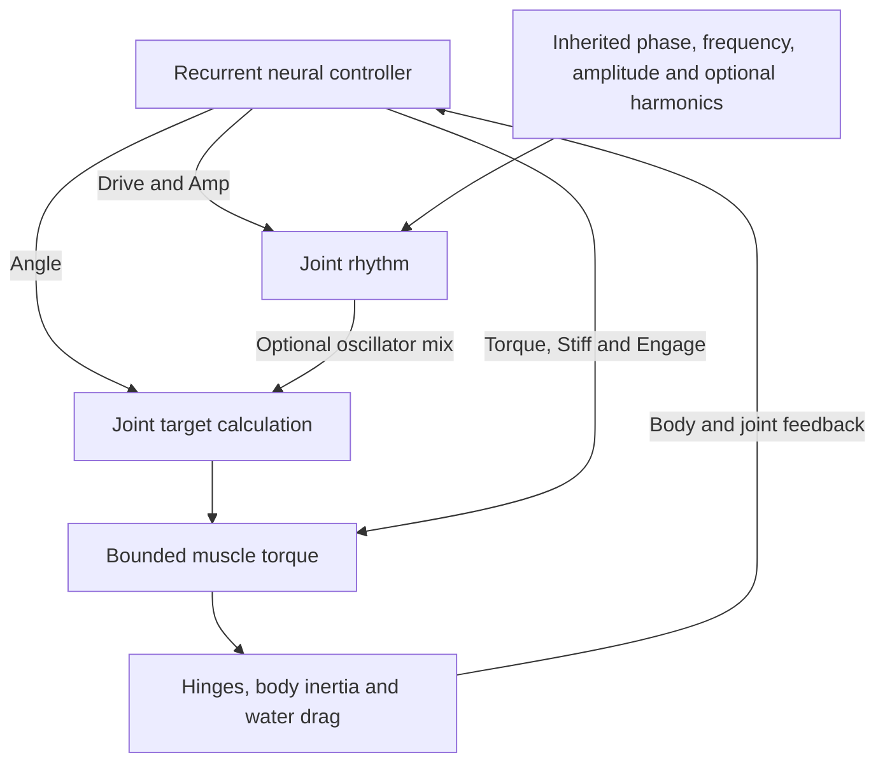

# Movement and Motor Control

Rectangular body parts connect through physical hinges at their attachment
faces. Joint torques and water resistance produce motion; neural outputs do
not directly set world-space position or grant forward thrust.

## Controller

Each joint has six neural outputs:

| Output | Effect |
| --- | --- |
| Angle | Joint posture/target-angle command |
| Drive | Oscillation frequency modulation |
| Torque | Peak torque modulation |
| Stiff | Controller stiffness/damping modulation |
| Amp | Rhythmic stroke amplitude, including suppression |
| Engage | Muscle engagement, including zero active torque |

Inherited phase, frequency and amplitude genes define each joint's rhythm.
The optional `oscillatorMix` gene ranges from 0 (direct posture) to 1 (full
rhythmic contribution). Four optional bounded harmonics permit smooth
non-sinusoidal strokes. On the evolved mixed/direct path, suppressing the
rhythm gives the Angle command full joint travel. Older genes lacking the
new fields use their original sine calculation exactly.

Body geometry, relative timing, force limits and drag determine whether a
stroke produces useful progress. No universal swimming or escape policy is
imposed. Rigid hinged jellyfish do not have deformable bells or fluid jets.

## Motor control loop



The target calculation preserves the legacy path for older genes. Physical
motion, rather than a direct position command, closes the feedback loop.

## Current physics and its limits

With body-local velocity components `u` and `v`, width `w`, height `h`,
viscosity `mu` and angular velocity `omega`:

```text
Fx_local = -0.05 * mu * h * u
Fy_local = -2.0  * mu * w * v
drag_torque = -mu * omega * (w^3 + h^3) / 6
```

Passive translation and rotation dissipate motion. This is a calibrated
anisotropic approximation: axial resistance is 1/40 of the uniform four-face
normal-drag reference, while rotation retains full-face damping. Fluid flow,
wakes and shielding between surfaces are not simulated.

Muscle gains and limits scale with average rotational inertia. At equal controller
commands, uniformly doubling both joint-part dimensions yields 16× torque in this 2D model; this
is not attachment-area/lever-arm muscle scaling. These same rules apply to
new and imported worlds.

Motor energy cost uses pre-update relative angular speed and a legacy
**40-J cap per complete simulation tick**. Its estimated cost is deducted
from usable reserves and recorded as heat. Chemical-ledger closure does
not prove complete articulated mechanical-energy conservation. Physics and
work-accounting revisions remain separate pending work.

## Offline starter development

The bounded search uses the production kernel and existing mutable motor
genes. It keeps anatomy, neural weights, organs, learning traits, lifecycle
genes and normal starting reserves intact, retaining each family separately.
It never supplies scores or target coordinates to a living brain.

The default budget is 25 training evaluations per family: one parent plus
three generations of eight offspring. Six-second food-free trials exclude
one second of startup from COM progress and path measurements. Fitness
combines straightness, sustained late progress and total reserve expenditure;
idle and startup-only movement cannot score.

Promotion uses three nine-second swims at different headings/viscosities
(0.15/0.18/0.22), plus a 15-second swim. Every screen requires at least 5%
more progress, 2% more progress per reserve joule, no lower late speed,
no more than 5% extra expenditure and preservation of the prior route.
Sampled caps, hinge drift, invalid poses, exhaustion and accounting errors
reject a result. Final-tick observations cannot exclude all substep exploits.

Selected alleles apply only to newly constructed CUR-003/008/009 genomes.
Existing saved genes continue unchanged. The method adapts COM/late-motion
evaluation from Karl Sims's *Evolving Virtual Creatures* (1994); efficiency
weighting and promotion guards are VIDA-specific. Stronger empty-water
swimming does not establish mouth-first travel, food capture or fitness.

## Developer entry points

- `npm run audit:locomotion`: actual-kernel passive drag/spin and size-scaling checks.
- `npm run search:locomotion -- --check`: reproduce the committed default selection.
- `--id CUR-003`, `--seed`, `--generations` (1–8), `--offspring` (1–16) and `--output report.json`: bounded search options; `--check` requires the default budget/seed.
- Code: `simulation.ts`, `locomotionSearch.ts`, `locomotionPhysicsAudit.ts`, `starterLocomotion.ts`.
- Checks: `tests/motor-control.test.ts`, `tests/evolvable-actuation.test.ts`, `tests/locomotion-search.test.ts`.
