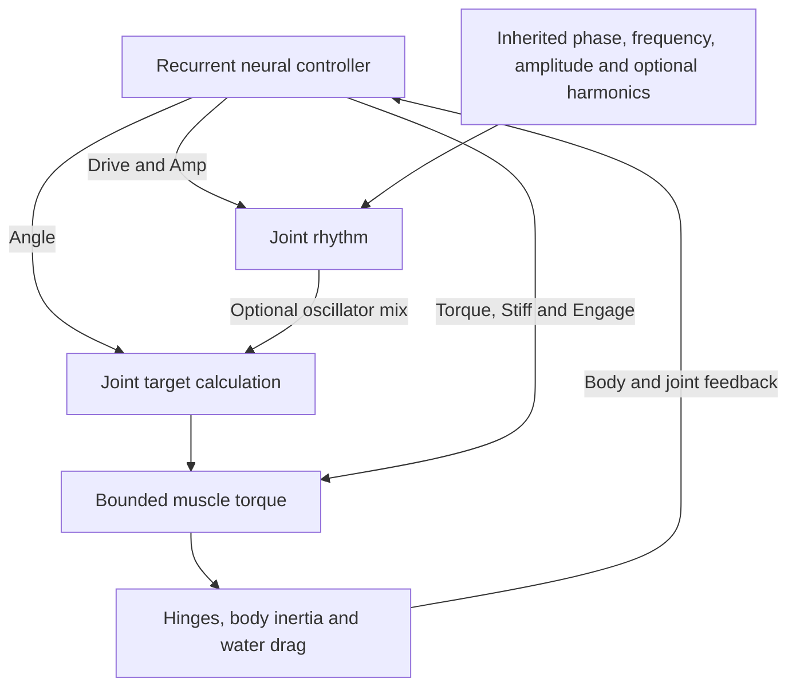

# Movement and Motor Control

Rectangular body parts connect through physical hinges at their attachment
faces. Joint torques and water resistance produce motion; neural outputs do
not directly set world-space position or grant forward thrust.

## Controller

Each joint has six neural outputs:

| Output | Effect |
| --- | --- |
| Angle | Joint posture/target-angle command |
| Drive | Oscillation frequency modulation |
| Torque | Peak torque modulation |
| Stiff | Controller stiffness/damping modulation |
| Amp | Rhythmic stroke amplitude, including suppression |
| Engage | Muscle engagement, including zero active torque |

Inherited phase, frequency and amplitude genes define each joint's rhythm.
The optional `oscillatorMix` gene ranges from 0 (direct posture) to 1 (full
rhythmic contribution). Four optional bounded harmonics permit smooth
non-sinusoidal strokes. On the evolved mixed/direct path, suppressing the
rhythm gives the Angle command full joint travel. Older genes lacking the
new fields use their original sine calculation exactly.

Body geometry, relative timing, force limits and drag determine whether a
stroke produces useful progress. No universal swimming or escape policy is
imposed. Rigid hinged jellyfish do not have deformable bells or fluid jets.

## Motor control loop



The target calculation preserves the legacy path for older genes. Physical
motion, rather than a direct position command, closes the feedback loop.

## Current physics and its limits

New worlds use `surface-work-v1`. Imported v3–v11 worlds use `legacy-v0`;
v12 snapshots explicitly persist and validate the regime. A world keeps its
regime through export, fork, Worker commands and fallback. Reset creates a new
world using current physics. The settings window identifies the active regime.

### Surface drag

Each rectangle is a unit-depth lamina. All four faces count, including connected
or geometrically covered faces: no exposure clipping, shielding, wakes or fluid
motion is simulated. Normal velocity is evaluated across each whole face as
`v_face = v_COM + omega cross r`, rather than only at its midpoint. Integrating
`dF = -mu * (v_face dot normal) * normal * ds` yields:

```text
Fx_local = -2 * mu * h * u
Fy_local = -2 * mu * w * v
drag_torque = -mu * omega * (w^3 + h^3) / 6
power = -2*mu*h*u^2 - 2*mu*w*v^2 - mu*(w^3+h^3)*omega^2/6
```

This is one dissipative law for translation and rotation. Force rotates into
world coordinates; the kernel retains its fixed substeps and explicit velocity
integration. It follows the normal-resistance idea in Karl Sims's
[*Evolving Virtual Creatures*, section 4](https://www.karlsims.com/papers/siggraph94.pdf).
The equations and all-face policy are VIDA's 2D decisions; the paper does not
provide an exact coefficient/exposure implementation to copy.

### Muscles and units

Simulation coordinates are pixels and seconds; mass remains
`max(0.35, 0.4 * dimN * dimM)`, inertia `mass * (w^2+h^2)/12`.
One mechanical simulation-energy unit is **1.75e-7 J**, retaining the former
conversion as an explicit unit convention (equivalently 1 px = 1 mm and one
mass unit = 0.175 kg). This is not independently calibrated biological tissue
or real-water density. `mu` and muscle stress are constitutive model parameters.

For each hinge, `section` is the smaller of the two attachment-face lengths,
times unit depth. `lever` is the average of each part's smaller half-extent.
Stress is 300 simulated force/px². With neural modifiers `stiff` and `torque`:

```text
strength = stress * section * lever
maxTorque = strength * torque
kp = motorForce * strength * (480/2200) * stiff
Ieff = 1 / (1/Iparent + 1/Ichild)
kd = 1.4 * sqrt(kp * Ieff) * stiff
command = clamp(kp * angleError - kd * relativeSpeed, +/-maxTorque) * engagement
```

Unit depth stays fixed when 2D dimensions double: section/force doubles,
lever doubles, torque quadruples, mass quadruples and inertia grows 16-fold.
This explicitly differs from scaling every dimension of a 3D solid. Sims
section 3.3 motivates cross-section-limited strength, not these 2D parameters.
The controller still supports independent joints, silence and non-rhythmic motion.

### Paid actuation

Each substep applies muscles as sequential equal/opposite angular impulses,
before drag, external forces and hinge constraints. For impulse `J`, initial
relative speed `r` and `S = 1/Iparent + 1/Ichild`, torque-only kinetic change is
`J*r + 0.5*J^2*S`. The accounting integrates positive and negative work separately,
splitting at a within-impulse reversal; braking cannot offset paid acceleration.
Shared-part joints read velocities after earlier impulses.

Positive work costs `positiveWorkJ / 0.25` chemical joules. Negative work
dissipates without regeneration. The kernel shortens an impulse **before it
acts** if reserves cannot pay, then debits it immediately. Zero reserves mean
zero muscle impulse; later feeding can fund only subsequent substeps/ticks.
There is no corrected-regime 40-J billing cap. Muscles spend before basal upkeep;
that priority is a model choice, not extra funded energy.

Diagnostics expose per-tick positive work, negative work, budget-limited impulses
and numerical speed-guard events. The 400 px/s and 20 rad/s guards remove motion,
never grant it; their events are visible in exported organism diagnostics.
`mechanicalWorkHeat` retains its historical field name but is a **chemical motor
expenditure bucket**, including allocated mechanical work and inefficiency,
not an assertion that all paid work instantly became thermodynamic heat.

The discrete solver still uses velocity bias, position projection, joint limits
and contact impulses. Those operations can alter mechanical energy. Correct
actuator billing and chemical-ledger closure do **not** prove full articulated
mechanical conservation or exclude every constraint/contact exploit.

### Legacy continuation

`legacy-v0` retains axial coefficient 0.05 versus transverse 2, the previous
rotational term, inertia-scaled muscles, pre-update absolute-speed billing,
40 J per-tick billing cap and original reserve debit/order. Historical full-state
hashes and starter comparisons remain pinned to this regime, without changing
their expected results. New frozen starters may swim less effectively under the
corrected model; no automatic coefficient or genotype tuning compensates for it.

## Offline starter development

The bounded search uses the production kernel and existing mutable motor
genes. It keeps anatomy, neural weights, organs, learning traits, lifecycle
genes and normal starting reserves intact, retaining each family separately.
It never supplies scores or target coordinates to a living brain.

The default budget is 25 training evaluations per family: one parent plus
three generations of eight offspring. Six-second food-free trials exclude
one second of startup from COM progress and path measurements. Fitness
combines straightness, sustained late progress and total reserve expenditure;
idle and startup-only movement cannot score.

Promotion uses three nine-second swims at different headings/viscosities
(0.15/0.18/0.22), plus a 15-second swim. Every screen requires at least 5%
more progress, 2% more progress per reserve joule, no lower late speed,
no more than 5% extra expenditure and preservation of the prior route.
Sampled caps, hinge drift, invalid poses, exhaustion and accounting errors
reject a result. Final-tick observations cannot exclude all substep exploits.

Selected alleles apply only to newly constructed CUR-003/008/009 genomes.
Existing saved genes continue unchanged. The method adapts COM/late-motion
evaluation from Karl Sims's *Evolving Virtual Creatures* (1994); efficiency
weighting and promotion guards are VIDA-specific. Stronger empty-water
swimming does not establish mouth-first travel, food capture or fitness.

## Food-oriented starter calibration

New CUR-002 Twin Oar genomes shift the SOUTH paddle phase by half a cycle,
aligning travel with the forward mouth. Balanced mode pairs that timing with
stronger mutable retinal/Angle weights. The live controller still receives
ordinary RGB and body feedback; food locations and audit scores remain offline.
The controlled approach improvement was measured under legacy physics;
scattered-food intake remains seed-dependent. Current physics changes do not
rewrite those inherited genes. Equivalent corrected-world benefits are unproven.

## Developer entry points

- `npm run audit:foraging`: Twin Oar finite-food controls and three short scattered-food pairs.
- `npm run audit:foundation`: bounded frozen-genome comparison of both regimes.
- `npm run audit:locomotion`: historical legacy passive drag/spin and scaling checks.
- `npm run search:locomotion -- --check`: reproduce the committed default selection.
- `--id CUR-003`, `--seed`, `--generations` (1–8), `--offspring` (1–16) and `--output report.json`: bounded search options; `--check` requires the default budget/seed.
- Code: `simulation.ts`, `foundationPhysics.ts`, `locomotionSearch.ts`, `locomotionPhysicsAudit.ts`, `starterLocomotion.ts`.
- Checks: `tests/motor-control.test.ts`, `tests/evolvable-actuation.test.ts`, `tests/locomotion-search.test.ts`.
