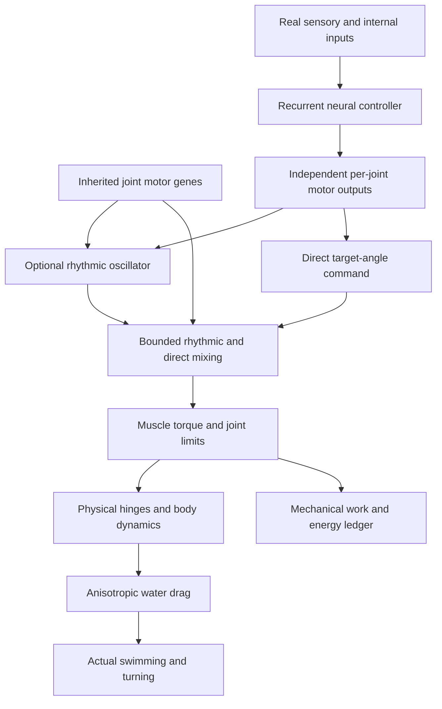
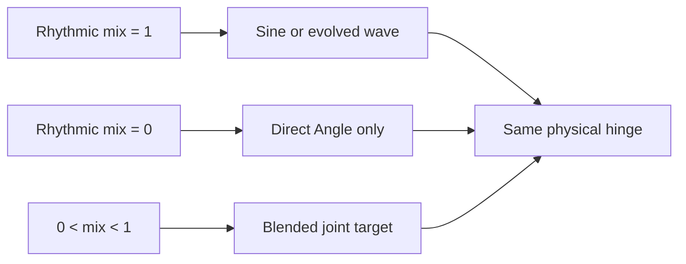

# Movement and Motor Control

VIDA's articulated organisms swim and maneuver using **physical hinges** between rectangular body segments. Muscle torque rotates joints, while anisotropic water drag turns articulated motion into movement. No brain command sets world-space position or applies free forward thrust.

## At a glance

| Property | Current behavior |
| --- | --- |
| Actuators | One torque-driven hinge per connected body part |
| Neural outputs | Six independent outputs per joint: Angle, Drive, Torque, Stiff, Amp, Engage |
| Rhythmic movement | Optional per-joint oscillator with independent phase, speed and amplitude |
| Non-rhythmic movement | Brain-controlled joint-angle posture can operate without an oscillator |
| Waveform | Smooth, bounded combination of sine and up to four inherited harmonics |
| Evolution | Mix and waveform coefficients may mutate separately in offspring |
| Energy | Motor work is deducted from usable energy and becomes heat; no free thrust |
| Old genomes | Missing new parameters take the original sine controller exactly |

## How commands become movement



Each connected joint has its own **oscillatorMix** allele between **0** (fully optional rhythm disabled) and **1** (full rhythmic contribution). Intermediate values blend the rhythmic command with direct neural positioning. The **Angle** output commands posture. The **Amp** output controls the oscillator's actual stroke amplitude: when the oscillator's amplitude reaches zero on an evolved joint, the Angle command obtains the joint's full allowable range. **Engage** can still disengage the muscle, and **Drive**, **Torque** and **Stiff** remain independent joint controls.

These commands do **not** guarantee forward swimming; motion depends on actual morphology, relative phase, torque, water drag, mass and energy availability.

## Waveform design

A joint with no waveform allele executes the original sine wave. Evolved joints can blend the base sine wave with the second through fifth harmonics:

```text
raw(φ) = sin(φ) + a₂ sin(2φ) + a₃ sin(3φ) + a₄ sin(4φ) + a₅ sin(5φ)
wave(φ) = raw(φ) / (1 + |a₂| + |a₃| + |a₄| + |a₅|)
```

- Each `a` coefficient is inherited, mutable, and bounded **−1 to +1**.
- The normalized waveform stays in **[−1, 1]**.
- Harmonic mixtures can approximate asymmetric, triangle-like or sawtooth-like strokes **smoothly**. Discontinuous sawtooth impulses are not generated.
- The creature can independently vary frequency and timing through the existing **Drive** output, and inherits its CPG phase offset and frequency multiplier.
- Individual waveform/phase changes can improve or harm locomotion; successful feeding and steering must be physically measured.

## Inheritance and compatibility

For old organisms and unchanged founder genotypes, both new joint fields are absent. This deliberately runs the original exact sine calculation, preserving existing saved motion and motor energy. Genetic mutation may introduce `oscillatorMix` or `waveHarmonics` on descendants. Offspring inherit those fields, and no parent genome is edited by mutations.

A joint with `oscillatorMix = 0` can use the full range of its direct **Angle** neural command while active. A joint may also set **Amp** to zero and use direct posture, without turning off its muscle. Without a brain command, a direct-only joint does not move on its own.

World snapshots use the existing version-11 schema. New fields are optional, strictly validated on import and round-trip exactly; saved older genomes are never rewritten to acquire new motor alleles.

## Drag and muscle scaling

The current water model uses body-local translation with these coefficients:

```text
Fx_local = -0.05 × viscosity × height × local_vx
Fy_local = -2.0  × viscosity × width  × local_vy
torque_drag = -viscosity × angular_velocity × (width³ + height³) / 6
```

These terms dissipate passive motion. They are a calibrated anisotropic model,
not a literal application of the same normal-drag coefficient to all four
rectangle faces: lengthwise resistance is 1/40 of that four-face reference.
Rotation retains the full-face damping coefficient. No fluid flow, wakes or
shielding between adjacent body surfaces is simulated.

Muscle gains and torque limits scale with average joint-part rotational inertia.
Uniformly doubling both bodies' dimensions yields 16× torque in the 2D model.
This differs from muscle limits based on attachment area and lever arm. The
existing drag and muscle rules remain in force for both new and imported worlds.
Changing these rules requires a separately evaluated, save-compatible physics
revision; the offline calibration does not introduce alternate live physics.

`npm run audit:locomotion` checks actual passive motion against analytical
substep decay at several orientations, passive spin, free momentum without
viscosity, and actual muscle size scaling. It confirms those bounded properties,
not complete articulated mechanical-energy conservation. Motor cost currently
uses pre-update relative angular speed and a legacy 40-J **per complete tick**
cap. The chemical ledger can close even when that cost estimate is imperfect.

## Offline swimming development

`npm run search:locomotion -- --output report.json` runs a bounded asexual
search using the production kernel: nine separate anatomical families, three
generations of eight offspring each, with the parent retained (25 training
trials per family). Only existing motor frequency, force, joint phase, amplitude
and smooth waveform genes are eligible. Bodies, mouths, eyes, neural weights,
learning traits, initial reserve and lifecycle genes are preserved.

Six-second food-free training measures COM progress after one second of settling,
straightness, progress during the final third and chemical energy spent.
An idle swimmer or startup-only push cannot score. The search never supplies
coordinates, fitness rewards or thrust to a brain, and is not part of live
selection or lifetime learning.

Candidates are screened on three nine-second swims with different headings and
viscosities (0.15, 0.18, 0.22), plus a 15-second swim. Promotion requires at least
5% more progress and 2% more progress per total reserve joule in **every** screen,
no lower late speed, no more than 5% extra reserve expenditure, and preservation
of the original travel direction. Sampled speed/work caps, hinge drift,
non-finite poses, depleted reserves or ledger errors reject a result. Final-tick
observations cannot exclude every substep spike or numerical exploit.

Selected genes in `data/starter-locomotion.json` apply only when constructing
new featured genotypes. CUR-003, CUR-008 and CUR-009 use the selected alleles;
the other six featured and all 55 legacy founders retain their prior genes.
Existing saved genomes keep their actual genes and exact continuation. The
search's `--check` option reproduces the default selection and verifies the
committed constructor output. `--id CUR-003` limits it to one family;
`--seed`, `--generations` (1–8) and `--offspring` (1–16) allow bounded experiments.

This adapts the COM/late-motion evaluation idea from Karl Sims,
*Evolving Virtual Creatures* (SIGGRAPH 1994, §§3.3, 4, 5.1). Efficiency weighting
and promotion guards are VIDA-specific. The measured result is stronger empty-
water locomotion. Direction preservation does not guarantee mouth-first travel,
food capture, prey pursuit or sustainable reproduction. Detailed historical
measurements live in `docs/PROJECT_STATUS.md`, outside this current reference.

## Boundaries and current limitations

- This is **joint-space** direct control, not arbitrary forces, fins with lift, suction, jet propulsion or deformable jellyfish bells.
- The oscillator is not a mandatory swimming gait, but evolving coordinated direct control is not guaranteed; poor neural configurations can still fail to move.
- Harmonics share the joint's base phase. Independently evolvable harmonic phase shifts and explicit oscillator reset commands are not implemented.
- The current movement is physically simulated; no claims are made that the newest motor genes have improved ecological fitness across seeds.
- The default founders retain their previously calibrated behavior (including the head-first FND-001 gait).

## Implementation and regression checks

- **Physics/controller:** `simulation.ts` — `evaluateMotorWave`, `calculateJointMotorTarget`, `advanceOrganismPhysics`
- **Inheritance:** `simulation.ts` — `mutateGenome` and `PartDef`
- **Import validation:** `persistence.ts` — `validateGenome`, `restoreSnapshot`
- **Tests:** `tests/evolvable-actuation.test.ts`, `tests/motor-control.test.ts`, `tests/behavior-baseline.test.ts`


