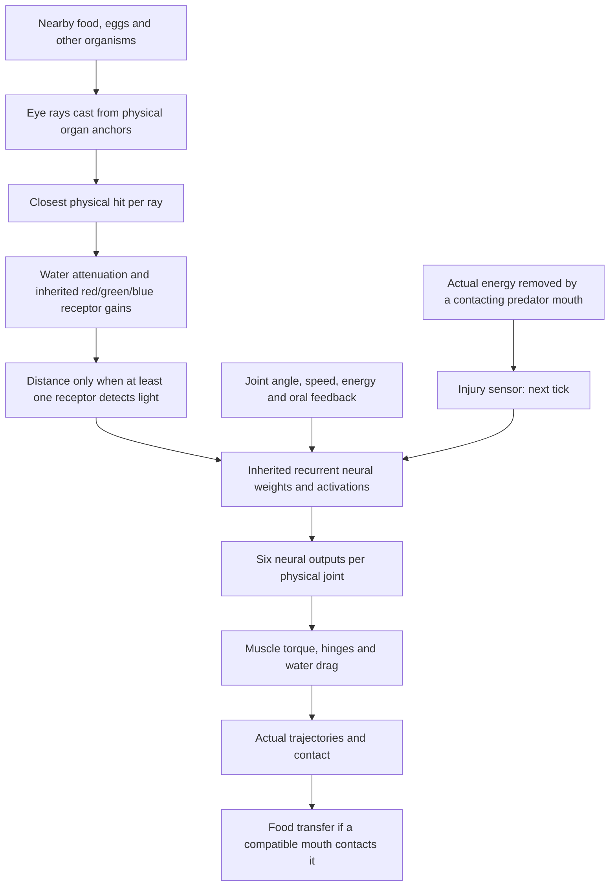

# Senses and Visually Guided Behavior

VIDA organisms sense their environment through real organ geometry and a recurrent, inheritable neural controller. **Seeing an object is not the same as recognizing or reaching it.** Actual locomotion, contact and energy intake depend on the creature's articulated body and physical simulation.

## Physically overlapping prey and oral contact

Carnivore and omnivore mouths transfer energy only through their real,
oriented aperture when it contacts a prey's body. The contact geometry
checks an aperture crossing an actual rectangular body edge, proximity
to that edge, **or a mouth entirely buried inside the prey's rotated
body rectangle**. The enclosed case matters because an edge-only
test can miss deep physical overlap. Bounding checks respect each
body part's size rather than assuming a fixed distance.

A bite consumes the prey's existing reserve/tissue at the mouth's
finite intake rate and pays assimilation losses to metabolic heat.
It gives no target location, scripted pursuit, energy bonus or
diet exception. Whether a founder can *reach* and catch moving
prey without assistance is still unproven.

## Sensory pathways

## Somatic injury sensing

A creature now has a **body:injury** neural input that reports actual energy
transferred out of its usable reserves or tissue by a predator's **physically
contacting mouth**. The input is the previous tick's bite loss divided by
60 joules and clamped to **0–1**. Multiple legitimate bites accumulate
within a tick; the stimulus is read once on the following neural update,
then cleared and replenished only by further real bites.

This is *not* a general-purpose enemy radar. Mere proximity, a brightly
colored predator, collisions, ordinary swimming metabolism or low energy
do not trigger it. An animal must first experience a bite to get the cue.

The sensory input enters the same inherited recurrent network as sight,
mouth feedback and joint feedback; its synapses can evolve. **New founder
brains start with this input disconnected**, preserving the previously
calibrated founder behaviors and avoiding a hardcoded universal panic reflex.
Descendants may inherit and mutate connections that use it. Importing older
worlds preserves their weights and neural activations by identity, adding
only a zeroed input.

**Genetic injury-response innovation:** A rare offspring topology mutation,
`wire-injury-motor`, can add an **isolated hidden neuron** connected to this
injury sensor and to one randomly selected existing motor channel across
the body's joints. It chooses independent positive or negative sensory
and motor gains. The new neuron is silent until a real bite occurs, and
its wiring is heritable and subject to later mutation. Nothing
automatically decides which direction is safe or injects thrust; neurons,
connections and muscles consume their usual energy.

**Measured defensive capability:** In seven paired 2.5-second laboratory
scenarios with a stationary predator biting the tail of a Three-link
Darter, a stronger-stroke injury response reduced real stolen energy
from **420–450 J** to **270–330 J**, increasing separation. The reversed,
weaker-stroke response made bites much worse. A separate genetically
generated `Amp` microcircuit reduced stolen energy from **450 J to
330 J** compared with its identical injury-disconnected control.

A further paired study uses a **self-propelled articulated hunter**
that actually swims using muscle torque and water drag. In **nine
physically biting Darter encounters**, the same inherited injury
response reduced damage in **six**, had no difference in **two**,
and increased damage in **one**. Six additional starts never
produced a bite and were excluded from escape claims.

The identical kind of injury response was also exercised across five
different body plans with rear-surface bite starts. Of **15 genuine
biting scenarios**, **five** improved, **six** worsened and **four**
were unchanged. The correct response therefore depends on
morphology and movement context; no universal panic/flight behavior
has been added.

**Limitation:** The original mobile-hunter injury comparisons use
straight-swimming hunters, not tracking hunters. A separate inherited
retinal-steering mutation can now change hunter heading and cause real
bites on independently swimming prey (described below). Neither set of
tests proves **reliable prey pursuit**, successful prey classification,
learned recognition or long-term ecological fitness.

## Observing injury in the Brain inspector

For the selected creature, the recurrent Brain inspector displays
**Bite signal** (the actual 0–1 activation read on the last neural
tick), **queued energy** from physical bites to be read on the next
neural tick, and the count of **enabled inherited injury-input
synapses**. These are read-only telemetry from the same genome and
energy ledger used by the simulation—not a new danger detector,
experience bonus or instruction to flee.

## Physical eye rays

Each eye casts **five rays** across its inherited field of view, from the eye's true body-surface anchor. A ray returns attenuated red, green and blue levels plus a normalized hit distance. The brain also receives joint and movement feedback, energy level, central oscillator phase, and mouth feeding/contact feedback. Sensor and motor pathways are genetically mutable and may use the inherited neural memory timescales.

**Visual rays do not encode object type, identity, diet, hostility, future position or desired steering direction.** The diagnostic display can label hit objects, but those labels do not enter the neural controller. Water and tank walls are black in the eye's perception; presentation glows do not create signals.

## Inherited spectral sensitivity and camouflage

An eye can carry three independent **red, green and blue sensitivity genes**, each bounded from **0 (no response)** to **1 (full response)**. Missing genes in the existing founders, Bank specimens and saved worlds mean **[1, 1, 1]**, preserving their original retina and sensory metabolism exactly. Offspring can acquire and inherit changed sensitivities, lose any one receptor completely or regain a lost receptor, using the ordinary deterministic mutation process. No extra neural inputs or target-classification switches are introduced.

Each eye still casts five physically grounded rays. After attenuation through water, the RGB signals are multiplied by that eye's receptor gains. The **distance** input reports the closest physical surface only if at least one receptor detects its light; otherwise distance is **1** (empty-ray baseline). A spectrally invisible solid surface still occludes objects behind it. Debug hit labels and positions remain available to inspectors, **never** to the creature's brain.

For a precise green-only organism surface, an eye with **[1, 0, 1]** gets no RGB or distance cue. Actual plant nutrients are *green-dominant, not green-only*: they also reflect red and blue, so suppressing green does **not** completely hide them from the same eye. Likewise, pigmentation is not a guaranteed camouflage mechanism: multiple rays, shape, other pigments and physical contact remain relevant.

There is an energetic trade-off. Each eye's sensory upkeep contribution is **5 × (0.25 + 0.75 × mean(R,G,B))** sensing units, multiplied by the existing sensory energy rate. Lower sensitivity saves some metabolic energy, but also discards optical information; even a fully blind eye retains one-quarter of the original eye cost, and its underlying physical structure and neural network remain. No calories or free motion are created.

## Inherited visual-turn circuit in moving hunters

The **`wire-retinal-turn`** genetic topology operation can occur as a
rare ordinary offspring mutation. It adds one isolated hidden neuron, receives
left-versus-right contrast from the five real rays of **one inherited eye**
at a randomly chosen red, green or blue wavelength, and connects to the
organism's existing **Angle** motor outputs. The sign, input gain and
motor gain are stochastic, so some offspring turn usefully and others
turn the wrong way. Empty black water leaves the new neuron silent.
The circuit's weights, disabled connection keys and neuron are heritable
and mutable; enabled edges and physical muscles pay normal energy costs.

**Short controlled evidence:** In 24 paired five-second scenarios across
twelve fixed genetic circuit draws and prey positions on either side,
both predator and prey moved through their *own articulated swimming*.
Four sighted variants bit prey **after it had already travelled about
30–90 pixels**; their otherwise identical retinal-disconnected
counterfactuals made **no bites**. All 24 pairs conserved energy.
No retina/object-type oracle, target coordinates, free thrust or scripted
prey-chasing velocities were provided. Critically, **none** of the 24
sighted variants improved the tested closest *center-of-mass distance*
relative to its disconnected control: mouth/tail geometry can produce
real physical contact without general pursuit convergence. Many mutants
were ineffective; this is a demonstrated **possible inherited
sensory-driven attack**, not reliable tracking, generalizable hunting
or a food-web viability claim.

## Current inherited visual behavior

- The **balanced** founder mode adds a weak, mutable color-contrast-to-joint prior to the default founder brains. Unbiased mode does not add that prior.
- The **Three-link Darter (FND-001), balanced mode** uses a stronger inherited retinal connection and corrected steering polarity. It was calibrated using physical off-axis nutrient trials; no target-coordinate logic was added.
- The corrected prior responds to **green plant-food contrast** along the rays and translates the response into the existing `Angle` motor output. This steers real joints through ordinary muscle torque and hydrodynamic drag.
- The new connections are ordinary genome weights. They can mutate, be inherited by descendants and interact with their other neural connections. They are *not* online learning.
- Other founders retain their established weak visual priors; old saved organisms retain the neural weights they already possessed.

## Evidence and interpretation

The Darter was compared against the preceding weaker inherited visual weights and against an otherwise matching creature with visual connections disconnected. In **eight** reproducible six-second single-food trials (food on either side of the head, at four distances of 110–190 px), the calibrated sighted genotype made physical contact and ate in **seven** cases; the former weak and retinally disconnected comparison genotypes ate nothing in those scenarios. It also approached closer to the food in all eight trials than its disconnected-vision comparison.

These results establish **short-range, visually influenced nutrient approach for this genotype in the tested geometry**, not generally reliable foraging across all creatures, terrains, pigments or generations. All feeding removes actual finite nutrient energy through a compatible contacting mouth.

## What VIDA cannot yet do reliably

- A creature cannot reliably identify a predator by its danger level from pigmentation alone. Pigment is inherited separately from diet and hostility.
- A generated genotype can reduce repeated biting in some mobile-hunter
  encounters, but can make others worse; robust escape from **tracking or
  pursuing hunters**, anticipatory predator classification, and generalization
  across anatomy remain unproven. The injury input alone cannot guarantee escape.
- Other founder types may swim inefficiently or possess inadequate visual/motor coordination.
- Ecological fitness, lifetime survival and reproductive advantages require controlled longer-term studies.
- No hidden target tracking, automatic pursuit, guaranteed food handouts, scripted escape, synaptic lifetime training or sleeping is added.

## Implementation and regression checks

- `simulation.ts`: organ raycast, RGB attenuation, real bite feedback into neural inputs, neural evaluation and true mouth contact
- `founders.ts`: `addRetinalSteeringPrior` (genetic weight initialization)
- `tests/visual-steering-survey.test.ts`: paired visible/legacy/blind physical food approach, conserved energy, old-save behavior and sensory limitations
- `tests/injury-sense.test.ts`: real-bite-only injury cue, conservation, migration, invalid saves
- `tests/bite-escape-survey.test.ts`: real transferred bite joules, beneficial/harmful inherited actuation, randomly generated isolated injury-motor circuits, and exact-save continuation
- `tests/moving-hunter.test.ts`: paired self-propelled straight-swimming hunters, real bite gates, physical displacement, and five prey morphologies
- `tests/moving-visual-hunter.test.ts`: ordinary offspring innovation, receptor-to-joint circuit, blinded matched controls, moving-prey displacement *before* first bite, genuine mouth transfers, conservation and exact save continuation
- `tests/senses-contact.test.ts`: light, geometry and feeding invariants
- `tests/spectral-vision.test.ts`: inherited gains, green-only creature and real greenish food contrast, distance gating, sensory upkeep, reversible mutation, validation and exact current-save continuation
- `tests/behavior-baseline.test.ts`: locomotion and baseline steering comparisons

This page is a reference to the **current implementation**. It is updated in place; it is not a changelog.
