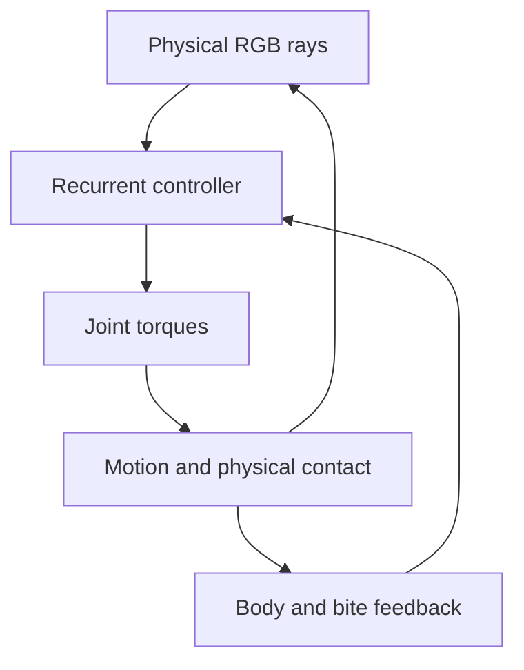

# Senses and Visually Guided Behavior

A creature's recurrent controller receives physical sensory/internal inputs
and commands its joints. Seeing, recognizing, reaching and eating an object
are separate capabilities; reliable pursuit and escape remain unproven.

## Sensory feedback loop

## Retina and inherited color sensitivity

Each eye casts **five physical rays** from its organ anchor. The closest
physical surface supplies RGB values, attenuated with distance. Creatures,
food, remains and white eggs can be seen. Empty water, walls, grid and display
effects supply no visual target. Body pigment is inherited independently of diet.

Each eye may inherit three 0–1 `spectralSensitivity` gains. Missing gains mean
[1,1,1]. Mutation can suppress or restore any channel, including exact zero.
After filtering, a ray's neural distance becomes 1 when no channel detects
light; physical occlusion still applies. Diagnostic hit labels never enter
the brain. Reduced green sensitivity can suppress purely green stimuli;
other colors, geometry and contact prevent guaranteed camouflage.

Eye upkeep is proportional to `5 * (0.25 + 0.75 * mean(R,G,B))` sensing units.
Reduced sensitivity saves some energy while discarding information; a blind
eye retains one-quarter of the original eye contribution.

## Other neural inputs

- Joint angle and angular velocity; body speed and usable energy.
- Rhythm phase, normalized COM depth, per-mouth edible contact/intake and a whole-body feeding flag.
- **Injury:** actual reserve/tissue energy removed by physically contacting predator mouths during the previous tick, divided by 60 J and clamped to [0,1].

Nearby predators, harmless collisions, ordinary metabolism and low reserves
do not trigger injury. New founder brains start with zero inherited injury-input
weights; descendants can evolve responses. Injury can also
modulate [personal synaptic learning](Waking-Learning) when aversion evolves.

## Inherited responses

Balanced founder mode adds mutable retinal-to-joint steering weights; Unbiased
mode omits that prior. FND-001 and its featured Darter derivative retain the
stronger reviewed green-contrast steering prior. New CUR-002 Twin Oar genomes
also use this stronger prior, paired with mouth-first paddle timing. Finite
food tests under legacy physics show vision-dependent approach; gains with naturally scattered
food vary by seed. These are inherited initial weights, separate from changes
acquired during an individual's life. Existing saved genomes keep their genes.

Rare topology mutations can add an isolated neuron linking:

- Actual injury to a randomly signed existing motor pathway (`wire-injury-motor`).
- Lateral contrast in one eye/color channel to joint Angle outputs (`wire-retinal-turn`).

Signs and gains can help or harm. Neurons, enabled connections and muscle
motion retain normal costs. No hidden target coordinates, prey-category
inputs, prescribed safe direction or automatic pursuit are supplied.

## Mouth contact and interpretation

Carnivore/omnivore bites require their oriented physical aperture to contact
prey, including an aperture enclosed inside a rotated body rectangle. Intake
removes finite prey energy under normal diet, rate and assimilation rules.
See [Ecology](Ecology-Baseline) for transfer and egg accounting.

Controlled comparisons demonstrate genotype-specific visual food approach,
possible late bites on moving prey and injury responses that can improve or
worsen outcomes. They do not establish generally reliable hunting, predator
recognition, anticipatory escape, or long-term ecological fitness. Personal
learning exists, but does not guarantee any of these outcomes.

The Brain inspector exposes actual rays, neural activations, queued bite
energy and inherited injury connections. Code is in `simulation.ts` and
`founders.ts`; focused checks cover senses, spectral vision, injury and paired
visible/disconnected movement in `tests/`.
