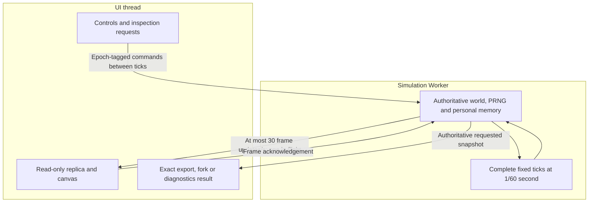

# Simulation Performance

The authoritative **1/60-second simulation runs in a Web Worker**. Rendering
and controls remain on the UI thread. Every creature continues sensing,
moving and evolving off-camera. Worker separation is integrated and deployed.

## State ownership and rendering

World commands run between complete fixed ticks. Exports, forks and diagnostics
use authoritative Worker state, including randomness and acquired memory;
render replicas are not saves. Epochs reject stale-world messages.

Render transport is bounded to 30 updates/s with one frame in flight. Genomes
travel once; lineage sends actual changed records after an initial transfer.
Heavy neural arrays travel only for a selected creature with diagnostics open.
Canvas painting can run independently of those updates. Paused worlds do not
stream unchanged frames; Worker errors pause visibly.

Batches yield after about 8 ms. Overdue work resumes through MessageChannel;
light worlds pace themselves and paused worlds idle. Unsupported Workers use
a main-thread fallback; `?mainthread` explicitly selects it for diagnosis.

## Worker and display architecture



Painting does not advance simulation time. The main-thread fallback retains
fixed-tick behavior when the Worker is unavailable or explicitly disabled.

## Stable toolbar layout

The toolbar uses right-anchored desktop controls, with Menu kept
at the top-right. General telemetry uses the horizontal space left by controls.
Generation, achieved speed/FPS/steps and elapsed time move together as one group;
only a container narrower than the group requires its compact internal layout.

Author credits are optional when space is scarce. Measured item widths keep them
visible whenever they do not add a row. They can hide to retain a single general
row, and fit alongside the identity again when the metrics already need their
own row. The decision uses reserved geometry, never changing statistic values.

Six monospace characters are reserved per count/generation and twelve for elapsed
seconds. The performance chip reserves the whole readout while its text remains
naturally packed, without individual numeric padding. Oversized numbers use
scientific notation with their full values in hover titles. These are display
rules only; simulation values, controls, Worker behavior and saves are unchanged.

Phones use five evenly spaced icon action buttons and one full-width speed row,
with Menu pinned beside the identity. Counters show distinguishable icons and
reserved values in two rows; names and the food target remain in accessible
labels/tooltips. Desktop counters retain their text labels and food target.
Changing statistics does not reflow the toolbar or alter tank bounds at a fixed
viewport.


## Current optimizations

| Area | Strategy |
| --- | --- |
| Neural evaluation | Transient topology/masks and ordered enabled-row loops; live weights remain authoritative |
| Personal learning | Reused records/buffers; aligned records overwrite eligible slots directly |
| Vision | Conservative physical-bounds ray queries in original candidate order |
| Feeding | Separate post-movement aperture indexes, invalidated when food/eggs change |
| Contacts | Reused cell buckets, pair ownership, current-pass rotations and fixed clipping buffers |
| Hinges/hatching | Reuse invariant geometry within its valid solve/pass; refresh moving bounds and add newborn bounds immediately |
| Lineage | Subscribe to births, laying and deaths instead of rescanning unchanged ancestors |
| Painting | Cached food/remains glows and viewport culling of paint calls |

These optimizations preserve physical substeps, sensing rates and numerical
ordering. Spatial/neural scratch is transient and never saved. New corpses
produce one conserved-energy circle; closed worlds aggregate carrion at the
food safety limit instead of discarding it. Stored fragments remain intact on import. See [Ecology](Ecology-Baseline).

## FPS and simulation speed

**FPS** measures presentation. **Steps/s** measures physical ticks completed.
Real-time 1x requires 60 ticks/s; 5x requires 300. A responsive display can coexist
with a CPU-limited simulation that falls short of its requested multiplier.

There is no universal browser-speed guarantee. The original roughly
100-creature/1,000-part ambition is unverified, and current anatomy is capped
at seven parts. Joints, ray geometry, evolved brains and population size can
still dominate cost. Native packaging alone does not remove those costs;
compiled/WASM kernels are a separate future option.

## Checks and diagnostics

```sh
npm run test:fast
npm run build
npm run test:worker
```

The Worker check executes the production bundle on a real thread. Focused
Chromium/Firefox checks cover actual UI/Worker integration in CI.

- `npm run benchmark:performance -- --baseline /path/to/checkout`: same-state kernel comparison.
- `node --import tsx scripts/profile-performance.mjs [checkout] [output.json]`: four bounded CPU profiles, including a synthetic Gen-6 tank. Original catalogue genes/phases pin the historical state hashes.
- `node --import tsx scripts/benchmark-runtime-components.mjs <baseline-checkout>`: isolated collision, learning-buffer and lineage costs.

Synthetic and component measurements do not predict a user's browser FPS.
Historical timing tables are in
[project status](https://github.com/smeagol44/vidAI/blob/main/docs/PROJECT_STATUS.md).

## Economy state and capacity

Current passive-solver worlds use schema v15 with either economy and mouth model.
Explicit solver stabilization changes only physics on an authoritative snapshot.
Older worlds with full capsule mouth contact use schema v14, independently of their stored physics
or open/closed ecology. Historical contact worlds retain v13 when closed and v12
when open, with exact continuation. Closed saves persist live reserve/budget and
egg age/target. Explicit mouth upgrade obtains the authoritative snapshot and
changes only the contact model; control packets cannot switch it. Budget edits are Worker
actions between ticks. Imports and explicit conversion use authoritative state;
control packets cannot switch physics or ecology regimes.

Population remains bounded at 30 slots initially (living creatures plus eggs in
closed worlds), adjustable to 150. The separate 75-egg computational limit is
retained. Food conversion stops at 2,200 particles and banks remaining energy;
one extra carrion slot plus carrion aggregation preserves remains at capacity.
Unlimited ecological nutrients does not remove these computational safeguards.

## Transient interface messages

Notifications expire after 2.5 seconds of wall time, including while paused.
Replacing a message or repeating the same message restarts its lifetime; an old
message cannot dismiss its replacement. Noninteractive banners do not capture
pointer input. Hinge dots are hidden; physical joints and their Worker data remain.
This removes drawing commands, with no measured FPS or solver-speed claim.
