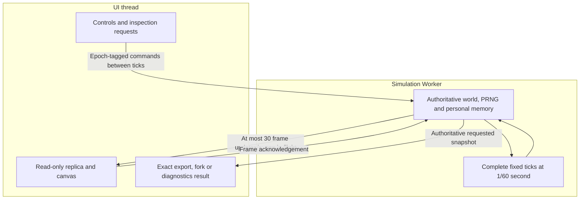

# Simulation Performance

The authoritative **1/60-second simulation runs in a Web Worker**. Rendering
and controls remain on the UI thread. Every creature continues sensing,
moving and evolving off-camera. Worker separation is integrated and deployed.

## State ownership and rendering

World commands run between complete fixed ticks. Exports, forks and diagnostics
use authoritative Worker state, including randomness and acquired memory;
render replicas are not saves. Epochs reject stale-world messages.

Render transport is bounded to 30 updates/s with one frame in flight. Genomes
travel once; lineage sends actual changed records after an initial transfer.
Heavy neural arrays travel only for a selected creature with diagnostics open.
Canvas painting can run independently of those updates. Paused worlds do not
stream unchanged frames; Worker errors pause visibly.

Batches yield after about 8 ms. Overdue work resumes through MessageChannel;
light worlds pace themselves and paused worlds idle. Unsupported Workers use
a main-thread fallback; `?mainthread` explicitly selects it for diagnosis.

## Worker and display architecture



Painting does not advance simulation time. The main-thread fallback retains
fixed-tick behavior when the Worker is unavailable or explicitly disabled.

## Stopped time and manual interaction

**0x is the paused simulation speed**. Pause and Space toggle
between 0x and the last selected nonzero speed. Selecting another speed resumes
immediately. Finite speeds remain 1x, 2x, 5x, 10x and 20x; MAX runs without a multiplier ceiling.
Imports start at 0x. The speed selector shows the effective speed, including 0x
while the application menu is open; closing that menu restores the prior state.

At 0x, simulation time and all autonomous processes stop. The tank stays
interactive: select and inspect creatures/eggs, open diagnostics and other
panels, pan/zoom, add creatures/food, clear free nutrients, edit applicable
settings and import/export exact worlds. The pause screen no longer covers
these controls. Start, application-menu and extinction overlays retain their
own behavior.

Manual actions still use the authoritative Worker commands and existing
validation, energy funding and population/food limits. Accepted edits refresh
the rendered world without a simulation tick; added food is not eaten until
time resumes. Stopped wall time and unfinished pacing debt are discarded when
the speed changes. The main-thread fallback follows the same pause controls.
Save schemas, physics, genetics, feeding and learning rules are unchanged.

This proposal is validated in the contributor fork and awaits upstream acceptance.

## Live performance circle

The existing 12px header circle shows actual simulation throughput. Pulse frequency
is `2.5 * log(1 + min(actualSpeed, 50)) / log(51)` Hz: about 0.44 at 1x,
1.52 at 10x and 2.5 at 50x and above. Only the visual frequency saturates.

Each pulse expands outward from its normal radius to 2.5 times that radius while
fading from full opacity to transparent, then repeats. Its visual diameter grows
from 12px to 30px; its layout box stays 12px square, so neighboring elements do not
move. The existing animation changes only transform and opacity, without adding
per-frame JavaScript, particles, blur or shadow effects.

Finite speed colors show actual/requested achievement, capped at 100%:
red at 10% or less, orange at 30%, yellow at 60% and green at 100% or more.
MAX uses 50x as a **visual reference**, with the same anchors through green,
then pure cyan at 65x and pure white at 75x and above. Colors interpolate
continuously in Oklab. White never resets at higher throughput.

MAX is an explicit unlimited mode, replacing the old paced 50x alias after
contributor approval. Worker batches yield after 8ms or 256 ticks and immediately
queue the next batch; fallback execution shares the UI thread with a 16ms batch
budget. These are responsiveness budgets, not simulated-speed multipliers.
Fixed 1/60-second ticks, finite-speed pacing, physics, ecology and saves are unchanged.
A world can age much faster in wall time in MAX; this does not change its rules.

The circle and existing speed readout share a constant-size sampler of authoritative
simulation time divided by monotonic wall time. It uses 250ms windows and 350ms
exponential smoothing. Mode/world changes establish a fresh baseline; missing
measurements expire after 1.25s. No speed is inferred from selected multipliers,
render FPS or CPU utilization. World-stat rendering is bounded to four updates/s.

At 0x, the retained animation holds its exact current phase, opacity and scale.
Any in-progress color transition is frozen at the displayed color. Manual world
commands do not advance the pulse. Resume waits for fresh measurements and adjusts
playback rate without resetting the animation timeline. Reduced-motion preferences
hold the movement while keeping performance color available.

There is **no tooltip, hover content, popover, visible explanatory text or new
interaction**. Nonvisual screen-reader descriptions distinguish paused, measuring,
unavailable, finite achievement and MAX's visual reference. During startup or a
mode change, the pulse waits for fresh data; stale running data becomes neutral.
This proposal is validated in the contributor fork and awaits upstream acceptance.

## Current optimizations

| Area | Strategy |
| --- | --- |
| Neural evaluation | Transient topology/masks and ordered enabled-row loops; live weights remain authoritative |
| Personal learning | Reused records/buffers; aligned records overwrite eligible slots directly |
| Vision | Conservative physical-bounds ray queries in original candidate order |
| Feeding | Separate post-movement aperture indexes, invalidated when food/eggs change |
| Contacts | Reused cell buckets, pair ownership, current-pass rotations and fixed clipping buffers |
| Hinges/hatching | Reuse invariant geometry within its valid solve/pass; refresh moving bounds and add newborn bounds immediately |
| Lineage | Subscribe to births, laying and deaths instead of rescanning unchanged ancestors |
| Painting | Cached food/remains glows and viewport culling of paint calls |

These optimizations preserve physical substeps, sensing rates and numerical
ordering. Spatial/neural scratch is transient and never saved. New corpses
produce one conserved-energy circle; closed worlds aggregate carrion at the
food safety limit instead of discarding it. Stored fragments remain intact on import. See [Ecology](Ecology-Baseline).

## FPS and simulation speed

**FPS** measures presentation. **Steps/s** measures physical ticks completed.
Real-time 1x requires 60 ticks/s; 5x requires 300. A responsive display can coexist
with a CPU-limited simulation that falls short of its requested multiplier.

There is no universal browser-speed guarantee. The original roughly
100-creature/1,000-part ambition is unverified, and current anatomy is capped
at seven parts. Joints, ray geometry, evolved brains and population size can
still dominate cost. Native packaging alone does not remove those costs;
compiled/WASM kernels are a separate future option.

## Checks and diagnostics

```sh
npm run test:fast
npm run build
npm run test:worker
```

The Worker check executes the production bundle on a real thread. Focused
Chromium/Firefox checks cover actual UI/Worker integration in CI.

- `npm run benchmark:performance -- --baseline /path/to/checkout`: same-state kernel comparison.
- `node --import tsx scripts/profile-performance.mjs [checkout] [output.json]`: four bounded CPU profiles, including a synthetic Gen-6 tank. Original catalogue genes/phases pin the historical state hashes.
- `node --import tsx scripts/benchmark-runtime-components.mjs <baseline-checkout>`: isolated collision, learning-buffer and lineage costs.

Synthetic and component measurements do not predict a user's browser FPS.
Historical timing tables are in
[project status](https://github.com/smeagol44/vidAI/blob/main/docs/PROJECT_STATUS.md).

## Economy state and capacity

Current passive-solver worlds use schema v15 with either economy and mouth model.
Explicit solver stabilization changes only physics on an authoritative snapshot.
Older worlds with full capsule mouth contact use schema v14, independently of their stored physics
or open/closed ecology. Historical contact worlds retain v13 when closed and v12
when open, with exact continuation. Closed saves persist live reserve/budget and
egg age/target. Explicit mouth upgrade obtains the authoritative snapshot and
changes only the contact model; control packets cannot switch it. Budget edits are Worker
actions between ticks. Imports and explicit conversion use authoritative state;
control packets cannot switch physics or ecology regimes.

Population remains bounded at 30 slots initially (living creatures plus eggs in
closed worlds), adjustable to 150. The separate 75-egg computational limit is
retained. Food conversion stops at 2,200 particles and banks remaining energy;
one extra carrion slot plus carrion aggregation preserves remains at capacity.
Unlimited ecological nutrients does not remove these computational safeguards.

## Transient interface messages

Notifications expire after 2.5 seconds of wall time, including while paused.
Replacing a message or repeating the same message restarts its lifetime; an old
message cannot dismiss its replacement. Noninteractive banners do not capture
pointer input. Hinge dots are hidden; physical joints and their Worker data remain.
This removes drawing commands, with no measured FPS or solver-speed claim.
