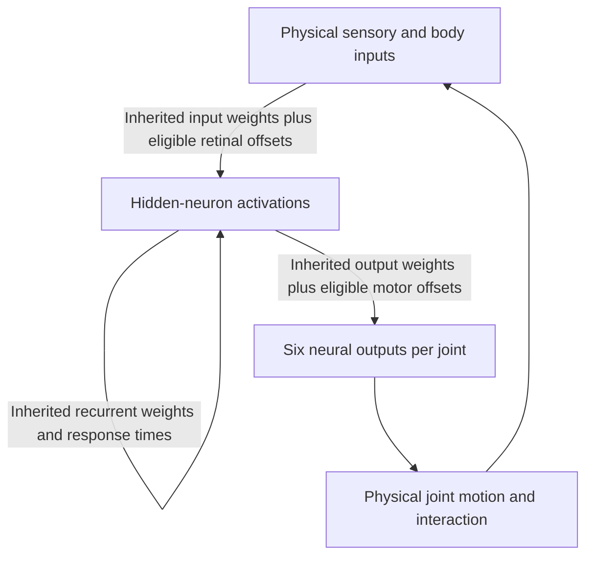
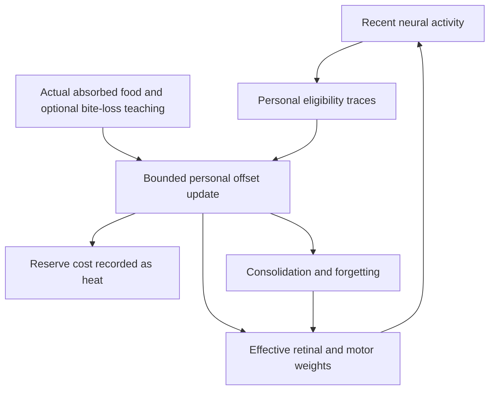

# Waking Synaptic Learning

**Original Phase 5 is implemented as a bounded waking-learning feature set.**
Learning changes subsequent trajectories and can change physical feeding;
reliable generalization and ecological benefit remain unproven. Optional
sleep/rest, experience replay and world-model dreaming are not implemented.

## Brain, memory and inheritance

| State or capability | Current behavior |
| --- | --- |
| Inherited neural architecture | Stable identities, 1–96 hidden neurons and at most 65,536 enabled connections; founders start with 24 hidden neurons |
| Structural evolution | Offspring may add/remove neurons and mutate connections within bounds |
| Activation memory | Recurrent activity with inherited per-neuron 0–4-second response times; zero retains the legacy update |
| Personal synaptic memory | Individual retinal/motor offsets, eligibility traces and consolidation |
| Offspring | Inherit baseline genes and learning rules; start without parental acquired offsets, traces or activations |

Activation memory retains recent activity. Synaptic learning changes effective
connection weights during life. Within-life neuron/topology growth is absent.

## Recurrent brain architecture

Only enabled RGB-input and motor-output edges can acquire offsets, within
the limits below. Recurrent weights and topology evolve through inheritance;
learning does not rewrite them during life.

## Personal learning loop

Teaching uses the previous completed tick. Offspring inherit baseline genes
and learning rules, never these acquired offsets, traces or consolidation.

## Learning rule and limits

Optional inherited `plasticityRate` and `sensoryPlasticityRate` enable motor
and retinal learning respectively (0–0.8/s; missing or zero disables that
capability). Learned offsets are separate from inherited weights and bounded
to **±0.8 per edge**.

- Motor learning covers up to **96 existing enabled hidden→motor edges**. Default scope is Angle-only; inherited `plasticMotorScope: 'all'` allows all six joint-output types.
- Retinal learning covers up to **96 existing enabled eye-RGB→hidden edges**.
- A 0.6-second eligibility trace associates recent neural activity with feedback from the previous completed tick.
- Positive teaching comes from actual absorbed food. Optional inherited `injuryAversionRate` (0–1/s) adds negative teaching from real bite losses.
- Vision, food proximity, contact without absorption and diagnostic labels provide no reward. Learned offsets affect later ordinary neural evaluation and physical actuation.

Inherited `forgettingRate` relaxes offsets (0–1/s; default 0.1 when enabled).
Optional `memoryConsolidationRate` (0–2/s) stabilizes changes when later signed
reinforcement agrees with them. Conflict weakens consolidation; lack of reward
also lets it decay. Stabilization can reduce forgetting by up to 95%, without
making a memory permanent.

## Costs, saves and inspection

| Cost | Charge |
| --- | --- |
| Eligible plastic-edge upkeep | 0.002 J per edge per second |
| Rewriting an acquired offset | 0.4 J per unit absolute weight change |
| Consolidation upkeep | 0.004 J per fully consolidated eligible edge per second, proportional at partial consolidation |

Costs debit usable reserves into metabolic heat and are limited by available
energy. Learning cannot create calories or change shared inherited weights.

Save schema **v12** preserves personal offsets, traces and consolidation
with strict identity/bounds validation. Creatures without the relevant genes
do not acquire them merely by importing a save. The Brain inspector displays
effective inherited-plus-acquired weights, learning rates and costs.

## Evidence and scope

Focused tests establish within-life changes, forgetting, retained associations,
energy charges, individual isolation, inheritance rules and exact continuation.
Matched retained-versus-erased-experience swimmers isolate changes in acquired
synaptic state from inherited genes and initial physical conditions. Coverage
also checks exact retained-memory replays, real contact, absorbed
receipts and energy accounting for subsequent physical feeding. Encounter
geometry and finite meals can change or saturate the intake difference; a fixed
mixture of helpful, harmful and tied outcomes is not guaranteed. These checks
demonstrate a functioning mechanism, not reliable learned survival.

Original Phase 6 remains optional future work. Any replay implementation would
need bounded personal experience, real resting vulnerability/costs, no replayed
food energy and a comparison with equal-compute waking learning.

Code: `simulation.ts`, `neuralRuntime.ts`, `persistence.ts`, `BrainGraph.tsx`.
Focused checks: waking plasticity, sensory association, selective memory and
learned physical outcomes in `tests/`. Historical trial figures are in
[project status](https://github.com/smeagol44/vidAI/blob/main/docs/PROJECT_STATUS.md).
